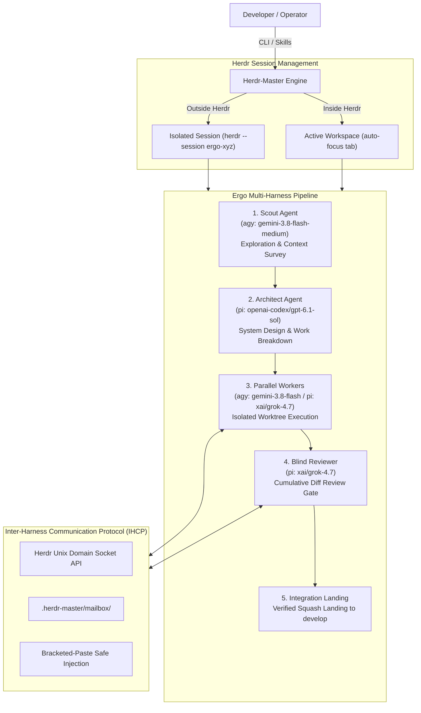

# 👑 AiHead-Orchestrator / Herdr-Master (`herdm`)

> **Universal Multi-Master, Multi-Worker Cross-Harness AI Agent Orchestrator built on [Herdr](https://herdr.dev).**

[](https://github.com/pank85/AiHead-Orchestrator)
[](LICENSE)
[](https://www.python.org/downloads/)
[](https://herdr.dev)
[](#-testing--verification)
[](https://github.com/astral-sh/ruff)

---

## 📖 Overview

**Herdr-Master (`herdm`)** is the CLI and canonical skill suite for orchestrating autonomous AI coding agents (Master Orchestrators and Worker Squads) running atop the **[Herdr](https://herdr.dev)** terminal agent manager.

Whether coordinating multiple background jobs simultaneously or driving structured multi-stage pipelines, Herdr-Master connects different agent harnesses (**Antigravity**, **Pi**, **Claude Code**, and **OpenCode**) under a unified protocol with strict Git worktree sandboxing.

---

## ⚡ Standalone Skills & Slash Commands (All 4 Harnesses)

Herdr-Master ships with **five canonical agent skills and slash commands** installable across all four supported agent harnesses (**Antigravity**, **Pi**, **Claude Code**, and **OpenCode**).

### 🎯 The Five Standalone Capabilities

#### 1. `/herdr-master [task]` — Persistent Root Orchestrator (Multiple Jobs)

> **Requires:** Herdr ([herdr.dev](https://herdr.dev)) and the `herdm` CLI. The skill exits if `HERDR_ENV` is unset.

* **Interactive or Prompted**: Can be launched without an initial prompt to inspect the workspace and wait for jobs, or launched with a task directly.
* **Autonomous Delegation & Sandboxing**:
  * Delegates each task into an isolated Git worktree branched from `develop`.
  * Opens dedicated Herdr tabs resolving the product Scout (`agy:gemini-3.8-flash-medium`) for bootstrapping and product Reviewer (`pi:xai/grok-4.7`) for diff reviews.
  * Runs a mandatory **Master Final Review Gate** on cumulative diffs before squash-merging into `develop`.
  * Main working tree remains untouched and protected.

#### 2. `/ergo [--native] [--models ...] [intent]` — Phased Pipeline (Single Major Job)

> **Requires:** `herdm`, plus **Herdr for default cross-harness mode**. `--native` runs on host subagents without Herdr.

* **Structured Multi-Stage Execution**:
  * Runs a phased pipeline: `Scout` (exploration) → `Architect` (design & task breakdown) → `Parallel Coders` (isolated worktree implementation) → `Reviewer` (blind diff review gate) → `Squash Integration`.
* **Execution Modes**:
  * **Default Herdr Mode**: Roles run as interactive Herdr agent tabs inside a Herdr workspace.
  * **Explicit `--native` Mode**: Roles run using the parent harness's native subagent tool (`invoke_subagent` in `agy`, `subagent` in `pi`/`opencode`, `Agent` in `claude`).
* **Authoritative Product Default Squad**:
  * **Scout**: `agy:gemini-3.8-flash-medium`
  * **Architect**: `pi:openai-codex/gpt-6.1-sol`
  * **Reviewer**: `pi:xai/grok-4.7`
  * **Workers**: `agy:gemini-3.8-flash` (simple/mechanical) and `pi:xai/grok-4.7` (complex/architectural).

#### 3. `/orchestration [--models ...] [intent]` — Phased Pipeline, Host Subagents Only (No Herdr)

> **Requires:** a shell, a git repository, and a host subagent tool. **No Herdr, no `herdm`, no catalog required.**

* **Zero external dependencies**: Runs Scout → Architect → parallel Coders → blind Reviewer using the current harness's native subagents.
* **Portable**: Supports Antigravity (`invoke_subagent`), Pi (`subagent`), Claude Code (`Agent`), and OpenCode (`subagent`).
* **Safe Landing**: Isolated worktree on `orchestration/<run-id>`, approval gate, and single squash commit.

#### 4. `/council [intent]` — Multi-Agent Consensus Deliberation

> **Requires:** `herdm` CLI and configured harnesses. Deliberates architectural proposals and RFCs to consensus or a decisive fallback vote.

* **Protocol**: Coordinator facilitates state transitions, Scout surveys constraints into `context.md`, and Council Members (≥ 2) draft independent proposals and cross-review.
* **Guarantees**: Up to 5 feedback cycles before a 1-round fallback ballot. Produces a sealed `final_plan.md` artifact.

#### 5. `/aihead [initial task]` — Interactive Technical Director & Advisor

> **Requires:** `herdm` CLI (or standalone `aihead` binary). Starts an interactive AiHead session in a Herdr workspace.

* **Automatic Workspace Adoption**:
  * Adopts an existing Herdr workspace if available, or starts Herdr and creates a new workspace. AiHeadDev is not required for this command.
* **Interactive & Headless Modes**:
  * Interactive by default; supports `--no-attach` for background launch without hijacking the terminal.

---

### 📦 Installation Across All Harnesses

Install all five canonical skills (`/herdr-master`, `/ergo`, `/orchestration`, `/council`, `/aihead`) across every supported harness using either:

```bash
# Using herdm install
herdm install

# Or using the skills subcommand
herdm skills install
```

### 🗺️ Multi-Harness Integration Matrix

The installer detects and symlinks canonical skills into the native directories of all 4 harnesses:

| Harness | Skill Type | Destination Path | Available Command |
| :--- | :--- | :--- | :--- |
| **Antigravity (`agy`)** | Native Skill | `~/.gemini/antigravity-cli/skills/<skill>/SKILL.md` | `/herdr-master`<br/>`/ergo`<br/>`/orchestration`<br/>`/council`<br/>`/aihead` |
| **Pi (`pi`)** | Prompt / Skill | `~/.pi/agent/skills/<skill>/SKILL.md` | `/herdr-master`<br/>`/ergo`<br/>`/orchestration`<br/>`/council`<br/>`/aihead` |
| **Claude Code (`claude`)** | Custom Slash Command | `~/.claude/commands/<skill>.md` | `/herdr-master`<br/>`/ergo`<br/>`/orchestration`<br/>`/council`<br/>`/aihead` |
| **OpenCode (`opencode`)** | Skill & Command | `~/.config/opencode/skills/<skill>/SKILL.md`<br/>`~/.config/opencode/commands/<skill>.md` | `/herdr-master`<br/>`/ergo`<br/>`/orchestration`<br/>`/council`<br/>`/aihead` |

Inspect the status of installed skill endpoints:

```bash
herdm skills list
```

---

## 🖥️ Terminal Management Cockpit

The interactive terminal management cockpit is provided by the separate **[AiHead-Cockpit](https://github.com/pank85/AiHead-Cockpit)** application (`aiheaddev`). Running `herdm tui` launches this cockpit (or `herdm tui --demo` for demo mode) to inspect Herdr sessions, manage workspaces, and view agent output.

---

## 🏛️ System Architecture



---

## ⚡ Slugs & Supported Harnesses

Define agent bindings using the compact slug format: `<harness>:<model>`

| Harness | Slug Prefix | Catalog Model Slugs | Ideal Roles & Strengths |
| :--- | :--- | :--- | :--- |
| **Antigravity** | `agy` | `agy:gemini-3.8-flash-medium`<br/>`agy:gemini-3.8-flash` | Rapid exploration, fast and mechanical implementations |
| **Pi Agent** | `pi` | `pi:openai-codex/gpt-6.1-sol`<br/>`pi:xai/grok-4.7` | Deep system architecture, independent review gate |
| **Claude Code** | `claude` | *Configured per user setup* | Nuanced implementations and edge-case analysis |
| **OpenCode** | `opencode` | *Configured per user setup* | Open models and local execution |

---

## 🚀 Quickstart & Installation (CLI)

```bash
# Clone repository
git clone https://github.com/pank85/AiHead-Orchestrator.git
cd AiHead-Orchestrator

# Install with uv
uv pip install -e .

# Or install with pipx
pipx install --editable .
```

Verify your installation:
```bash
aihead --help
```

---

## 💻 CLI Usage Guide

`herdm` is deprecated; its existing subcommands remain available for compatibility.

Quick start: `aihead` shows help without launching. Use `aihead --task "..."` for
interactive AiHead, `aihead --tui` for the cockpit, or delegate in the background:
Delegation requires the caller's `HERDR_PANE_ID` or a unique existing `ai-head` pane;
otherwise it stops rather than launching an unparented agent.

Run `aihead --setup` to choose `aihead`, `ergo`, `orchestration`, `council`,
`herdr-master`, or `all` and configure that skill. Use `--config PATH` for a
specific TOML file. The wizard previews changes and saves only after confirmation;
cancelling or invalid input leaves the file unchanged. Ergo bindings can use
different harnesses; orchestration uses one selected harness for all its models.
The optional `[master_coordinator]` binding supplies the master launcher default;
explicit launcher overrides take precedence.

```bash
aihead --ergo "Implement Redis rate limiting middleware"
aihead --council "Architect the telemetry pipeline"
aihead --orchestration "Implement a rate limiter"
aihead --herdr-master "Audit the microservices roadmap"
```

### 1. Workspace Initialization & Status
```bash
# Initialize .herdr-master workspace configuration and git develop branch
herdm init --target-branch develop

# Show active masters, workers, and pipelines
herdm status

# Inspect effective configuration
herdm config
```

### 2. Launch Ergo Pipeline (Single Major Job)
```bash
# Simple launch using authoritative default squad configuration
aihead --ergo "Implement Redis rate limiting middleware"

# Launch with custom role overrides
herdm ergo "Add WebSocket notification server" \
  --scout agy:gemini-3.8-flash-medium \
  --architect pi:openai-codex/gpt-6.1-sol \
  --workers agy:gemini-3.8-flash,pi:xai/grok-4.7 \
  --reviewer pi:xai/grok-4.7
```

### 3. Launch Native Orchestration (Single Harness)
```bash
# Launch a self-contained pipeline using the configured harness
aihead --orchestration "Implement token bucket rate limiter"
```

### 4. Launch AI Council Deliberation
```bash
# Launch multi-agent deliberation to reach consensus on architectural design
aihead --council "Architect event-driven telemetry pipeline"
```

### 5. Launch Root Herdr Master (Multiple Jobs)
```bash
# Launch master coordinator to supervise multiple tasks
herdm master start --name backend-lead

# Launch with an initial task
aihead --herdr-master "Audit microservices roadmap"
```

### 6. Interactive AiHead & Headless Decisions

* **Interactive AiHead (`aihead --task`)**:
  Adopts an existing Herdr workspace if one is open, or starts Herdr and creates a new workspace. AiHeadDev is not required.
  ```bash
  # Launch interactive AiHead session
  aihead --task "Review the project"

  # Launch with an initial task assigned
  aihead --task "Review database migration schema"

  # Background launch without terminal attachment
  aihead --task "Investigate flaky integration test" --no-attach
  ```

* **Headless AiHead CLI (`herdm aihead-cli`)**:
  The bounded headless decision path for pipelines when no active AiHead exists. This is not the interactive launcher.
  ```bash
  # Request a bounded decision directly
  herdm aihead-cli -q "Choose caching strategy" -c "High read throughput required" --choices "redis,memcached"
  ```

### 7. Skills Management & Catalog Queries
```bash
# Install canonical skills across all harnesses
herdm install
# Or:
herdm skills install

# Inspect installed skill symlinks
herdm skills list

# Query catalog identities and default squad resolution
herdm catalog show --json
herdm catalog squad --json
```

### 8. Workspaces & TUI Cockpit
```bash
# Create a Herdr workspace
herdm workspace --label my-project

# Launch the separate AiHead-Cockpit management cockpit
herdm tui
```

---

## 🧪 Testing & Verification

The project includes an automated test suite covering state machines, framing protocols, launcher lifecycles, and standalone skills installation:

```bash
# Run test suite
uv run pytest tests/

# Code quality check with Ruff
uv run ruff check .
```

---

## 📖 Skill Guides

Detailed documentation for each canonical skill:

* [**`/herdr-master`**](docs/skills/herdr-master.md) — multiple jobs, one tab and worktree each, final review gate before landing.
* [**`/ergo`**](docs/skills/ergo.md) — one major job, phased pipeline, cross-harness model per role.
* [**`/orchestration`**](docs/skills/orchestration.md) — the same pipeline on the host's own subagents, no Herdr required.
* [**`/council`**](skills/council/SKILL.md) — multi-agent consensus deliberation and architectural decision voting.
* [**`/aihead`**](skills/aihead/SKILL.md) — interactive technical director & advisor; adopts workspace or starts Herdr automatically.

---

## 📚 Deep-Dive Documentation

For detailed architectural specifications and design documents, explore the [`ai_docs/`](ai_docs/) directory:

* [**00. System Overview & Vision**](ai_docs/00_OVERVIEW.md) — Vision, tenets, and principles.
* [**01. Architecture & Core Specifications**](ai_docs/01_ARCHITECTURE_AND_SPECS.md) — System components, worker states, and lifecycle.
* [**02. Inter-Harness Communication Protocol (IHCP)**](ai_docs/02_INTER_HARNESS_PROTOCOL.md) — Message envelopes, mailboxes, and PTY injection.
* [**03. Orchestration Pipelines & Ergo Integration**](ai_docs/03_ORCHESTRATION_AND_ERGO_PIPELINE.md) — Phased pipeline execution flow.
* [**04. CLI & Terminal UI (TUI) Specification**](ai_docs/04_CLI_AND_TUI_SPEC.md) — UI widgets, actions, and modal specs.
* [**05. Herdr Plugin & Integration Packaging**](ai_docs/05_HERDR_PLUGIN_AND_INTEGRATION.md) — Packaging as Herdr plugin and skill.

---

## 📄 License

Distributed under the **MIT License**. See [`LICENSE`](LICENSE) for more details.
