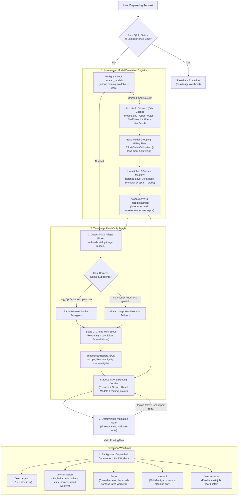

# 👑 AiHead-Orchestrator (`aihead`)

> **Fully Autonomous Cross-Harness AI Technical Director & Multi-Agent Orchestrator built on [Herdr](https://herdr.dev).**

[](https://github.com/pank85/AiHead-Orchestrator)
[](LICENSE)
[](https://www.python.org/downloads/)
[](https://herdr.dev)
[](https://github.com/astral-sh/ruff)

---

## 🎯 What Is AiHead?

**AiHead** is an autonomous AI Technical Director that sits above your coding agent harnesses—**Antigravity (`agy`)**, **Pi (`pi`)**, **Claude Code (`claude`)**, **OpenCode (`opencode`)**, **Hermes (`hermes`)**, **Codex (`codex`)**, and **Kilo (`kilo`)**—and runs engineering work end-to-end without tying up your main chat or asking you to manually wire models for every task.

Instead of relying on static hardcoded squads or guessing from model names, AiHead combines **three tightly integrated autonomous systems**:

1. **Incremental Model Evaluation Registry (`[models.ratings]`)** — Scores every enabled model across 6 normalized dimensions (`intelligence`, `coding`, `agentic`, `speed`, `cost_efficiency`, `context_handling`) plus billing tier (`free` / `subscription` / `api`), context window, family, and effort support using zero-auth public benchmarks + a batched harness evaluator fallback for preview/custom models.
2. **Two-Stage Read-Only Smart Triage (`Mini-Scout → Strong Router → Validation Gate`)** — Automatically surveys the codebase with a cheap, fast model, decides the optimal workflow (`/ergo`, `/council`, `/orchestration`, `/herdr-master`, or `direct`), harnesses, models, and effort levels with a strong reasoning model, and deterministically validates every binding before dispatching.
3. **Dynamic Rated Architect Worker Selection** — Static worker-pool settings are gone from Ergo and Orchestration. The Architect receives a live, rated `ALLOWED CODER MODELS` pool ranked by your active optimization profile (`balanced` | `quality` | `fast` | `frugal`) and assigns the best model and effort per task dynamically.

---

## 🧠 Fully Autonomous Mode Architecture

When `ai_head.automode = true` (or launched with `aihead --automode`), every incoming engineering request flows through a deterministic, context-preserving autonomous loop:



---

## 📊 1. Available Harness & Model Evaluation Registry

AiHead never guesses model capabilities from slug strings. Every model enabled in `[models.available]` is evaluated **incrementally**—already-rated models are skipped, and manual overrides (`manual_override = true`) are protected unless `--force` is passed.

### Six Normalized 0–100 Dimensions + Routing Metadata

| Dimension / Field | What It Measures | How AiHead & Architects Use It |
| :--- | :--- | :--- |
| **`intelligence`** | Reasoning, planning, ambiguity resolution | Selects **Architect**, **Council Members**, and **Stage-2 Router**. |
| **`coding`** | Multi-file editing, debugging, code synthesis | Selects **Coders**, **Reviewer**, and **Direct** implementation agents. |
| **`agentic`** | Tool use, iterative test/fix loops, repo navigation | Distinguishes strong autonomous coding models from chat-only models. |
| **`speed`** | Generation throughput & responsiveness | Selects **Stage-1 Mini-Scout**, pipeline **Scout**, and fast fixes. |
| **`cost_efficiency`** | Value relative to `billing_tier` (`free` / `subscription` / `api`) | Balances API $/token, subscription quota burn, and `:free` routes. |
| **`context_handling`** | Context window size (`200k`, `1M`, etc.) & long-context fit | Routes large-repo surveys and cross-module refactors. |
| **`family` & `supported_efforts`** | Lineage (`openai`, `anthropic`, `google`, `xai`, ...) & effort flags | Enforces **cross-family Architect vs Reviewer** and valid effort flags (recognizing effort-encoded slugs like `gemini-4-neon-high`). |

### Zero-Auth Multi-Source Pipeline (Zero API Keys Required)

1. **Layer 1 & 2 — Zero-Auth Public Benchmarks (24h Disk Cache in `~/.cache/herdr-master/model-eval-sources/`)**:
   - [`models.dev`](https://models.dev/api.json) — Specs, pricing, context windows, reasoning options, descriptions, and release dates.
   - [`OpenRouter /api/v1/models`](https://openrouter.ai/api/v1/models) — Cross-provider pricing, context limits, and relative throughput ordering.
   - **SWE-bench** (`Verified`, `Multilingual`, `Lite`) — Real-world multi-file issue resolution.
   - **Aider Polyglot** — Multi-language code editing accuracy.
   - **LiveBench** — Contamination-free reasoning and coding scores.
2. **Base-Model Grouping & Effort-Delta Calibration**:
   - Effort-encoded sibling slugs (e.g., `gemini-4-neon-low`, `-medium`, `-high`, `-xhigh`) are evaluated **once** as a base model and calibrated monotonically so `-low` is always faster/cheaper and `-high`/`-xhigh` is always stronger.
3. **Layer 3 — Batched Harness Evaluator + Opt-In Live Probe**:
   - For brand-new preview models, proxy aliases (`litellm/coding-pro`), or free routers not yet on public leaderboards, a single batched call to a headless harness evaluator scores **only the unmatched models** while preserving hard Layer-1 pricing/context facts.
   - Pass `--probe` to run a bounded live latency/health micro-probe, or `--no-llm` for purely deterministic zero-token runs.
4. **Ancestor Config Inheritance**:
   - Store `[models.available]` and `[models.ratings]` once in `~/.herdr-master.toml`. Project repositories under `$HOME` automatically inherit your home ratings, billing tiers, and (when absent locally) allowlists—while still allowing project-local overrides.

---

## 🧭 2. Two-Stage Smart Triage & Deterministic Validation

Instead of having AiHead scan files in its main conversation or guess a workflow from one sentence:

1. **Deterministic Triage Picker (`aihead catalog triage-models`)**:
   - Picks the fastest/cheapest rated model (`intelligence >= 45`, `effort = low`) on your host harness for **Stage-1 Mini-Scout**, and the strongest reasoning model for **Stage-2 Router**.
   - On native-subagent hosts (`agy`, `pi`, `claude`, `opencode`), AiHead runs them directly as read-only same-harness subagents (respecting `agy_mode = "subagents"` tier IDs vs `"swarm"` exact slugs).
   - On non-native hosts (`kilo`, `codex`, `hermes`, `gemini`), AiHead seamlessly invokes `aihead triage` to run the exact same two-stage pipeline via verified headless CLI runners.
2. **Stage-1 Mini-Scout (Read-Only)**:
   - Surveys git status, touched modules, coupling, test framework, ambiguity, and multi-job structure, outputting a compact `TriageScoutReport` JSON.
3. **Stage-2 Strong Routing Decider (Read-Only)**:
   - Combines your request, `TriageScoutReport`, the compact rated-models table, and `ai_head.routing_profile` into a `RoutingPlan` JSON selecting:
     - **Workflow**: `direct` | `orchestration` | `ergo` | `council` | `herdr-master`
     - **Role bindings & efforts**: strictly from `[models.available]`
     - **Worker selection mode**: `balanced` | `quality` | `fast` | `frugal`
4. **Deterministic Validation Gate (`aihead catalog validate-route`)**:
   - Verifies every binding against `[models.available]` (zero hallucinated IDs), `core/catalog.py` legality, single-harness `/orchestration`, Herdr Core boundaries, and cross-family Architect/Reviewer diversity.
   - If validation fails, feeds the exact error back to Stage-2 for at most **1 bounded self-repair retry**, failing closed otherwise.

---

## ⚡ 3. Dynamic Architect Worker Selection & Shared Modes

You no longer need to maintain redundant static worker lists (`[models.worker_pool]` or `[orchestration] worker_models`) in `aihead --setup`:

- **Ergo (`/ergo`)**: `aihead catalog squad` builds a rated `ALLOWED CODER MODELS` block from **all enabled Herdr harnesses** in `[models.available.herdr]` + `[models.ratings]`. The Architect reads the ratings and assigns the optimal harness, model, and effort per task in `plan.md`.
- **Orchestration (`/orchestration`)**: Builds `ALLOWED CODER MODELS` strictly from **the active native harness only** (using `available.herdr.agy` in `swarm` mode or `available.native.agy` in `subagents` mode).
- **Shared Optimization Modes**: AiHead (`ai_head.routing_profile`), Ergo (`ergo.worker_mode`), and Orchestration (`orchestration.worker_mode`) share the exact same four presets:

| Mode | Behavior |
| :--- | :--- |
| **`balanced`** *(default)* | balanced: prefers tier 2 and tier 1; tier 3 (frontier) only when truly necessary. Role tiers: scout tier 1, architect tier 3, reviewer tier 2. |
| **`quality`** | quality: uses tier 3 (frontier); uses tier 2 (all-around) only when quality will not be lost. Role tiers shift up (tier 3, tier 2 only when quality will not be lost). |
| **`fast`** | fast: prefers fast tier 1/2 models. |
| **`frugal`** | frugal: normally tier 1; may rise to tier 2. Role tiers shift down (tier 1, at most tier 2). |
| **`inherit`** *(Ergo & Orchestration default)* | Follows `ai_head.routing_profile` when dispatched by AiHead, or `balanced` standalone. |

Tier 1 = fast/cheap, Tier 2 = decent/all-around, Tier 3 = frontier/clever. Thinking effort is guidance, not a one-to-one lock: AiHead or the Architect combines worker tier and effort. Option 1: tiers are enforced only on the controlled dispatch path (aihead worker dispatch); a direct agent launch is not intercepted or blocked.

*(Legacy `.herdr-master.toml` files containing `[models.worker_pool]` or `worker_models` still load cleanly without error, and explicit one-off CLI `--workers` / `--models coder=...` overrides continue to work.)*

---

## 🚀 Quick Start

### 1. Install Package & Multi-Harness Skills

```bash
git clone https://github.com/pank85/AiHead-Orchestrator.git
cd AiHead-Orchestrator

# Install editable via uv (recommended)
uv pip install -e .

# Install all 5 canonical skills (/aihead, /ergo, /orchestration, /council, /herdr-master)
# across detected harnesses (agy, pi, claude, opencode, hermes, codex, kilo)
aihead install
```

### 2. Configure Available Models, Billing Tiers & Automode

```bash
# Open the unified interactive setup TUI
aihead --setup
```

Inside `aihead --setup`:
- **`[6] Available`**: Toggle the models you want to allow per harness, set each harness's **Billing Tier** (`api` / `subscription` / `free`), press **`E`** to evaluate all unrated models live, and press **`V`** on any model to inspect its full rating breakdown.
- **`[1] aihead`**: Enable **Automode = true** and choose your default **Routing Profile** (`balanced` | `quality` | `fast` | `frugal`).
- **`[2] ergo` / `[3] orchestration`**: Choose **Worker Mode** (`inherit` | `balanced` | `quality` | `fast` | `frugal`) — no manual worker lists required.
- Press **`S`** to save atomically to `.herdr-master.toml`.

### 3. Evaluate Models & Test Smart Routing from CLI

```bash
# Incrementally evaluate any unrated available models (zero-auth sources + Layer-3 fallback)
aihead catalog evaluate --project ~/.herdr-master.toml

# Inspect stored ratings across harnesses
aihead catalog ratings --project ~/.herdr-master.toml

# Manually override a model's score (locks manual_override=true against auto-refresh)
aihead catalog rate --binding pi:openai/gpt-6.1-sol --coding 96 --billing-tier api

# Lock or explicitly unlock the independent worker routing tier (1, 2 or 3)
aihead catalog rate --binding pi:openai/gpt-6.1-sol --worker-tier 2
aihead catalog rate --binding pi:openai/gpt-6.1-sol --clear-worker-tier-override

# Preview a full two-stage triage decision without dispatching
aihead triage --task "Add rate-limiting middleware and tests" --project ~/.herdr-master.toml --dry-run
```

Worker tiers are separate from `billing_tier`. Tier-only changes do not lock scores;
`--clear-worker-tier-override` recomputes the tier locally without clearing the score
lock. Conversely, `--clear-override` unlocks score refresh without clearing a tier
lock. Set and clear of the worker tier cannot be combined; score edits may be
combined with either. In TOML, `worker_tier = 1` (or 2/3) and
`worker_tier_override = true` explicitly lock a tier; `false` marks it automatic.
Legacy ratings without a tier derive one lazily.

For controlled worker dispatch, resolve a run-policy record using the **exact actual**
run inputs and capture the effective ratings/allowlist snapshot. Bind both in the
versioned manifest and validate against current policy:

```bash
aihead worker run-policy create --run-id RUN_ID --worktree /absolute/project --mode herdr \
  --output /tmp/run-policy.json
# Include --run-squad /absolute/squad.toml and --workers EXACT_OVERRIDE if actually used.
aihead worker snapshot --worktree /absolute/project --output /tmp/policy.json
aihead worker manifest schema  # exact required fields and versioned task facts
# Write the manifest with returned snapshot_digest, absolute run_policy_path,
# returned run_policy_digest and all exact task facts.
aihead worker manifest validate --manifest /tmp/manifest.json
# Only after the human or AiHead has reviewed and approved BOTH printed digests:
aihead worker approval create --manifest /tmp/manifest.json \
  --manifest-digest APPROVED_MANIFEST_SHA256 --snapshot-digest APPROVED_POLICY_SHA256 \
  --approver-type human --approver NAME --confirm-approved --output /tmp/approval.json
aihead worker dispatch --manifest /tmp/manifest.json --task-id TASK_ID --approval /tmp/approval.json
```

Validation is not approval. The approval command records an operator's attestation
of prior approval; it does **not** authenticate the named approver or provide a
cryptographic identity. Run inputs are caller-supplied, not independently authenticated;
the caller must pass the real inputs. Missing or changed run-policy bindings fail closed,
and policy drift requires a new snapshot, manifest and external approval. Artifacts are
never overwritten. Unmediated launches outside the controlled path are outside this
application-level guarantee; this is not a sandbox.

### 4. Launch Autonomous AiHead

```bash
# Attach to an existing AiHead or launch in a Herdr workspace
aihead

# Launch with an immediate objective and force automode on for this session
aihead --automode --task "Refactor auth token refresh and add integration tests"
```

---

## 🔀 Execution Workflows Selected by AiHead

| Workflow | When AiHead Selects It | Isolation & Execution | Review & Integration |
| :--- | :--- | :--- | :--- |
| **`direct`** | Atomic 1–2 file mechanical change, low ambiguity, no design needed. | Single background Herdr job workspace. | Optional cross-family lightweight reviewer. |
| [**`/orchestration`**](skills/orchestration/README.md) | Cohesive small–medium task where one native harness covers all roles strongly. | 100% single-harness native subagents (`agy`, `pi`, `claude`, `opencode`); Architect picks same-harness rated workers. | Blind reviewer gate; parent integrates. |
| [**`/ergo`**](skills/ergo/README.md) | Complex feature, cross-module refactor, or high-rigor work benefiting from cross-harness diversity. | Isolated Git worktree & Herdr workspace; Architect picks rated workers across all enabled harnesses. | Plan Approval Gate + up to 3 adversarial Reviewer fix loops + squash-merge. |
| [**`/council`**](skills/council/README.md) | High ambiguity, major RFC, or architectural trade-offs needing consensus before coding. | Coordinator + Scout + ≥2 Council Members from distinct model families (max 5 cycles). | Produces `final_plan.md` only; zero code edits. |
| [**`/herdr-master`**](skills/herdr-master/README.md) | Multiple decoupled tasks or parallel workstreams across repos/folders. | One Herdr job workspace per workstream + async watchers. | Serial final review and squash-merge into `develop`. |

---

## 💻 CLI Reference

### Core AiHead Entrypoints
```bash
aihead                                    # Attach to or launch interactive AiHead
aihead --task "<objective>"               # Launch AiHead with an initial objective
aihead --automode / --no-automode         # Launch-time override of ai_head.automode
aihead --setup                            # Unified interactive TUI settings & model evaluator
aihead --menu                             # Curses command-pane menu inside Herdr
aihead triage --task "<req>" [--profile balanced|quality|fast|frugal] [--dry-run] [--json]
aihead --ergo "<intent>"                  # Dispatch /ergo in a background Herdr workspace
aihead --orchestration "<intent>"         # Dispatch /orchestration
aihead --council "<intent>"               # Dispatch /council deliberation
aihead --herdr-master                     # Dispatch /herdr-master multi-job coordinator
```

### Catalog, Evaluation & Routing Commands
```bash
# Incremental model evaluation & rating management
aihead catalog evaluate [--project PATH] [--harness KIND] [--refresh] [--force] [--max-age DAYS] [--probe] [--no-llm] [--evaluator SLUG] [--dry-run] [--json]
aihead catalog ratings  [--project PATH] [--harness KIND] [--json]
aihead catalog rate     --binding <harness:model> [--intelligence N] [--coding N] [--agentic N] [--speed N] [--cost-efficiency N] [--context-handling N] [--billing-tier free|subscription|api] [--worker-tier 1|2|3 | --clear-worker-tier-override] [--clear-override] [--notes TEXT]

# Allowlist inspection (includes ratings & unrated_models)
aihead catalog available [--project PATH] [--json]

# Two-stage triage & deterministic route validation
aihead catalog triage-models  [--harness HOST] [--project PATH] [--profile MODE] [--json]
aihead catalog validate-route --from-json <PATH|-> [--project PATH] [--backend herdr|core] [--json]

# Squad & agent launch resolution (with dynamic rated worker pool)
aihead catalog squad [--mode herdr|native|core] [--harness HOST] [--worker-mode inherit|balanced|quality|fast|frugal] [--project PATH] [--models "..."] [--write-snapshot /abs/squad.toml] [--json]
aihead catalog agent --binding <harness:model[:effort]> --role <role> [--mode herdr|native] [--json]
aihead catalog show [--json]
```

### Skill Management
```bash
aihead install          # Alias for `aihead skills install`
aihead skills list      # Inspect symlink/composed status across all harnesses
aihead skills remove    # Cleanly remove managed skill links
```

---

## ⚙️ Configuration Reference (`.herdr-master.toml`)

```toml
[general]
default_session = "default"
target_integration_branch = "develop"
create_develop_if_missing = true
disallow_hard_reset = true

[ai_head]
enabled = true
automode = true                         # Enable autonomous triage & rated squad composition
routing_profile = "balanced"            # balanced | quality | fast | frugal
autonomy = "routine"                    # routine (autonomous) | ask (confirm before dispatch)
brief_before_action = true
split = true
dangerously_skip_permissions = true
lesson_paths = ["~/.herdr-master/lessons"]

[ai_head.binding]
kind = "pi"
model = "openai/gpt-6.1-sol"
effort = "high"

[models.available.herdr]
agy = ["gemini-4-hydrogen-low", "gemini-4-neon-medium", "gemini-4-neon-high", "claude-opus-5-5-high"]
pi = ["openai/gpt-6.1-sol", "xai/grok-4.7", "openai/gpt-6-luna"]
claude = ["opus", "sonnet", "haiku"]
kilo = ["kilo/kilo-auto/free", "openai/gpt-6.1-terra"]

[models.available.native]
agy = ["flash_lite", "flash", "pro"]

[models.evaluation]
cache_ttl_hours = 24
max_age_days = 30

[models.evaluation.billing]
agy = "subscription"
claude = "subscription"
pi = "api"
kilo = "free"

# Populated automatically by `aihead catalog evaluate` (inherited from ~/.herdr-master.toml)
[models.ratings.pi."openai/gpt-6.1-sol"]
intelligence = 93
coding = 94
agentic = 93
speed = 74
cost_efficiency = 73
context_handling = 96
family = "openai"
billing_tier = "api"
context_window = 1050000
supports_reasoning = true
supported_efforts = ["low", "medium", "high", "max"]
recommended_roles = ["scout", "direct", "coder", "architect", "reviewer", "council", "router"]
source = "models_dev+harness_eval"
confidence = "medium"
manual_override = false

[ergo]
coordinator = "agy:gemini-4-neon-low"
worker_mode = "inherit"                 # inherit | balanced | quality | fast | frugal

[orchestration]
harness = "agy"
agy_mode = "swarm"                      # subagents (tier IDs) | swarm (exact agy slugs)
worker_mode = "inherit"                 # Architect picks workers from active harness Available models only
scout_model = "gemini-4-hydrogen-low"
architect_model = "gemini-4-neon-high"
reviewer_model = "claude-opus-5-5-high"

[council]
coordinator = "pi:openai/gpt-6.1-sol:high"
scout = "agy:gemini-4-hydrogen-low"

[[council.members]]
label = "council-1"
binding = "pi:openai/gpt-6.1-sol:high"
enabled = true

[[council.members]]
label = "council-2"
binding = "agy:claude-opus-5-5-high"
enabled = true
```

---

## 🔌 Supported Harnesses & Herdr Integration

| Harness | Herdr Cross-Harness | Native Subagents (`/orchestration` & Triage) | Skill Install Destination |
| :--- | :---: | :---: | :--- |
| **Antigravity (`agy`)** | ✅ | ✅ (`invoke_subagent` / `swarm`) | `~/.gemini/antigravity-cli/skills/<skill>/SKILL.md` |
| **Pi (`pi`)** | ✅ | ✅ (`subagent`) | `~/.pi/agent/skills/<skill>/SKILL.md` |
| **Claude Code (`claude`)** | ✅ | ✅ (`Agent`) | `~/.claude/commands/<skill>.md` |
| **OpenCode (`opencode`)** | ✅ | ✅ (`subagent`) | `~/.config/opencode/skills/<skill>/SKILL.md` & `commands/<skill>.md` |
| **Hermes (`hermes`)** | ✅ | Headless triage fallback (`aihead triage`) | `~/.hermes/skills/<skill>/SKILL.md` |
| **Codex (`codex`)** | ✅ | Headless triage fallback (`aihead triage`) | `~/.agents/skills/<skill>/SKILL.md` |
| **Kilo (`kilo`)** | ✅ | Headless triage fallback (`aihead triage`) | `~/.config/kilo/skills/<skill>/SKILL.md` |

### Core Operating Invariants

The first task prompt binds the actual immediate supervisor. A Herdr child receives that coordinator's concrete pane ID and sends every question, decision request, blocker, and completion only there; environment/bootstrap values corroborate the route. A missing delegated route stops before spawn. Only an intentional root handles user decisions directly.

Only AiHead acting within its authorized scope or the human can approve a gated exact plan version. A delegated coordinator sends that plan and its run/version to its direct parent and waits for explicit approval. Intermediaries can relay the original decision with provenance, but neither they nor the coordinator can self-approve. Standalone coordinators use enabled AiHead where supported, or ask the human and wait. A routine automode update outside a gate is not approval.

Automode handles routine reversible work without waiting for the user. Batch materially consequential choices into a plan checkpoint; keep non-automode and explicit gates. A technical `APPROVED` is not permission to bypass security or irreversibly destroy state. Those actions need explicit user approval for the specific target and action, relayed through the direct chain. Trust prompts and silence never grant it.

After the first confirmed child is registered, the spawning coordinator starts one detached `python -m herdr_master.pipeline.child_watch --run-dir "$RUN_DIR" --parent-pane "$PARENT"` process for its private mode-700 run directory, in the verified session (pin `--parent-generation` for detached handoff). It checks confirmed child identities every 600 seconds and reports verified loss only to that coordinator, not to the user. Idle or blocked is not dead; RPC uncertainty is unknown. This is separate from startup checks and completion callbacks; files alone do not establish success and no child is automatically retried. Stop with `touch "$RUN_DIR/child-watch.stop"`; never reuse the run directory or kill by watcher PID. No monitor agent or pane is created. Native workers use only the invoking supervisor's return/message channel, even when the coordinator itself has a Herdr parent. A blocking tool's terminal result/error is its supervision; background launches require queryable exact native run IDs and one run-scoped 600-second health watcher. Stop on teardown or all children terminal. Without the adapter, do not dispatch in the background. Health alerts do not replace result callbacks.
- **Main chat stays always free**: AiHead never edits files or blocks in polling loops—every job runs in a background Herdr workspace with push notifications (`herdr agent prompt`) one level up.
- **User-facing inspection tabs**: Approved plans (`Plan: <short>`), completion summaries (`Update: <short>`), escalations (`Info: <short>`), and blocking questions (`Q: <short>`) open in interactive tabs in the coordinator workspace.
- **Zero fabricated models**: Every automated routing decision passes through `validate_route()` against `[models.available]` and `core/catalog.py`.
- **Mandatory squash-merge & cleanup**: Completed feature branches are squash-merged into `develop` once review and tests pass, followed by automatic worktree, branch, and tab cleanup.
- **Experimental Herdr Core (`--backend core`)**: Supported for Pi AiHead launch (`aihead --backend core --harness pi`) and `aihead core terminals`; `validate_route --backend core` fails closed on legacy Herdr-only workflows (`/ergo`, `/council`, `/herdr-master`).

---

## 🧪 Testing & Verification

```bash
# Lint with Ruff
uv run ruff check .

# Run Model Evaluation, Dynamic Worker, and Triage test suites
uv run --extra dev pytest tests/test_model_ratings.py tests/test_eval_sources.py tests/test_model_evaluator.py tests/test_triage_and_dynamic_workers.py

# Run full test suite
uv run --extra dev pytest
```

---

## 📄 License

Distributed under the **MIT License**. See [`LICENSE`](LICENSE) for details.
