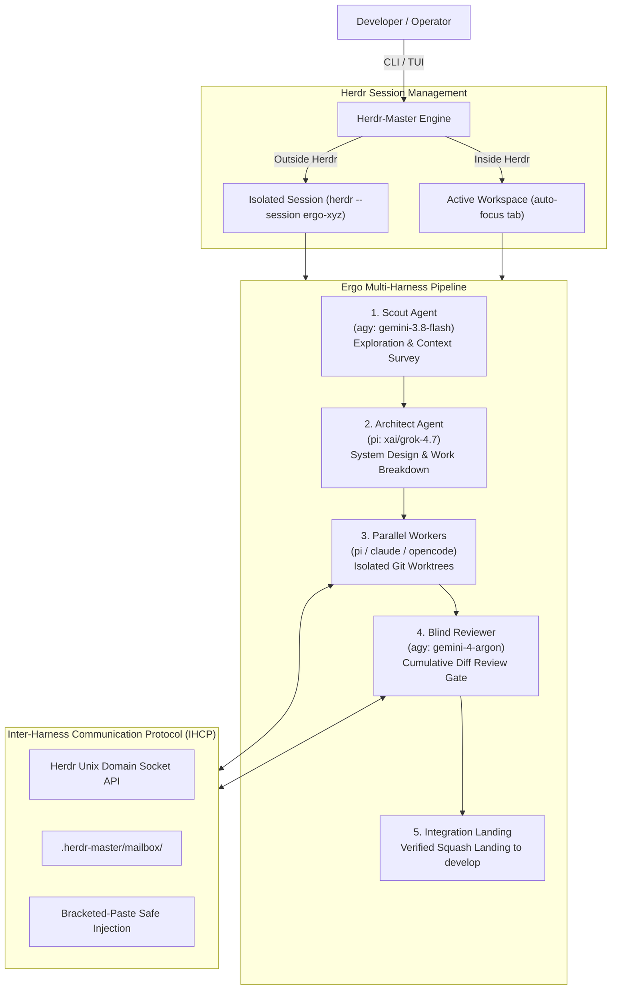

# 👑 Herdr-Master (`herdm`)

> **Universal Multi-Master, Multi-Worker Cross-Harness AI Agent Orchestrator & TUI Dashboard built on [Herdr](https://herdr.dev).**

[](https://github.com/pank85/herdr-master)
[](LICENSE)
[](https://www.python.org/downloads/)
[](https://herdr.dev)
[](https://textual.textualize.io/)
[](#-testing--verification)
[](https://github.com/astral-sh/ruff)

---

## 📖 Overview

**Herdr-Master (`herdm`)** standardizes and elevates the orchestration of multiple autonomous AI coding agents (Master Orchestrators and Worker Squads) running atop the **[Herdr](https://herdr.dev)** terminal agent manager.

Whether coordinating multiple background jobs simultaneously or driving a structured multi-stage coding pipeline, Herdr-Master connects different agent harnesses (**Antigravity**, **Pi**, **Claude Code**, and **OpenCode**) under a unified protocol with strict Git worktree sandboxing.

---

## ⚡ Standalone Skills & Slash Commands (All 4 Harnesses)

Herdr-Master ships with **first-class, standalone agent skills and slash commands** that can be installed directly into all four supported agent harnesses (**Antigravity**, **Pi**, **Claude Code**, and **OpenCode**). 

### 🎯 The Two Standalone Capabilities

#### 1. `/herdr-master [task]` — Persistent Root Orchestrator (Multiple Jobs)
* **Works with OR without an initial prompt**:
  * You can invoke `/herdr-master` **completely blank without a prompt**. The Master will initialize, inspect the Herdr workspace, verify Git repository state (ensuring the `develop` integration branch is ready), and confirm that orchestration is active.
  * It will prompt: *"Orchestration is active. What is your first job?"*
  * It stays alive in your workspace as a long-running supervisor. You can assign jobs interactively throughout your session whenever needed.
* **Autonomous Delegation & Sandboxing**:
  * For each task you delegate, the Master creates an isolated Git worktree branched from `develop`.
  * It opens a dedicated Herdr tab with the optimal harness and model for that task.
  * It monitors workers reactively using native async watchers (zero polling loops).
  * It runs a mandatory **Master Final Review Gate** on the cumulative diff, sending remediation requests if needed, and safely lands approved changes via squash merge into `develop`.
  * **Zero `git reset --hard`**: Your main working tree remains untouched and protected.

#### 2. `/ergo [--herdr] [--models ...] [intent]` — Phased Pipeline (Single Major Job)
* **Structured Multi-Stage Execution**:
  * Runs a rigid, high-assurance pipeline: `Scout` (reconnaissance) → `Architect` (system design & work breakdown) → `Parallel Coders` (isolated worktree implementations) → `Reviewer` (blind diff review gate) → `Squash Integration`.
* **Dual Execution Modes**:
  * **Native Subagent Mode**: Executes using the parent harness's native subagent tool (`define_subagent` in `agy`, background agents in `pi` / `claude`, or native `subagent` in `opencode`).
  * **`--herdr` Cross-Harness Mode**: Executes every pipeline role as an interactive Herdr tab in a temporary workspace, letting you mix and match engines (e.g. Gemini Flash for Scout, Grok 4.7 for Architect, Codex & Claude for Coders, and Gemini Argon for Reviewer).

---

### 📦 1-Command Installation Across All Harnesses

Install both canonical `/herdr-master` and `/ergo` skills & slash commands across all installed harnesses with a single command:

```bash
# Using the herdm CLI:
herdm install
# (or: herdm skills install)

# Or using the zero-dependency shell script:
./scripts/install-skills.sh
```

### 🗺️ Multi-Harness Integration Matrix

The installer automatically detects and symlinks canonical skill definitions into the native directories of all 4 harnesses:

| Harness | Skill Type | Destination Path | Available Command |
| :--- | :--- | :--- | :--- |
| **Antigravity (`agy`)** | Native Skill | `~/.gemini/config/skills/herdr-master/SKILL.md`<br/>`~/.gemini/config/skills/ergo/SKILL.md` | `/herdr-master`<br/>`/ergo` |
| **Pi (`pi`)** | Prompt / Slash Command | `~/.pi/agent/prompts/herdr-master.md`<br/>`~/.pi/agent/prompts/ergo.md` | `/herdr-master`<br/>`/ergo` |
| **Claude Code (`claude`)** | Custom Slash Command | `~/.claude/commands/herdr-master.md`<br/>`~/.claude/commands/ergo.md` | `/herdr-master`<br/>`/ergo` |
| **OpenCode (`opencode`)** | Skill & Command | `~/.config/opencode/skills/`<br/>`~/.config/opencode/commands/` | `/herdr-master`<br/>`/ergo` |

### 🔍 Inspect Installation Status

You can inspect the live status of all installed skill endpoints at any time:

```bash
herdm skills list
```

```text
                👑 Herdr-Master & Ergo Standalone Harness Skills                
┏━━━━━━━━━━━━━━━━━━━━━━┳━━━━━━━━━━━━━━━━┳━━━━━━━━━┳━━━━━━━━━━━━━━━━━┳━━━━━━━━━━┓
┃ Harness              ┃ Command / Role ┃ Type    ┃ Installed Path  ┃  Status  ┃
┡━━━━━━━━━━━━━━━━━━━━━━╇━━━━━━━━━━━━━━━━╇━━━━━━━━━╇━━━━━━━━━━━━━━━━━╇━━━━━━━━━━┩
│ Antigravity (agy)    │ /herdr-master  │ skill   │ ~/.gemini/...   │ ✓ Active │
│ Pi (pi)              │ /herdr-master  │ command │ ~/.pi/...       │ ✓ Active │
│ Claude Code (claude) │ /herdr-master  │ command │ ~/.claude/...   │ ✓ Active │
│ OpenCode (opencode)  │ /herdr-master  │ skill   │ ~/.config/...   │ ✓ Active │
│ OpenCode (opencode)  │ /herdr-master  │ command │ ~/.config/...   │ ✓ Active │
│ Antigravity (agy)    │ /ergo          │ skill   │ ~/.gemini/...   │ ✓ Active │
│ Pi (pi)              │ /ergo          │ command │ ~/.pi/...       │ ✓ Active │
│ Claude Code (claude) │ /ergo          │ command │ ~/.claude/...   │ ✓ Active │
│ OpenCode (opencode)  │ /ergo          │ skill   │ ~/.config/...   │ ✓ Active │
│ OpenCode (opencode)  │ /ergo          │ command │ ~/.config/...   │ ✓ Active │
└──────────────────────┴────────────────┴─────────┴─────────────────┴──────────┘
```

---

## 🖥️ Interactive TUI Cockpit

Herdr-Master also features a standalone interactive terminal management cockpit built on Textual:

```bash
herdm tui
```

### 1. Main Cockpit Screen (Full-Width Landing View)
The landing view gives an uncluttered, 100% full-width dashboard with three prominent quick-launch cards:

```text
┌────────────────────────────────────────────────────────────────────────────────────────┐
│ 👑 HERDR-MASTER COCKPIT        [● CONNECTED]  Workspaces: 1  Agents: 0    17:30       │
├────────────────────────────────────────────────────────────────────────────────────────┤
│                                                                                        │
│  ╭─ 👑 New Herdr Master ──╮  ╭─ ⚡ New Ergo Pipeline ──╮  ╭─ ⚙️ Configure Squad ─────╮  │
│  │ Multiple Jobs           │  │ Single Major Job        │  │ Default Harness & Squad  │  │
│  │ Main orchestrator that  │  │ Dedicated workspace &   │  │ Configure default roles, │  │
│  │ delegates to multiple   │  │ multi-tab Ergo pipeline │  │ harnesses, models and    │  │
│  │ worker tabs & squads.   │  │ (Scout→Architect→Pool). │  │ worker squad topology.   │  │
│  │                         │  │                         │  │                          │  │
│  │  [ 👑 Launch Master ]   │  │  [ ⚡ Launch Ergo ]     │  │  [ ⚙️ Configure Squad ]  │  │
│  ╰─────────────────────────╯  ╰─────────────────────────╯  ╰──────────────────────────╯  │
│                                                                                        │
│  [1] Pipeline Graph    [2] Cumulative Diff    [3] Agent Output Streamer                │
└────────────────────────────────────────────────────────────────────────────────────────┘
│ [n] New Master  [e] New Ergo  [s/c] Settings  [1..4] View Modes  [q] Quit              │
└────────────────────────────────────────────────────────────────────────────────────────┘
```

---

### 2. 2-Column Squad Topology & Pipeline Launcher Modal
Press `[ ⚡ New Ergo Pipeline ]`, `[ ⚙️ Configure Squad ]`, or keys `e` / `s`:

```text
┌─ ⚡ ERGO SQUAD TOPOLOGY & PIPELINE LAUNCHER ───────────────────────────────────────────┐
│                                                                                        │
│ ┌─ Top 75%: Squad Configuration ─────────────────────────────────────────────────────┐ │
│ │  Topology Tree (Left Column)      │  Agent Details (Right Column)                  │ │
│ │                                   │                                                │ │
│ │  👑 Herdr-Master Root             │  Role: Scout                                   │ │
│ │  ├── ● Scout (agy:gemini-flash)   │  Harness:  [ agy ▼ ]                           │ │
│ │  ├── ● Architect (pi:grok-4.7)    │  Model:    [ gemini-3.8-flash-high           ] │ │
│ │  ├── 📦 Worker Pool (2 workers)   │  Effort:   [ high ▼ ]                          │ │
│ │  │   ├── ● worker-1 (pi:codex)    │  Label:    [ scout                           ] │ │
│ │  │   └── ● worker-2 (claude:sonn) │                                                │ │
│ │  └── ● Reviewer (agy:argon)       │  [+ Add Worker]  [- Remove Worker]             │ │
│ └───────────────────────────────────┴────────────────────────────────────────────────┘ │
│                                                                                        │
│ ┌─ Bottom 25%: Execution Deck ───────────────────────────────────────────────────────┐ │
│ │  Objective Prompt: [ Implement OAuth2 SSO & JWT authentication                  ]  │ │
│ │  Workspace Label:  [ ergo-auth-pipeline     ]                                      │ │
│ │                                                                                    │ │
│ │  [ ⚡ Start Ergo Pipeline ]         [ 💾 Save Default ]          [ Cancel ]        │ │
│ └────────────────────────────────────────────────────────────────────────────────────┘ │
└────────────────────────────────────────────────────────────────────────────────────────┘
```

---

## 🏛️ System Architecture



---

## ⚡ Slugs & Supported Harnesses

Define any agent using the compact slug format: `<harness>:<model>[:<effort>]`

| Harness | Slug Prefix | Example Slugs | Ideal Roles & Strengths |
| :--- | :--- | :--- | :--- |
| **Antigravity** | `agy` | `agy:gemini-3.8-flash-high`<br/>`agy:gemini-4-argon-high` | Rapid context survey, deep architectural audit, strict diff reviews |
| **Pi Agent** | `pi` | `pi:xai/grok-4.7`<br/>`pi:openai-codex/gpt-6.1-terra` | Complex refactoring, fast code synthesis, test authoring |
| **Claude Code** | `claude` | `claude:claude-3-7-sonnet`<br/>`claude:claude-3-opus` | Thoughtful implementation, nuanced edge-case analysis |
| **OpenCode** | `opencode` | `opencode:deepseek-r1`<br/>`opencode:qwen-2.5-coder` | Local models and private open-weights execution |

---

## 🚀 Quickstart & Installation (CLI)

### Standalone CLI Installation

```bash
# Clone repository
git clone https://github.com/pank85/herdr-master.git
cd herdr-master

# Install with uv (fastest)
uv pip install -e .

# Or install with pipx
pipx install --editable .
```

Verify your installation:
```bash
herdm --help
```

---

## 💻 CLI Usage Guide

### 1. Launch Ergo Pipeline (Single Major Job)
```bash
# Simple launch using default squad configuration
herdm ergo "Implement Redis rate limiting middleware"

# Full custom squad across diverse harnesses & models
herdm ergo "Add WebSocket notification server" \
  --scout agy:gemini-3.8-flash-high \
  --architect pi:xai/grok-4.7 \
  --workers pi:openai-codex/gpt-6.1-terra,claude:claude-3-7-sonnet \
  --reviewer agy:gemini-4-argon-high \
  --workspace-label real-time-notifications
```

### 2. Launch Root Herdr Master (Multiple Jobs)
```bash
# Launch without task (wait for interactive delegation)
herdm master start backend-lead

# Or launch with an initial task
herdm master start backend-lead \
  --harness agy \
  --model gemini-4-argon-high \
  --initial-task "Audit microservices and prepare refactoring roadmap"
```

### 3. Interactive TUI Cockpit
```bash
# Launch interactive cockpit connected to Herdr
herdm tui

# Launch in demo mode with mock data
herdm tui --demo
```

### 4. Repository Initialization
```bash
cd /path/to/my-project
herdm init --target-branch develop
```

---

## 🧪 Testing & Verification

The project includes an automated test suite covering state machines, framing protocols, launcher lifecycles, standalone skills installer, and Textual pilot interactions:

```bash
# Run full test suite (35 passed)
uv run pytest tests/

# Code quality check with Ruff
uv run ruff check .
```

```text
============================== 35 passed in 6.59s ==============================
```

---

## 📚 Deep-Dive Documentation

For detailed architectural specifications and design documents, explore the [`ai_docs/`](file:///home/pank/projects/herdr-master/ai_docs/) directory:

* [**00. System Overview & Vision**](file:///home/pank/projects/herdr-master/ai_docs/00_OVERVIEW.md) — Vision, tenets, and principles.
* [**01. Architecture & Core Specifications**](file:///home/pank/projects/herdr-master/ai_docs/01_ARCHITECTURE_AND_SPECS.md) — System components, worker states, and lifecycle.
* [**02. Inter-Harness Communication Protocol (IHCP)**](file:///home/pank/projects/herdr-master/ai_docs/02_INTER_HARNESS_PROTOCOL.md) — Message envelopes, mailboxes, and PTY injection.
* [**03. Orchestration Pipelines & Ergo Integration**](file:///home/pank/projects/herdr-master/ai_docs/03_ORCHESTRATION_AND_ERGO_PIPELINE.md) — Phased pipeline execution flow.
* [**04. CLI & Terminal UI (TUI) Specification**](file:///home/pank/projects/herdr-master/ai_docs/04_CLI_AND_TUI_SPEC.md) — Textual UI widgets, actions, and modal specs.
* [**05. Herdr Plugin & Integration Packaging**](file:///home/pank/projects/herdr-master/ai_docs/05_HERDR_PLUGIN_AND_INTEGRATION.md) — Packaging as Herdr plugin and skill.

---

## 📄 License

Distributed under the **MIT License**. See [`LICENSE`](file:///home/pank/projects/herdr-master/LICENSE) for more details.
