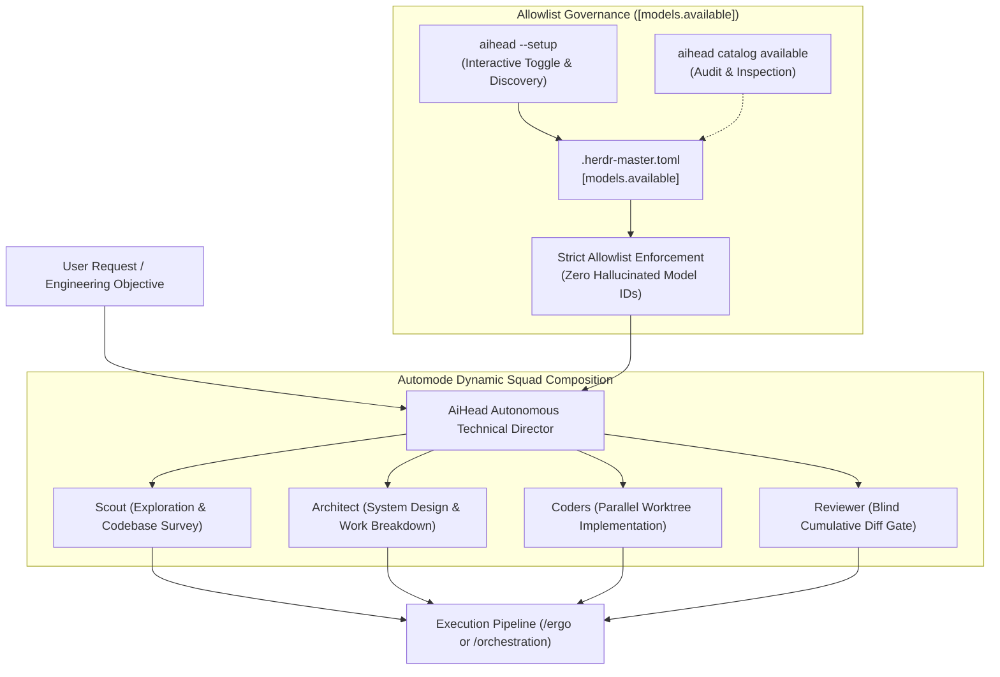

# 👑 AiHead-Orchestrator (`aihead` / `herdm`)

> **Universal Multi-Master, Multi-Worker Cross-Harness AI Agent Orchestrator built on [Herdr](https://herdr.dev).**

[](https://github.com/pank85/AiHead-Orchestrator)
[](LICENSE)
[](https://www.python.org/downloads/)
[](https://herdr.dev)
[](#-testing--verification)
[](https://github.com/astral-sh/ruff)

---

## 📖 Executive Summary

**AiHead-Orchestrator** is an autonomous multi-agent engineering platform that connects disparate AI agent harnesses—**Antigravity (`agy`)**, **Pi (`pi`)**, **Claude Code (`claude`)**, **OpenCode (`opencode`)**, and **Hermes (`hermes`)**—into structured, verifiable engineering pipelines with strict Git worktree sandboxing.

The platform provides two primary interfaces:
1. **`aihead` (Modern Primary Entrypoint):** An interactive, autonomous Technical Director and decision-maker that evaluates user intents, dynamically composes specialist squads via **Automode**, approves implementation plans, and directs execution without escalating routine decisions to the operator.
2. **`herdm` / `herdr-master` (Orchestration Engine & Compatibility CLI):** The underlying multi-workstream engine managing concurrent jobs, background watcher processes, cross-harness IPC, and backwards-compatible CLI tooling.

---

## 🧠 AiHead Automode & Available Models Architecture

The flagship capability of AiHead is **Automode** (`ai_head.automode = true` in `.herdr-master.toml` or overridden via `--automode / --no-automode`).



### 1. Dynamic Squad Composition
When Automode is active, AiHead analyzes incoming tasks and dynamically matches specialized models to pipeline roles based on the nature of the work:
- **Exploration & Context Survey (Scout):** Fast, high-context retrieval models (e.g. `agy:gemini-3.8-flash-medium`).
- **Architecture & System Design (Architect):** Deep-reasoning models capable of strict interface specifications (e.g. `pi:openai-codex/gpt-6.1-sol` with reasoning effort `max`).
- **Implementation (Coders):** Allocated from the user's enabled coder pool, matching task complexity (mechanical tasks get lightweight fast coders; intricate algorithms get frontier coders).
- **Independent Verification (Reviewer):** Unbiased, cross-family review models that evaluate cumulative diffs against specifications (e.g. `pi:xai/grok-4.7`).

### 2. Available Models Allowlist (`[models.available]`)
Automode is strictly bound by the user's configured model allowlist in `.herdr-master.toml`. AiHead selects models **only** from this explicit pool and **never invents or hallucinates model IDs**.

The configuration supports distinct allowlists for **Herdr cross-harness mode** and **Native subagent mode**:

```toml
[models.available.herdr]
agy = ["gemini-3.8-flash-medium", "gemini-3.8-flash", "gemini-3.8-pro"]
pi = ["openai-codex/gpt-6.1-sol", "xai/grok-4.7", "anthropic/claude-3-7-sonnet"]
claude = ["claude-3-7-sonnet"]
opencode = ["deepseek-coder-v2"]
hermes = ["qwen2.5-coder-32b"]

[models.available.native]
agy = ["flash", "pro", "flash_lite"]
pi = ["default", "fast"]
claude = ["sonnet", "haiku"]
opencode = ["general", "code"]
```

#### Allowlist Semantics:
- **Missing or `None`:** The mode or harness remains **unrestricted** (all discovered models are allowed).
- **Explicit List:** Only listed model identifiers are permitted.
- **Empty List (`[]`):** Explicitly **zero** models are allowed for that harness.
- **Omitted Harness Key:** That specific harness remains unrestricted even if sibling harnesses are constrained.

### 3. Interactive Configuration via `aihead --setup`
Run `aihead --setup` to launch the curses configuration interface. Navigate to the **"Available"** models screen:
- **Copy-on-First-Touch (`materialize_toggle`):** When you toggle a model in a previously unrestricted harness, the system snapshots all discovered models for that harness and flips the selected item. Untouched harnesses remain unrestricted.
- **Dynamic Picker Filtering:** Model selectors across AiHead, Ergo, Orchestration, and Council immediately restrict their dropdown menus to enabled models.

### 4. Allowlist Inspection CLI
Audit and verify your active allowlist and discovered catalog models at any time:

```bash
# Human-readable summary of restrictions, Automode status, and enabled models
aihead catalog available

# Machine-readable JSON output for scripting and CI
aihead catalog available --json --project /path/to/project
```

---

## 🔌 Herdr Plugin & Interactive Cockpit (`pank85.aihead-cockpit`)

AiHead integrates natively into the **[Herdr](https://herdr.dev)** terminal manager via `herdr-plugin.toml` (`min_herdr_version = "0.9.5"`).

### 1. Six Workspace Actions
When working inside a Herdr workspace, the plugin registers 6 actions accessible directly through the Herdr UI or command palette:

| Action ID | Title | Execution Command | Behavior |
| :--- | :--- | :--- | :--- |
| **`head`** | **AiHead** | `herdm head` (or `aihead`) | Launches an interactive AiHead session in a new tab. |
| **`master`** | **New Master** | `aihead --herdr-master` | Spawns a root Herdr-Master multi-job orchestrator in a new tab. |
| **`ergo`** | **New Ergo** | `python3 src/herdr_master/menu.py ergo` | Prompts for an objective, attaches project config, and starts Ergo. |
| **`orchestration`** | **Orchestrate** | `python3 src/herdr_master/menu.py orchestration` | Prompts for an objective, attaches project config, and starts Orchestration. |
| **`council`** | **AI Council** | `python3 src/herdr_master/menu.py council` | Prompts for an objective, attaches project config, and starts AI Council. |
| **`settings`** | **Settings** | `python3 src/herdr_master/menu.py settings-open` | Discovers active pane cwd, sets `AIHEAD_SETTINGS_CONFIG`, and opens the Settings TUI. |

### 2. Curses Command-Pane Menu (`aihead --menu`)
Executing `aihead --menu` inside Herdr opens an interactive terminal menu:
- Displays actions `[0] AiHead`, `[1] New Master`, `[2] New Ergo`, `[3] Orchestrate`, `[4] AI Council`, and `[5] Settings`.
- **Objective Handling:** When selecting Ergo, Orchestration, or Council, it prompts `Objective: ` directly in the pane.
- **Config Auto-Discovery:** Discovers the active workspace's project directory and automatically appends `--config <path>` to ensure the session inherits local allowlists and squad configurations.

---

## ⚡ Canonical Skills & Slash Commands Overview

AiHead-Orchestrator ships with **5 canonical skills** deployable across all 5 harnesses:

| Skill | Primary Scope | Execution Mode | Delegation & Sandboxing | Review & Landing Gate |
| :--- | :--- | :--- | :--- | :--- |
| [**/aihead**](skills/aihead/README.md) | Technical Director & Decision-Maker | Herdr workspace | Always delegates to background Herdr workspaces; never implements in main chat. | Evaluates `plan.md`, verifies architectural alignment, opens interactive `Update: <short>` tab. |
| [**/ergo**](skills/ergo/README.md) | Phased Cross-Harness Pipeline (Single Major Job) | Herdr (default) or `--native` (host subagents) | Scout → Architect → parallel specialist Coders → Reviewer. Isolated Git worktree & branch. | Up to 3 Reviewer fix loops. Mandatory squash-merge into target branch (`develop`). |
| [**/orchestration**](skills/orchestration/README.md) | Phased Single-Harness Subagent Pipeline | 100% Herdr-free; host subagents only | Complete pipeline executed entirely within the host harness (`agy`, `pi`, `claude`, `opencode`, `hermes`). | Blind review gate. Commit on branch; delegating parent integrates. |
| [**/council**](skills/council/README.md) | Multi-Agent Architecture Consensus Deliberation | Herdr workspace | 1 Coordinator + 1 Scout + $\ge$2 Council Members. Independent drafting, cross-reviews, synthesis. | Atomic `council-state` CLI enforcement. Produces `final_plan.md` only; zero code changes or commits. |
| [**/herdr-master**](skills/herdr-master/README.md) | Root Multi-Job Orchestrator | Herdr workspace | Coordinates multiple concurrent tasks across parallel isolated worktrees. Escalates to human. | Serial squash-merge into `develop`. Native async watchers wake coordinator. |

---

## 📐 Universal Engineering Contracts

Every skill in the AiHead-Orchestrator ecosystem strictly adheres to eight core operating invariants:

1. **The Master Session Never Implements:** The coordinator session never edits files, runs build scripts, or executes implementation code directly. All implementation is delegated to isolated worktrees or subagents.
2. **Strict One-Level-Up Communication Hierarchy:**
   - Level 3 workers (Coders, Scout, Reviewer, Council Members) notify **ONLY** their direct Level 2 parent (Ergo Orchestrator or Council Coordinator) at `$ORCHESTRATOR_PANE_ID` / `$COORDINATOR_PANE_ID`. They never message AiHead or grandparent panes directly.
   - Level 2 coordinators notify **ONLY** Level 1 (AiHead or Herdr-Master) at `$HERDR_PARENT_PANE_ID`.
   - Child notification syntax: `herdr agent prompt <PARENT_PANE_ID> "..."`.
3. **Non-Blocking Parents (No Polling Loops):** Parents prompt child agents and immediately yield control. Parents sleep until an async notification or watcher wakes them; busy polling loops (`while true; sleep ...`) are strictly prohibited.
4. **Mandatory Launch Verification:** Every spawned pane is immediately checked via `herdr agent get <pane>` (status: `working`) and `herdr agent read <pane>` (model banner confirmed, no crash).
5. **Children Registry (`RUN_DIR/children.tsv`):** An 8-field tab-separated ledger tracking all spawned sessions: `pane_id`, `role`, `tab_id`, `branch`, `worktree`, `run_dir`, `status`, and `last_heartbeat`. Only the parent writes to this file.
6. **Read-Only Background Monitor:** A 10-minute recurring watcher inspects child health via non-invasive `herdr agent get/read` queries without closing panes or modifying state.
7. **Interactive Update Tabs vs Question Tabs:**
   - Operator questions appear in `Q: <short>` tabs and auto-close when answered.
   - Job completion reports appear in an interactive `Update: <short>` tab opened with `--focus` in the coordinator workspace. These tabs present plain-language summaries and remain open until explicitly acknowledged by the operator.
8. **Mandatory Post-Landing Cleanup:** Upon successful squash-merging of a feature branch, the parent automatically terminates child tabs, removes Git worktrees (`git worktree remove`), and deletes temporary branches (`git branch -D`).

---

## 📦 Installation & Setup

### 1. Package Installation
Install AiHead-Orchestrator into your Python environment:

```bash
# Clone the repository
git clone https://github.com/pank85/AiHead-Orchestrator.git
cd AiHead-Orchestrator

# Install editable via uv (recommended)
uv pip install -e .

# Or install via pipx for global CLI isolation
pipx install --editable .
```

### 2. Multi-Harness Skill Installation
Install all 5 canonical skills (`/aihead`, `/ergo`, `/orchestration`, `/council`, `/herdr-master`) across all detected agent harnesses:

```bash
# Using the CLI installer (recommended)
aihead install

# Or using the explicit skills subcommand
aihead skills install

# Or using the standalone shell script
./scripts/install-skills.sh
```

#### Supported Harness Destination Paths:

| Harness | Target Type | Installation Path | Features |
| :--- | :--- | :--- | :--- |
| **Antigravity (`agy`)** | Native Skill | `~/.gemini/antigravity-cli/skills/<skill>/SKILL.md` | Full tool integration, subagents |
| **Pi (`pi`)** | Prompt / Skill | `~/.pi/agent/skills/<skill>/SKILL.md` | Deep reasoning, system prompts |
| **Claude Code (`claude`)** | Custom Command | `~/.claude/commands/<skill>.md` | Slash command invocations |
| **OpenCode (`opencode`)** | Skill & Command | `~/.config/opencode/skills/<skill>/SKILL.md`<br/>`~/.config/opencode/commands/<skill>.md` | Local open models & dual dispatch |
| **Hermes (`hermes`)** | Skill | `~/.hermes/skills/<skill>/SKILL.md` | Protected against unowned clobbering |

> [!NOTE]
> `aihead install` (and `aihead skills install`) includes safety protections: existing non-Hermes symlinks are safely overwritten with `--force` (default: `True`), while unowned Hermes files are strictly protected against accidental clobbering via YAML frontmatter collision checks.

### 3. Inspecting & Removing Skills
```bash
# Inspect installation status across all harnesses (Active, Stale, Broken, Missing)
aihead skills list

# Remove installed symlinks across all harnesses
aihead skills remove
```

---

## 💻 CLI Reference

### 1. `aihead` CLI Reference

The `aihead` binary is the primary entrypoint for interactive and autonomous operations.

```bash
aihead [OPTIONS]
```

#### Launch Modes (Mutually Exclusive):
- `--setup`: Opens the interactive curses settings wizard. Rejects `--no-attach` or launch overrides (`--harness`, `--model`, `--effort`).
- `--tui`: Launches the full terminal management dashboard ([AiHead-Cockpit](https://github.com/pank85/AiHead-Cockpit)).
- `--menu`: Opens the curses command-pane menu inside a Herdr workspace.
- `--ergo <intent>`: Dispatches an Ergo pipeline for the specified objective in a new Herdr workspace.
- `--council <intent>`: Dispatches an AI Council deliberation in a new Herdr workspace.
- `--orchestration <intent>`: Dispatches single-harness Orchestration in a new Herdr workspace.
- `--herdr-master`: Dispatches a Herdr-Master root orchestrator in a new Herdr workspace.
- `--task`, `-t <task>`: Launches an interactive AiHead session in Herdr with an initial instruction.

#### Configuration & Runtime Overrides:
- `--automode / --no-automode`: Launch-time override of saved `ai_head.automode` without writing to disk.
- `--config <path>`: Explicit path to `.herdr-master.toml`.
- `--cwd`, `--folder`, `-C <path>`: Initial working directory for AiHead or child skill.
- `--attach / --no-attach`: Attach terminal to Herdr session (default: `True`). Background scripts pass `--no-attach`.
- `--session <str>`: Target Herdr session name (adopts active session or auto-provisions if omitted).
- `--workspace`, `-w <str>`: Target workspace label or ID.
- `--split / --no-split`: Split active Herdr screen so AiHead is primary and active pane is secondary.
- `--secondary`: Enforce screen split with active pane becoming secondary.
- `--skip-permissions / --no-skip-permissions`: Override `dangerously_skip_permissions` for the coordinator harness.
- `--harness <str>`: Interactive coordinator harness override (`agy`, `pi`, `claude`, `opencode`, `hermes`).
- `--model <str>`: Model slug override.
- `--effort <str>`: Reasoning effort override (`low`, `medium`, `high`, `max`).

### 2. `aihead catalog` CLI Reference

Inspect harnesses, resolve squads, and verify allowlists:

```bash
# 1. Audit allowlist and catalog models
aihead catalog available [--project <path>] [--json]

# 2. Inspect catalog identities, product defaults, and canonical skill paths
aihead catalog show [--json]

# 3. Resolve effective squad across catalog defaults, project configs, and CLI overrides
aihead catalog squad [--mode herdr|native] [--harness <host>] \
  [--models "scout:agy:gemini-3.8-flash-medium architect:pi:openai-codex/gpt-6.1-sol"] \
  [--write-snapshot /abs/path/squad.toml] [--json]

# 4. Resolve a binding slug into Herdr launch argv or native subagent descriptors
aihead catalog agent --binding agy:gemini-3.8-flash:medium --role coder [--mode herdr|native]
```

### 3. Headless Decisions & Subcommands

*(Legacy `herdm` and `herdr-master` commands remain supported as backwards-compatible entry points.)*

```bash
# Headless bounded decision-maker (used by pipelines when no active AiHead session is running)
aihead aihead-cli -q "Select database engine" -c "High write throughput required" --choices "postgres,scylladb"

# Initialize project configuration
aihead init --target-branch develop

# Show active sessions, worktrees, and running pipelines
aihead status

# View parsed configuration
aihead config
```

---

## ⚙️ Configuration Specification (`.herdr-master.toml`)

Here is an annotated reference configuration for `.herdr-master.toml`:

```toml
[general]
target_branch = "develop"
log_level = "INFO"

[worktree]
base_dir = ".orchestration/worktrees"
clean_on_exit = true

[ai_head]
enabled = true
automode = true                         # Enable dynamic squad composition
split = true                            # Split Herdr screen on launch
autonomy = "routine"                    # "routine" (autonomous) or "ask" (escalate)
dangerously_skip_permissions = true     # Bypass confirmation prompts for tool actions
cwd = "."

[ai_head.binding]
kind = "pi"
model = "openai-codex/gpt-6.1-sol"
effort = "max"

[models.available.herdr]
# Models permitted for cross-harness Herdr pipelines
agy = ["gemini-3.8-flash-medium", "gemini-3.8-flash", "gemini-3.8-pro"]
pi = ["openai-codex/gpt-6.1-sol", "xai/grok-4.7", "anthropic/claude-3-7-sonnet"]
claude = ["claude-3-7-sonnet"]
opencode = ["deepseek-coder-v2"]
hermes = ["qwen2.5-coder-32b"]

[models.available.native]
# Models permitted for single-harness native subagent pipelines
agy = ["flash", "pro", "flash_lite"]
pi = ["default", "fast"]
claude = ["sonnet", "haiku"]
opencode = ["general", "code"]

[models.default_squad]
# Authoritative product squad fallback for Ergo
scout = "agy:gemini-3.8-flash-medium"
architect = "pi:openai-codex/gpt-6.1-sol"
reviewer = "pi:xai/grok-4.7"

[models.worker_pool]
# Coder pool entries for Ergo implementation phases
worker-1 = { harness = "agy", model = "gemini-3.8-flash" }
worker-2 = { harness = "pi", model = "xai/grok-4.7" }

[ergo]
# Dedicated Ergo coordinator binding
coordinator = "pi:openai-codex/gpt-6.1-sol:max"

[orchestration]
# Native single-harness pipeline settings
harness = "agy"
scout_model = "flash"
architect_model = "pro"
worker_models = ["flash"]
reviewer_model = "pro"
scout_effort = "medium"
architect_effort = "high"
reviewer_effort = "high"

[council]
# AI Council consensus deliberation settings
coordinator = "pi:openai-codex/gpt-6.1-sol:max"
scout = "agy:gemini-3.8-flash-medium:medium"

[[council.members]]
label = "Security-Lead"
binding = "pi:xai/grok-4.7:high"
enabled = true

[[council.members]]
label = "Systems-Architect"
binding = "pi:anthropic/claude-3-7-sonnet:high"
enabled = true

[master_coordinator]
# Default binding for aihead --herdr-master
kind = "pi"
model = "openai-codex/gpt-6.1-sol"
effort = "high"
```

---

## 🧪 Testing & Verification

The test suite validates state machines, allowlist enforcement, framing protocols, launcher lifecycles, and distribution contracts:

```bash
# Run core contract and skills test suite
uv run --extra dev pytest tests/test_skill_contract.py tests/test_distribution_contract.py tests/test_skills_cli.py

# Run all unit tests with pytest
uv run --extra dev pytest

# Check code formatting and linting with Ruff
uv run ruff check .
```

---

## 📚 Deep-Dive Documentation

For detailed architectural specifications and design documents, refer to:

- [**00. System Overview & Vision**](ai_docs/00_OVERVIEW.md) — Architectural vision, tenets, and principles.
- [**01. Architecture & Core Specifications**](ai_docs/01_ARCHITECTURE_AND_SPECS.md) — System components, worker states, and lifecycle.
- [**02. Inter-Harness Communication Protocol (IHCP)**](ai_docs/02_INTER_HARNESS_PROTOCOL.md) — Message envelopes, mailboxes, and PTY injection.
- [**03. Orchestration Pipelines & Ergo Integration**](ai_docs/03_ORCHESTRATION_AND_ERGO_PIPELINE.md) — Phased pipeline execution flow.
- [**04. CLI & Terminal UI (TUI) Specification**](ai_docs/04_CLI_AND_TUI_SPEC.md) — UI widgets, actions, and modal specs.
- [**05. Herdr Plugin & Integration Packaging**](ai_docs/05_HERDR_PLUGIN_AND_INTEGRATION.md) — Packaging as Herdr plugin and skill.

---

## 📄 License

Distributed under the **MIT License**. See [`LICENSE`](LICENSE) for details.
