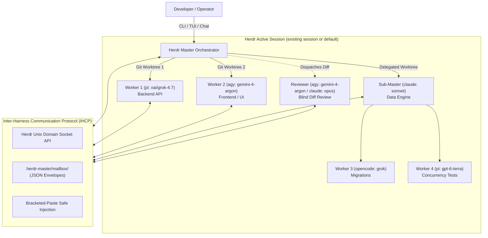

# 👑 Herdr-Master (`herdm`)

> **Universal Multi-Master, Multi-Worker Cross-Harness AI Agent Orchestrator & TUI Dashboard built on [Herdr](https://herdr.dev).**

[](LICENSE)
[](https://www.python.org/downloads/)
[](https://herdr.dev)
[](#cross-harness-support)

---

## 🇬🇷 Σύνοψη (Greek Summary)

Το **Herdr-Master** τυποποιεί και αναβαθμίζει την ενορχήστρωση πολλαπλών αυτόνομων agents (Master Orchestrators και Worker Agents) πάνω στο τερματικό οικοσύστημα του **Herdr**.

### Τι λύνει & τι προσφέρει:
1. **Διπλή μορφή διάθεσης (Dual Delivery)**:
   - **Herdr Plugin / Native Skill (`/herdr-master`)**: Εκτελείται μέσα στα panes του Herdr και αναλαμβάνει αυτόνομα το session.
   - **Αυτόνομο CLI & TUI Εργαλείο (`herdm`)**: Αυτόνομη κονσόλα διαχείρισης και διαδραστικό terminal cockpit (εμπνευσμένο από το minimal visual design του Herdr).
2. **Ιεραρχική Ενορχήστρωση (Masters -> Workers & Masters -> Sub-Masters)**:
   - Ένας Master μπορεί να ανοίγει πολλαπλούς workers σε παράλληλα tabs και να συντονίζει sub-masters για σύνθετα υποσυστήματα.
3. **Δια-λειτουργικότητα Harnesses (Cross-Harness Communication)**:
   - Διαφορετικά harnesses (**Antigravity / `agy`**, **Pi / `pi`**, **Claude Code / `claude`**, **OpenCode / `opencode`**, **Codex**) επικοινωνούν μεταξύ τους με κοινό πρωτόκολλο ανταλλαγής μηνυμάτων, διευκρινίσεων, approvals και diff reviews.
4. **Έτοιμο Orchestration Pipeline & Πλήρης Υποστήριξη `/ergo --herdr`**:
   - Out-of-the-box pipeline (`Scout -> Architect -> Parallel Specialist Coders -> Reviewer -> Squash Integration`).
   - Δυνατότητα ορισμού **διαφορετικού harness/μοντέλου ανά worker** στο ίδιο pipeline (π.χ. Scout σε Gemini Flash, Architect σε GPT-6.1 Sol / Claude Opus, Coders σε Grok 4.7 & Codex Terra, Reviewer σε Gemini Argon / Opus).
5. **Απόλυτη Ασφάλεια Git (Zero `git reset --hard`)**:
   - Κάθε worker εργάζεται σε απομονωμένο Git worktree. Κανένας worker δεν γράφει στο main working tree.
   - Υποχρεωτικό **Master Final Review Gate** πριν από κάθε squash merge στο `develop`.
   - Απαγορεύεται ρητά το `git reset --hard` — σε περίπτωση conflict, γίνεται rebase στο worktree του worker.

---

## 🏛️ System Architecture



---

## ✨ Key Capabilities

### 1. Cross-Harness Inter-Agent Communication (IHCP)
Harnesses no longer operate in isolation. Using our structured JSON messaging envelopes and file-based mailboxes:
- A Master on **Antigravity (`agy`)** can assign a backend task to **Pi (`pi`)** running Grok 4.7.
- The Pi worker can ask a clarification query back to the Master.
- The Master either answers automatically or prompts the user, routing the answer back without restarting the worker session.
- An independent Reviewer on **Claude Code (`claude`)** conducts a blind code review of the worker's branch.

### 2. Built-in Ergo `--herdr` Multi-Harness Pipeline
Run sophisticated multi-stage pipelines where each role is assigned the optimal LLM engine:

```bash
herdm pipeline run ergo \
  --scout agy:gemini-3.8-flash \
  --architect pi:openai-codex/gpt-6.1-sol \
  --workers pi:xai/grok-4.7,pi:openai-codex/gpt-6.1-terra,agy:gemini-4-argon \
  --reviewer agy:gemini-4-argon \
  --intent "Implement real-time WebSocket notifications with Redis Pub/Sub"
```

### 3. Reactive Async Monitoring (Zero Polling Loops)
- The coordinator does not loop-sleep or block terminal sessions.
- Leverages Herdr's native async event mechanisms (`herdr agent wait <pane> --timeout <ms>`, Unix socket subscriptions) and harness-native async subagents (`define_subagent` in Antigravity, background agents in Pi/Claude).
- Turns complete immediately after dispatch; events wake the coordinator reactively.

### 4. Git Worktree Isolation & Mandatory Review Gate
- **Target Branch**: Standardizes on `develop` (created automatically from `HEAD` if not present).
- **Worktree Sandboxing**: Every worker operates in an isolated temporary branch (`herdm/<job>-<timestamp>`).
- **Master Final Review Gate**: Cumulative diffs (`git diff develop...<worker-branch>`) must pass a thorough review. If issues are detected (`NEEDS FIXES`), feedback is routed back to the open worker pane for remediation.
- **NEVER `git reset --hard`**: Preserves code integrity at all times. Landing is achieved through verified `git merge --squash` followed by clean worktree removal.

### 5. Interactive Minimal Terminal UI (TUI)
Inspired by Herdr's clean, high-density aesthetics:
- Live hierarchy tree of active Masters and Workers with status badges (`WORKING`, `IDLE`, `BLOCKED`, `NEEDS_REVIEW`, `APPROVED`).
- Integrated Diff Viewer showing live changes against `develop`.
- Live Agent Output streamer.
- Single-key actions: `[p]` prompt worker, `[r]` trigger review, `[m]` squash-land, `[k]` terminate.

---

## 🚀 Quickstart & Installation

### Option A: Install Standalone CLI & TUI (`herdm`)

```bash
# Clone the repository
git clone https://github.com/<owner>/herdr-master.git /home/pank/projects/herdr-master
cd /home/pank/projects/herdr-master

# Install with pipx (or pip/uv)
pipx install --editable .
```

Verify installation:
```bash
herdm --help
```

### Option B: Install as Herdr Agent Skill (`/herdr-master`)

Run the automated skill installer to symlink the canonical skill into all your installed agent harnesses:

```bash
cd /home/pank/projects/herdr-master
chmod +x scripts/install-skill.sh
./scripts/install-skill.sh
```

Now, inside any Herdr pane with `HERDR_ENV=1`, you can simply run:
```bash
/herdr-master "Refactor authentication middleware to use Redis session store"
```

---

## 💻 CLI Usage Examples

### 1. Initialize Repository
```bash
cd /path/to/my-project
herdm init --target-branch develop
```

### 2. Spawn an Isolated Worker
```bash
herdm worker start worker-cache \
  --kind pi \
  --model xai/grok-4.7 \
  --task "Implement distributed caching in src/cache/" \
  --auto-watch
```

### 3. Inspect Live Worker Diff
```bash
herdm worker diff worker-cache
```

### 4. Launch the Interactive TUI Cockpit
```bash
herdm tui
```

---

## 📖 Deep-Dive Specifications

Comprehensive documentation and architecture specifications are available in the [`ai_docs/`](file:///home/pank/projects/herdr-master/ai_docs/) directory:

- [**00. System Overview & Vision**](file:///home/pank/projects/herdr-master/ai_docs/00_OVERVIEW.md)
- [**01. Architecture & Core Specifications**](file:///home/pank/projects/herdr-master/ai_docs/01_ARCHITECTURE_AND_SPECS.md)
- [**02. Inter-Harness Communication Protocol (IHCP)**](file:///home/pank/projects/herdr-master/ai_docs/02_INTER_HARNESS_PROTOCOL.md)
- [**03. Orchestration Pipelines & Ergo Integration**](file:///home/pank/projects/herdr-master/ai_docs/03_ORCHESTRATION_AND_ERGO_PIPELINE.md)
- [**04. CLI & Terminal UI (TUI) Specification**](file:///home/pank/projects/herdr-master/ai_docs/04_CLI_AND_TUI_SPEC.md)
- [**05. Herdr Plugin & Integration Packaging**](file:///home/pank/projects/herdr-master/ai_docs/05_HERDR_PLUGIN_AND_INTEGRATION.md)

---

## 📄 License

Distributed under the **MIT License**. See [`LICENSE`](file:///home/pank/projects/herdr-master/LICENSE) for more information.
