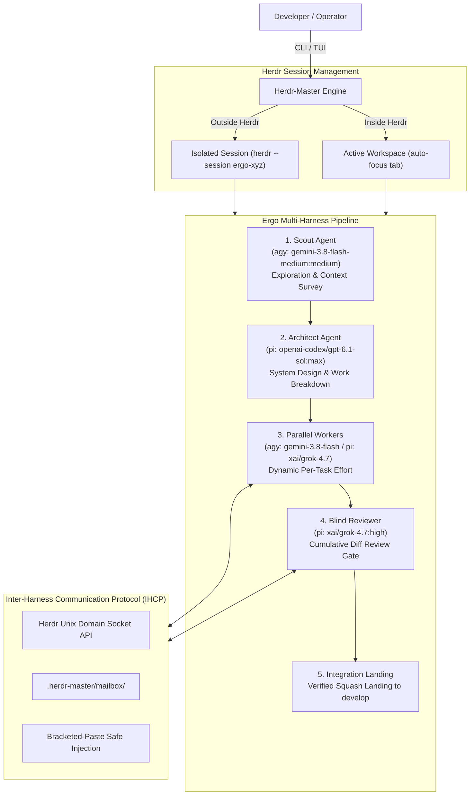

# 👑 Herdr-Master (`herdm`)

> **Universal Multi-Master, Multi-Worker Cross-Harness AI Agent Orchestrator & TUI Dashboard built on [Herdr](https://herdr.dev).**

[](https://github.com/pank85/herdr-master)
[](LICENSE)
[](https://www.python.org/downloads/)
[](https://herdr.dev)
[](https://textual.textualize.io/)
[](#-testing--verification)
[](https://github.com/astral-sh/ruff)

---

## 📖 Overview

**Herdr-Master (`herdm`)** standardizes and elevates the orchestration of multiple autonomous AI coding agents (Master Orchestrators and Worker Squads) running atop the **[Herdr](https://herdr.dev)** terminal agent manager.

Whether coordinating multiple background jobs simultaneously or driving a structured multi-stage coding pipeline, Herdr-Master connects different agent harnesses (**Antigravity**, **Pi**, **Claude Code**, and **OpenCode**) under a unified protocol with strict Git worktree sandboxing.

---

## ⚡ Standalone Skills & Slash Commands (All 4 Harnesses)

Herdr-Master ships with **first-class, standalone agent skills and slash commands** that can be installed directly into all four supported agent harnesses (**Antigravity**, **Pi**, **Claude Code**, and **OpenCode**).

### 🎯 The Four Standalone Capabilities

#### 1. `/herdr-master [task]` — Persistent Root Orchestrator (Multiple Jobs)

> **Requires:** Herdr ([herdr.dev](https://herdr.dev)) and the `herdm` CLI. The skill exits if `HERDR_ENV` is unset — by design.

* **Works with OR without an initial prompt**:
  * You can invoke `/herdr-master` **completely blank without a prompt**. The Master will initialize, inspect the Herdr workspace, verify Git repository state (ensuring the `develop` integration branch is ready), and confirm that orchestration is active.
  * It will prompt: *"Orchestration is active. What is your first job?"*
  * It stays alive in your workspace as a long-running supervisor. You can assign jobs interactively throughout your session whenever needed.
* **Autonomous Delegation & Sandboxing**:
  * For each task you delegate, the Master creates an isolated Git worktree branched from `develop`.
  * It opens a dedicated Herdr tab with the optimal harness and model resolved from the catalog.
  * Default child/bootstrap sessions resolve the product Scout binding (`agy:gemini-3.8-flash-medium:medium`), and final diff reviews resolve the product Reviewer (`pi:xai/grok-4.7:high`).
  * It monitors workers reactively using native async watchers (zero polling loops).
  * It runs a mandatory **Master Final Review Gate** on the cumulative diff, sending remediation requests if needed, and safely lands approved changes via squash merge into `develop`.
  * **Per-job pipelines**: asking for a job "with `/ergo`" or "with orchestration" forwards that command to the child session, so that tab runs a phased pipeline in its own worktree instead of plain work.
  * **Zero `git reset --hard`**: Your main working tree remains untouched and protected.

#### 2. `/ergo [--native] [--models ...] [intent]` — Phased Pipeline (Single Major Job)

> **Requires:** `herdm`, plus **Herdr for the default cross-harness mode**. `--native` runs on host subagents and needs no Herdr — but still needs `herdm` for squad resolution.

* **Structured Multi-Stage Execution**:
  * Runs a rigid, high-assurance pipeline: `Scout` (reconnaissance) → `Architect` (system design & work breakdown) → `Parallel Coders` (isolated worktree implementations) → `Reviewer` (blind diff review gate) → `Squash Integration`.
* **Execution Modes**:
  * **Default Herdr Cross-Harness Mode**: Plain `/ergo` defaults to Herdr mode. Because the operator's product default squad mixes `agy` and `pi`, all pipeline roles run as interactive Herdr agent tabs inside one Herdr workspace. `--herdr` is an explicit alias for this default.
  * **Explicit `--native` Mode**: When `--native` is explicitly passed, the pipeline runs using the parent harness's native subagent tool (`invoke_subagent` in `agy`, `subagent` in `pi`/`opencode`, `Agent` in `claude`). Because there is no separate native default squad, `--native` requires compatible role overrides or a compatible snapshot.
* **Authoritative Product Default Squad**:
  * **Scout**: `agy:gemini-3.8-flash-medium`, effort `medium`
  * **Architect**: `pi:openai-codex/gpt-6.1-sol:max`
  * **Reviewer**: `pi:xai/grok-4.7:high`
  * **Workers**: `agy:gemini-3.8-flash` (simple/mechanical) and `pi:xai/grok-4.7` (complex/architectural) with dynamic per-task effort.

---

#### 3. `/orchestration [--models ...] [intent]` — Phased Pipeline, Host Subagents Only (No Herdr)

> **Requires:** a shell, a git repository, and a host subagent tool. **No Herdr, no `herdm`, no catalog** — this is the only one of the three that runs standalone.

* **Zero external dependencies**: the same Scout → Architect → parallel Coders → blind Reviewer
  pipeline as `/ergo`, but every role is spawned with the current harness's own subagent tool.
  No Herdr workspace, no `herdr` CLI, no `herdm` CLI, no catalog lookup — just a shell, a git
  repository, and a subagent tool.
* **Portable by design**: works in Antigravity (`invoke_subagent`), Pi (`subagent`), Claude Code
  (`Agent`), and OpenCode (`subagent`). If the harness has no subagent tool, the skill stops
  instead of faking the pipeline in one context.
* **No invented models**: the host default is used unless the operator pins models with
  `--models scout=...,architect=...,coder=...,reviewer=...`.
* **Same guarantees**: isolated worktree on `orchestration/<run-id>`, mandatory Approval Gate,
  disjoint file ownership, expert persona per Coder, read-only blind Reviewer with a scoped fix
  loop, and a single squash commit — never `git reset --hard`.
* **Delegable from `/herdr-master`**: ask the master to *"do this job with orchestration"* and it
  opens a new tab, hands the child an isolated worktree, and that tab runs this full pipeline
  instead of plain work. The child stops after its own reviewed commit; the master keeps the final
  review gate and the squash-merge into `develop`.

```bash
/orchestration Implement OAuth2 SSO with tests and migration notes
/orchestration --models scout=<model>,architect=<model>,reviewer=<model> "Add rate limiting"
```

---

#### 4. `/council [intent]` — Multi-Agent Consensus Deliberation

> **Requires:** `herdm` CLI and configured harnesses. Deliberates architectural proposals and RFCs to unanimous consensus or a decisive fallback vote. Produces actionable plans only (`final_plan.md`); never executes unreviewed code changes.

* **Structured Deliberation Protocol**:
  * **Coordinator (1)**: Impartial facilitator who drives state gate transitions, produces unified feedback, and tallies votes. Coordinator and Scout never vote.
  * **Scout (1)**: Surfaces codebase context and surveys constraints into `context.md`.
  * **Council Members (≥ 2 enabled)**: Distinct agent identities who draft independent Round 0 plans, cross-review peers, submit revisions addressing unified feedback, and vote on candidate plans.
* **Protocol Invariants & Limits**:
  * **Max 5 Feedback Cycles**: If consensus is reached in any round (1–5), deliberation stops immediately (`UNANIMOUS_CONSENSUS`). Round 6 is strictly rejected.
  * **Fallback 1-Round Vote**: If 5 cycles complete without consensus, members cast 1 ballot each. Ties are broken deterministically by member order in the pinned roster.
  * **Sealed Artifact**: Outputs authoritative `final_plan.md` documenting the chosen plan, rounds used, and vote tallies. Subsequent modifications are sealed.

```bash
/council "Architect event-driven telemetry pipeline"
/council --ai-head "Refactor payment processing module"
```

---

### 📦 Installation Across All Harnesses

Install all four canonical skills & slash commands (`/herdr-master`, `/ergo`, `/orchestration`, `/council`)
across every supported harness:

```bash
# Using the herdm CLI:
herdm skills install

# Or using the local shell script (delegates to this checkout via uv):
./scripts/install-skills.sh
```

Prerequisites: `uv` or a Python environment with `herdr-master` installed. The installer reads destination templates and canonical sources directly from the catalog.

### 🗺️ Multi-Harness Integration Matrix

The installer detects and symlinks canonical skill definitions into the native directories of all 4 harnesses:

| Harness | Skill Type | Destination Path | Available Command |
| :--- | :--- | :--- | :--- |
| **Antigravity (`agy`)** | Native Skill | `~/.gemini/antigravity-cli/skills/<skill>/SKILL.md` | `/herdr-master`<br/>`/ergo`<br/>`/orchestration`<br/>`/council` |
| **Pi (`pi`)** | Prompt / Skill | `~/.pi/agent/skills/<skill>/SKILL.md` | `/herdr-master`<br/>`/ergo`<br/>`/orchestration`<br/>`/council` |
| **Claude Code (`claude`)** | Custom Slash Command | `~/.claude/commands/<skill>.md` | `/herdr-master`<br/>`/ergo`<br/>`/orchestration`<br/>`/council` |
| **OpenCode (`opencode`)** | Skill & Command | `~/.config/opencode/skills/<skill>/SKILL.md`<br/>`~/.config/opencode/commands/<skill>.md` | `/herdr-master`<br/>`/ergo`<br/>`/orchestration`<br/>`/council` |

### 🔍 Inspect Installation Status

You can inspect the live status of all installed skill endpoints at any time:

```bash
herdm skills list
```

The status column distinguishes live active symlinks (`✓ Active`) from missing, broken, or stale links.

To inspect the underlying harness catalog, default squad, and endpoint templates programmatically:
```bash
herdm catalog show --json
herdm catalog squad --json
```

---

## 🖥️ Interactive TUI Cockpit

Herdr-Master also features a standalone interactive terminal management cockpit built on Textual:

```bash
herdm tui
```

### 1. Main Cockpit Screen (Full-Width Landing View)
The default workspaces view is a full-width control panel. It discovers the
current socket, the default session, and named local sessions under
`~/.config/herdr/sessions/`, refreshing every three seconds without blocking input.

- Click a workspace to expand its agents and terminal panes; arrow keys and Enter work too.
- Status icons distinguish **● running**, **! blocked**, **○ idle**, **✓ done**, **? unknown**, and ordinary terminals. A mixed workspace also shows its blocked count. Blocked means the **reason is unknown—inspect output**; Protocol 22 does not confirm whether user input is required. Neither an old question nor an agent's readiness proves it is waiting for you.
- Role indicators **[Master]** and **[Ergo]** appear adjacent to workspace names when evidenced in session contents. Badges are identity indicators derived from snapshot evidence and live launch records, not an authoritative Protocol 22 role registry; custom-named Masters launched elsewhere or surviving a cockpit restart may be unidentifiable, and absence of a badge does not prove absence.
- Selecting a specific pane starts a **read-only** live output view; selecting a workspace does not select one of its panes. Selection never sends text, navigates, or exits the cockpit. Press **[o]** or click **Open in Herdr [o]** to navigate explicitly.
- Within the current Herdr session the cockpit stays open; outside Herdr (or when switching sessions), the CLI attaches to that session after focusing the target. Run `herdm tui` to return.
- Offline sessions are marked explicitly; retained snapshots are marked **stale** and
  cannot be navigated to. Demo mode is labeled and never controls live panes.
- **New Master**, **New Ergo**, and **AI Council** all offer a **Project folder** field, **Favorites** dropdown, and **Browse…**
  directory picker. Type a path (including `~`), select from saved favorite projects, or browse folders.
  Precedence strictly follows: **explicit folder > configured `default_folder` > current working directory**.
  Each launch opens a fresh workspace with that project as its working directory. The cockpit stays
  open after launching, so one TUI can manage jobs across multiple projects.
- In **Settings** (keys **`s`** or **`c`**), five dedicated tabs manage your complete cross-harness environment:
  1. **Projects & Folders**: Configure default directory and manage named favorite projects with path verification.
  2. **Ergo Squad**: Configure multi-harness squad topologies and dynamic worker pools.
  3. **Orchestration Squad**: Configure single-harness native orchestration pipelines (agy, pi, claude, opencode).
  4. **AI Council**: Configure Council Coordinator, Scout, and dynamic peer members (≥ 2 enabled required).
  5. **AiHead Persona**: Configure autonomous architecture decision persona, soul prompt, harness, model, and mode.
  Saving settings writes atomically to `.herdr-master.toml` and updates active memory without launching a pipeline.

```text
 [ New Master ]      [ New Ergo ]      [ AI Council ]      [ Settings ]
 [ Open in Herdr [o] ]  Workspace: project-a (default) · 2 panes
 Open switches to Herdr; another-session/outside-Herdr attach replaces this cockpit. Run `herdm tui` to return.
 2/2 sessions online · 3 workspaces · 4 agents · Click row to select; [o] to open
 ▼ ● running [Master] project-a · default · 3 panes
   ├── ● running  Builder · Implement · w1:p1 · /projects/project-a
   ├── ○ idle     Reviewer · Review · w1:p2 · /projects/project-a
   └── ● running [AiHead] Advisor · ai-head · w1:p3 · /projects/project-a
 ▶ ○ idle  project-b · default · 1 pane
 ▶ ● running [Ergo] backend · ergo-backend · 1 pane

 [n] New Master  [e] New Ergo  [s/c] Settings  [o] Open in Herdr  [q] Quit
```

**Persistent interactive AiHead.** When enabled, Herdr-Master automatically provisions or reuses a persistent agent tab labeled **`ai-head`** (badged with `[AiHead]` in the workspace browser). Operators can select the tab in the cockpit for live terminal interaction, direct chatting, or assigning ad-hoc tasks. During pipeline execution, automated decision requests delegate technical choices to AiHead autonomously without operator interruption, while genuinely ambiguous or destructive operations escalate directly to the operator. In CLI mode, `herdm aihead-cli` executes 100% Herdr-free via native headless subprocesses.

> 📖 **Deep Dive**: For complete configuration examples, Council deliberation state-machine transitions, and AiHead CLI usage, see the [AI Council & AiHead Architecture Guide](docs/council-aihead.md).

**Live output and replies.** Selecting a pane opens a panel beside the browser at
110 columns or wider, or below it on narrower terminals. Scroll up to pause the
visible bounded snapshot; **Follow** resumes at the newest output. The header
identifies the selected session, workspace, tab, and pane; **Target** opens the
complete socket and lease identity and status legend, with keyboard scrolling and
Escape to close. Invisible control characters in identifiers are shown as escapes.
A stale or unavailable target is labeled and cannot receive
replies. Pane changes never substitute another pane for the chosen target.

Choose **Reply**, enter ordinary text (Enter inserts a line), then choose **Send**.
The draft is pinned to the exact socket/workspace/pane and its observed lease, not
the current cursor. If the target changes or disappears, the original draft remains
visible and cannot be sent elsewhere; **Cancel** discards it. The cockpit uses one
`agent.prompt` attempt and does not infer an approval. **Accepted** means the RPC was
accepted, not that the agent answered; **rejected** leaves the draft in place.
**Uncertain** means delivery may have occurred: inspect the original pane before
manually deciding whether to retry. Cancellation cannot retract text already sent.
Native permission, approval, or key dialogs may require **Open in Herdr** and are
never automatically approved. Server-side close/reuse can still race validation:
there is no atomic conditional prompt RPC, and a missing terminal ID cannot prove a
pane incarnation.

---

### 2. 2-Column Squad Topology & Dynamic Capability Editor
Press `[ New Ergo ]`, `[ Squad Settings ]`, or keys `e` / `s`:

Squad options use two columns beside a compact topology tree. Configuration height
is capped, leaving extra terminal rows for the multiline prompt. The layout adapts
on resize: narrower trees and buttons on small screens, stacked options below 72
columns, and scrollable settings when necessary. Enter inserts a prompt line; Tab
moves from the prompt to the actions.

```text
┌─ Squad Settings & Ergo Pipeline Launcher ─────────────────────────────┐
│ Topology             │ Scout Role Configuration                     │
│ ├─ Scout             │ Harness [ agy ▼ ]     Model [ gemini-… ]      │
│ ├─ Architect         │ Effort  [ Medium ▼ ]  Role  [ scout    ]      │
│ ├─ Worker Pool       │                                              │
│ └─ Reviewer          │                                              │
├─────────────────────────────────────────────────────────────────────┤
│ Project folder: [ /projects/my-app ] [Browse…] Workspace: [ergo-app] │
│ Feature objective / prompt:                         [ Start Ergo  ] │
│ ┌─────────────────────────────────────────────────┐ [ Save Default] │
│ │ Implement OAuth2 SSO.                            │ [ Cancel      ] │
│ │ Include tests and migration notes.               │                 │
│ │                                                 │                 │
│ └─────────────────────────────────────────────────┘                 │
└─────────────────────────────────────────────────────────────────────┘
```

> **Dynamic Worker Capability Model**:
> Workers in the pool do **not** carry rigid thinking efforts or specific job names. Instead:
> * Workers are generic pool members (`worker-1`, `worker-2`).
> * Each worker carries capability info (e.g. *Junior dev: Fast, boilerplate & mechanical edits*, or *Mid/Senior dev: Complex, architectural & subtle tasks*).
> * The **Architect** inspects these capability descriptions to allocate the right model to each task and **dynamically determines reasoning effort** (`low`, `medium`, `high`, `max`) based on task complexity.

---

## 🏛️ System Architecture



---

## ⚡ Slugs & Supported Harnesses

Define any agent using the compact slug format: `<harness>:<model>[:<effort>]`

| Harness | Slug Prefix | Example Slugs | Ideal Roles & Strengths |
| :--- | :--- | :--- | :--- |
| **Antigravity** | `agy` | `agy:gemini-3.8-flash-medium:medium`<br/>`agy:gemini-3.8-flash:high` | Rapid context survey, mechanical and fast implementations |
| **Pi Agent** | `pi` | `pi:openai-codex/gpt-6.1-sol:max`<br/>`pi:xai/grok-4.7:high` | Deep system architecture, independent review gate, complex algorithms |
| **Claude Code** | `claude` | `claude:claude-3-7-sonnet`<br/>`claude:claude-3-opus` | Thoughtful implementation, nuanced edge-case analysis |
| **OpenCode** | `opencode` | `opencode:deepseek-r1`<br/>`opencode:qwen-2.5-coder` | Local models and private open-weights execution |

---

## 🚀 Quickstart & Installation (CLI)

### Standalone CLI Installation

```bash
# Clone repository
git clone https://github.com/pank85/herdr-master.git
cd herdr-master

# Install with uv (fastest)
uv pip install -e .

# Or install with pipx
pipx install --editable .
```

Verify your installation:
```bash
herdm --help
```

---

## 💻 CLI Usage Guide

### 1. Launch Ergo Pipeline (Single Major Job)
```bash
# Simple launch using authoritative default squad configuration
herdm ergo "Implement Redis rate limiting middleware"

# Query the authoritative squad resolution:
herdm catalog squad --json

# Full custom squad with inline overrides:
herdm ergo "Add WebSocket notification server" \
  --scout agy:gemini-3.8-flash-medium:medium \
  --architect pi:openai-codex/gpt-6.1-sol:max \
  --workers agy:gemini-3.8-flash,pi:xai/grok-4.7 \
  --reviewer pi:xai/grok-4.7:high
```

### 2. Launch Root Herdr Master (Multiple Jobs)
```bash
# Launch without task (wait for interactive delegation)
herdm master start backend-lead

# Or launch with an initial task
herdm master start backend-lead \
  --initial-task "Audit microservices and prepare refactoring roadmap"
```

### 3. Interactive TUI Cockpit
```bash
# Launch interactive cockpit connected to Herdr
herdm tui

# Launch in demo mode with mock data
herdm tui --demo
```

### 4. Harness Catalog Queries
```bash
# Inspect all harness capabilities and endpoints
herdm catalog show --json

# Resolve exact launch arguments for any binding:
herdm catalog agent --mode herdr --binding agy:gemini-3.8-flash-medium:medium --role scout --json
herdm catalog agent --mode herdr --binding pi:openai-codex/gpt-6.1-sol:max --role architect --json
herdm catalog agent --mode herdr --binding pi:xai/grok-4.7:high --role reviewer --json
```

### 5. Repository Initialization
```bash
cd /path/to/my-project
herdm init --target-branch develop
```

---

## 🧪 Testing & Verification

The project includes an automated test suite covering state machines, framing protocols, launcher lifecycles, standalone skills installer, and Textual pilot interactions:

```bash
# Run test suite
uv run pytest tests/

# Code quality check with Ruff
uv run ruff check .
```

---

## 📖 Skill Guides

Complete usage instructions for each command:

* [**`/herdr-master`**](docs/skills/herdr-master.md) — multiple jobs, one tab and worktree each, final review gate before landing.
* [**`/ergo`**](docs/skills/ergo.md) — one major job, phased pipeline, cross-harness model per role.
* [**`/orchestration`**](docs/skills/orchestration.md) — the same pipeline on the host's own subagents, no Herdr required.

---

## 📚 Deep-Dive Documentation

For detailed architectural specifications and design documents, explore the [`ai_docs/`](ai_docs/) directory:

* [**00. System Overview & Vision**](ai_docs/00_OVERVIEW.md) — Vision, tenets, and principles.
* [**01. Architecture & Core Specifications**](ai_docs/01_ARCHITECTURE_AND_SPECS.md) — System components, worker states, and lifecycle.
* [**02. Inter-Harness Communication Protocol (IHCP)**](ai_docs/02_INTER_HARNESS_PROTOCOL.md) — Message envelopes, mailboxes, and PTY injection.
* [**03. Orchestration Pipelines & Ergo Integration**](ai_docs/03_ORCHESTRATION_AND_ERGO_PIPELINE.md) — Phased pipeline execution flow.
* [**04. CLI & Terminal UI (TUI) Specification**](ai_docs/04_CLI_AND_TUI_SPEC.md) — Textual UI widgets, actions, and modal specs.
* [**05. Herdr Plugin & Integration Packaging**](ai_docs/05_HERDR_PLUGIN_AND_INTEGRATION.md) — Packaging as Herdr plugin and skill.

---

## 📄 License

Distributed under the **MIT License**. See [`LICENSE`](LICENSE) for more details.
