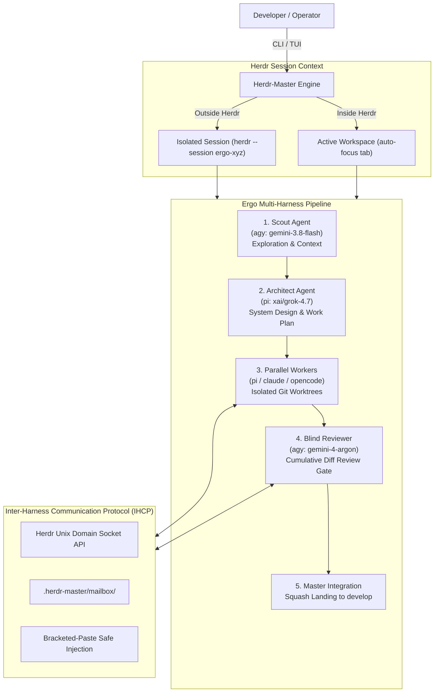

# 👑 Herdr-Master (`herdm`)

> **Universal Multi-Master, Multi-Worker Cross-Harness AI Agent Orchestrator & TUI Dashboard built on [Herdr](https://herdr.dev).**

[](https://github.com/pank85/herdr-master)
[](LICENSE)
[](https://www.python.org/downloads/)
[](https://herdr.dev)
[](https://textual.textualize.io/)
[](#testing--verification)
[](https://github.com/astral-sh/ruff)

---

## 🇬🇷 Σύνοψη (Greek Overview)

Το **Herdr-Master (`herdm`)** τυποποιεί και εκσυγχρονίζει την ενορχήστρωση πολλαπλών αυτόνομων AI agents (Master Orchestrators και Worker Squads) πάνω στο τερματικό περιβάλλον του **Herdr**. 

### 🌟 Τι προσφέρει:
1. **Δύο Τρόποι Εκκίνησης (Dual Operation Modes)**:
   - **`👑 New Herdr Master` (Multiple Jobs)**: Κεντρικός διαχειριστής (coordinator) που αναλαμβάνει πολλαπλά καθήκοντα, ανοίγοντας παράλληλους workers και sub-masters.
   - **`⚡ New Ergo Pipeline` (Single Major Job)**: Εξειδικευμένο στάδιο-προς-στάδιο pipeline (`Scout` → `Architect` → `Parallel Coders` → `Reviewer` → `Squash Integration`) για μία μεγάλη αυτόνομη εργασία.
2. **Διαδραστικό TUI Cockpit & Ρύθμιση Squad (Settings Modal)**:
   - Πλήρους πλάτους CenterDeck (100% width) με 3 εμφανείς κάρτες άμεσης εκκίνησης.
   - **2-Column Settings Modal**: 
     - **Επάνω 3/4**: Squad Topology Tree αριστερά & Πλήρης Editor agent (Harness, Model, Effort, Label) δεξιά.
     - **Κάτω 1/4**: Πεδία για Objective Prompt, Workspace Label και κουμπιά εκκίνησης/αποθήκευσης.
3. **Έξυπνη Απομόνωση Sessions & Focus**:
   - **Εκτός Herdr**: Δημιουργεί αυτόνομα **isolated named session** (`herdr --session ergo-...`) κρύβοντας όλα τα υπόλοιπα άσχετα workspaces/projects για απόλυτα καθαρή προβολή.
   - **Εντός Herdr**: Ενσωματώνεται στο υπάρχον session, δημιουργώντας αυτόματα tab ή workspace και καλεί `workspace.focus` & `tab.focus` για άμεση μετάβαση χωρίς κολλήματα.
4. **Cross-Harness Διαλειτουργικότητα (IHCP)**:
   - Συνδυάζει διαφορετικά harnesses στον ίδιο κύκλο: **Antigravity (`agy`)**, **Pi (`pi`)**, **Claude Code (`claude`)**, **OpenCode (`opencode`)**.
5. **Απόλυτη Ασφάλεια Git (Zero `git reset --hard`)**:
   - Κάθε worker αναπτύσσει σε δικό του απομονωμένο Git worktree. Κανένας agent δεν γράφει απευθείας στο κύριο working tree. Υποχρεωτικό Review Gate πριν το τελικό squash landing.

---

## 🖥️ Interactive TUI Cockpit

Εκκινήστε το διαδραστικό cockpit ανά πάσα στιγμή:

```bash
herdm tui
```

### 1. Αρχική Οθόνη Cockpit (Full-Width First Page)
Η πρώτη σελίδα προσφέρει 100% καθαρό χώρο με 3 κάρτες γρήγορης επιλογής:

```text
┌────────────────────────────────────────────────────────────────────────────────────────┐
│ 👑 HERDR-MASTER COCKPIT        [● CONNECTED]  Workspaces: 1  Agents: 0    17:30       │
├────────────────────────────────────────────────────────────────────────────────────────┤
│                                                                                        │
│  ╭─ 👑 New Herdr Master ──╮  ╭─ ⚡ New Ergo Pipeline ──╮  ╭─ ⚙️ Configure Squad ─────╮  │
│  │ Multiple Jobs           │  │ Single Major Job        │  │ Default Harness & Squad  │  │
│  │ Main orchestrator that  │  │ Dedicated workspace &   │  │ Configure default roles, │  │
│  │ delegates to multiple   │  │ multi-tab Ergo pipeline │  │ harnesses, models and    │  │
│  │ worker tabs & squads.   │  │ (Scout→Architect→Pool). │  │ worker squad topology.   │  │
│  │                         │  │                         │  │                          │  │
│  │  [ 👑 Launch Master ]   │  │  [ ⚡ Launch Ergo ]     │  │  [ ⚙️ Configure Squad ]  │  │
│  ╰─────────────────────────╯  ╰─────────────────────────╯  ╰──────────────────────────╯  │
│                                                                                        │
│  [1] Pipeline Graph    [2] Cumulative Diff    [3] Agent Output Streamer                │
└────────────────────────────────────────────────────────────────────────────────────────┘
│ [n] New Master  [e] New Ergo  [s/c] Settings  [1..4] View Modes  [q] Quit              │
└────────────────────────────────────────────────────────────────────────────────────────┘
```

---

### 2. 2-Column Squad Topology & Pipeline Launcher Modal
Πατώντας `[ ⚡ New Ergo Pipeline ]` ή `[ ⚙️ Configure Squad ]` (πλήκτρα `e` ή `s`):

```text
┌─ ⚡ ERGO SQUAD TOPOLOGY & PIPELINE LAUNCHER ───────────────────────────────────────────┐
│                                                                                        │
│ ┌─ Top 3/4: Squad Configuration ─────────────────────────────────────────────────────┐ │
│ │  Topology Tree (Left Column)      │  Agent Details (Right Column)                  │ │
│ │                                   │                                                │ │
│ │  👑 Herdr-Master Root             │  Role: Scout                                   │ │
│ │  ├── ● Scout (agy:gemini-flash)   │  Harness:  [ agy ▼ ]                           │ │
│ │  ├── ● Architect (pi:grok-4.7)    │  Model:    [ gemini-3.8-flash-high           ] │ │
│ │  ├── 📦 Worker Pool (2 workers)   │  Effort:   [ high ▼ ]                          │ │
│ │  │   ├── ● worker-1 (pi:codex)    │  Label:    [ scout                           ] │ │
│ │  │   └── ● worker-2 (claude:sonn) │                                                │ │
│ │  └── ● Reviewer (agy:argon)       │  [+ Add Worker]  [- Remove Worker]             │ │
│ └───────────────────────────────────┴────────────────────────────────────────────────┘ │
│                                                                                        │
│ ┌─ Bottom 1/4: Execution Deck ───────────────────────────────────────────────────────┐ │
│ │  Objective Prompt: [ Implement OAuth2 SSO & JWT authentication                  ]  │ │
│ │  Workspace Label:  [ ergo-auth-pipeline     ]                                      │ │
│ │                                                                                    │ │
│ │  [ ⚡ Start Ergo Pipeline ]         [ 💾 Save Default ]          [ Cancel ]        │ │
│ └────────────────────────────────────────────────────────────────────────────────────┘ │
└────────────────────────────────────────────────────────────────────────────────────────┘
```

---

## 🏛️ System Architecture



---

## ⚡ Slugs & Supported Harnesses

Ορίστε οποιοδήποτε agent με τη συνοπτική σύνταξη slug: `<harness>:<model>[:<effort>]`

| Harness | Slug Prefix | Example Slugs | Strengths |
| :--- | :--- | :--- | :--- |
| **Antigravity** | `agy` | `agy:gemini-3.8-flash-high`<br/>`agy:gemini-4-argon-high` | Rapid context survey, deep architectural audit, strict diff reviews |
| **Pi Agent** | `pi` | `pi:xai/grok-4.7`<br/>`pi:openai-codex/gpt-6.1-terra` | Complex refactoring, fast code synthesis, test authoring |
| **Claude Code** | `claude` | `claude:claude-3-7-sonnet`<br/>`claude:claude-3-opus` | Thoughtful implementation, nuanced code reviews |
| **OpenCode** | `opencode` | `opencode:deepseek-r1`<br/>`opencode:qwen-2.5-coder` | Local and open-weights agent execution |

---

## 🚀 Quickstart & Installation

### Option 1: Standalone CLI & TUI Installation (Recommended)

```bash
# Clone the repository
git clone https://github.com/pank85/herdr-master.git
cd herdr-master

# Install with uv (fastest)
uv pip install -e .

# Or install with pipx
pipx install --editable .
```

Verify the installation:
```bash
herdm --help
```

### Option 2: Herdr Plugin / Agent Skill Installation

Εγκαταστήστε το skill `/herdr-master` σε όλα τα τοπικά agent harnesses (`agy`, `pi`, `claude`):

```bash
cd herdr-master
chmod +x scripts/install-skill.sh
./scripts/install-skill.sh
```

---

## 💻 CLI Usage Guide

### 1. Εκκίνηση Ergo Pipeline (Single Major Job)
```bash
# Απλή εκκίνηση με προκαθορισμένο squad
herdm ergo "Implement Redis rate limiting middleware"

# Πλήρης παραμετροποίηση squad ανά ρόλο
herdm ergo "Add WebSocket notification server" \
  --scout agy:gemini-3.8-flash-high \
  --architect pi:xai/grok-4.7 \
  --workers pi:openai-codex/gpt-6.1-terra,claude:claude-3-7-sonnet \
  --reviewer agy:gemini-4-argon-high \
  --workspace-label real-time-notifications
```

### 2. Εκκίνηση Herdr Master Orchestrator (Multiple Jobs)
```bash
herdm master start backend-lead \
  --harness agy \
  --model gemini-4-argon-high \
  --initial-task "Audit all microservices and prepare refactoring roadmap"
```

### 3. Διαδραστικό TUI Cockpit
```bash
# Εκκίνηση σε σύνδεση με το Herdr
herdm tui

# Δοκιμαστική λειτουργία (Demo Mode) με προσομοίωση δεδομένων
herdm tui --demo
```

### 4. Αρχικοποίηση Project
```bash
cd /path/to/my-project
herdm init --target-branch develop
```

---

## 🧪 Testing & Verification

Το repository διαθέτει πλήρες σουίτα αυτοματοποιημένων δοκιμών (unit & textual pilot tests):

```bash
# Εκτέλεση όλων των δοκιμών (30 tests)
uv run pytest tests/

# Έλεγχος ποιότητας κώδικα (Ruff linter & formatter)
uv run ruff check .
```

```text
============================== 30 passed in 6.06s ==============================
```

---

## 📚 Deep-Dive Documentation

Λεπτομερείς αρχιτεκτονικές προδιαγραφές και πρωτόκολλα βρίσκονται στο φάκελο [`ai_docs/`](file:///home/pank/projects/herdr-master/ai_docs/):

* [**00. System Overview & Vision**](file:///home/pank/projects/herdr-master/ai_docs/00_OVERVIEW.md) — Όραμα και βασικές αρχές.
* [**01. Architecture & Core Specifications**](file:///home/pank/projects/herdr-master/ai_docs/01_ARCHITECTURE_AND_SPECS.md) — Δομή συστήματος, state machine και lifecycle.
* [**02. Inter-Harness Communication Protocol (IHCP)**](file:///home/pank/projects/herdr-master/ai_docs/02_INTER_HARNESS_PROTOCOL.md) — Μορφότυπος JSON envelopes, safety και PTY injection.
* [**03. Orchestration Pipelines & Ergo Integration**](file:///home/pank/projects/herdr-master/ai_docs/03_ORCHESTRATION_AND_ERGO_PIPELINE.md) — Πλήρης ροή Ergo pipeline.
* [**04. CLI & Terminal UI (TUI) Specification**](file:///home/pank/projects/herdr-master/ai_docs/04_CLI_AND_TUI_SPEC.md) — Προδιαγραφές Textual UI widgets και modal flows.
* [**05. Herdr Plugin & Integration Packaging**](file:///home/pank/projects/herdr-master/ai_docs/05_HERDR_PLUGIN_AND_INTEGRATION.md) — Σύνδεση με το Herdr API και distribution.

---

## 📄 License

Διανέμεται υπό την άδεια χρήσης **MIT License**. Δείτε το αρχείο [`LICENSE`](file:///home/pank/projects/herdr-master/LICENSE) για περισσότερες λεπτομέρειες.
