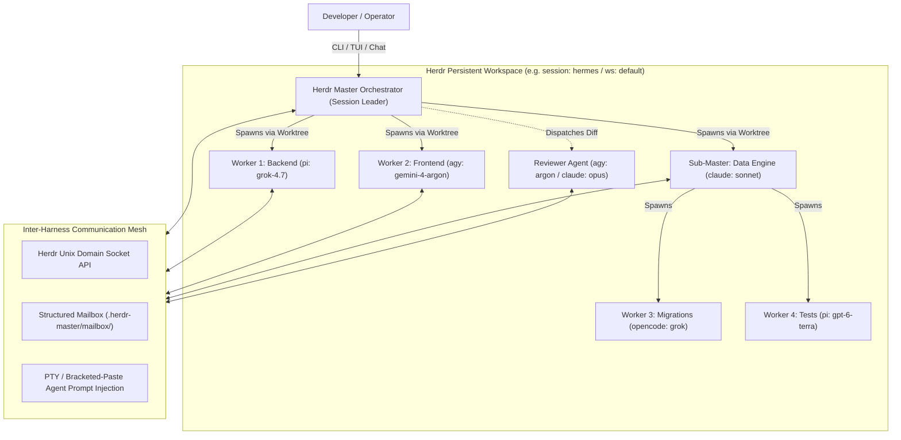

# Herdr-Master: System Overview & Architecture Vision

## 1. Executive Summary

**Herdr-Master** (`herdm`) is a production-grade, multi-master, multi-worker cross-harness AI agent orchestration platform and terminal management UI built on top of [Herdr](https://herdr.dev).

It bridges the gap between disparate LLM agent harnesses (**Antigravity (`agy`)**, **Pi (`pi`)**, **Claude Code (`claude`)**, **OpenCode (`opencode`)**, and **Codex CLI**) by establishing:
1. **Hierarchical Multi-Master / Multi-Worker Topologies**: Masters delegate tasks to workers, and can delegate to nested sub-masters.
2. **Unified Inter-Harness Communication Protocol**: Structured cross-agent messaging, query/answer cycles, approval dialogs, and artifact exchange regardless of which LLM or agent runtime is running in the terminal pane.
3. **Out-of-the-Box Orchestration Pipelines**: Native workflow engines, including full compatibility with the **Ergo Pipeline** (`Scout -> Architect -> Parallel Specialist Coders -> Reviewer -> Squash Integration`), allowing heterogeneous LLMs and harnesses per role/worker.
4. **Minimalist, High-Density TUI Dashboard**: An interactive terminal UI inspired by Herdr's aesthetics, featuring live state monitoring, git worktree diff viewers, message streams, and one-key approval/landing controls.
5. **Dual Distribution Model**:
   - **Herdr Plugin / Native Skill**: Seamlessly invocable inside Herdr terminal panes via `/herdr-master`.
   - **Standalone CLI & TUI Tool (`herdm` / `herdr-master`)**: Standalone binary or Python package managing Herdr workspaces, tabs, and agents from the command line or an interactive terminal application.

---

## 2. System Topology

---

## 3. Core Architectural Tenets

### I. Absolute Isolation via Git Worktrees
- Every worker operates in its own dedicated, clean Git worktree and branch based on `develop` `HEAD`.
- No worker writes to the canonical working tree, and no two workers share the same worktree.
- If uncommitted changes exist in the user repository, workers never touch them.

### II. Zero Polling — Pure Reactive Wakeups
- The orchestrator never blocks or polls in a busy loop.
- It leverages Herdr's native async event stream (`herdr agent wait`, Unix socket subscriptions) combined with harness-native async subagents or background tasks (`define_subagent` in Antigravity, background bash/subagents in Claude Code and Pi).
- Turns finish immediately after dispatching tasks and arming watchers; events wake the coordinator asynchronously.

### III. Inviolable Review Gate & No Hard Resets (`NEVER git reset --hard`)
- Code cannot land on `develop` without passing the **Master Final Review Gate**.
- If a review discovers flaws or missing tests, findings are routed back to the active worker session for remediation.
- Merges are performed serially with `git merge --squash` on clean trees. If conflicts occur, `develop` is merged/rebased inside the worker's worktree first.
- Destructive operations (`git reset --hard`, deleting branches before squash commit verification) are strictly prohibited.

### IV. Heterogeneous Cross-Harness Capabilities
- No vendor lock-in to a single LLM provider or harness.
- A single orchestration pipeline can mix:
  - Fast, cheap models for reconnaissance (e.g. Gemini 3.8 Flash in `agy`).
  - Deep-reasoning models for architecture (e.g. GPT-6.1 Sol in `pi`, or Claude 3.7/Opus in `claude`).
  - High-throughput coding specialists (e.g. Grok 4.7, Codex Terra in `pi` or `opencode`).
  - Strict reviewers from alternative model families (cross-family blind reviews).

---

## 4. Dual Packaging Model

| Aspect | Herdr Plugin / Extension Mode | Standalone CLI & TUI Tool (`herdm`) |
| :--- | :--- | :--- |
| **Invocation** | `/herdr-master [task]` within an agent session | `herdm [subcommand]` or `herdm tui` in any terminal |
| **Runtime Environment** | Injected into Herdr pane with `HERDR_ENV=1` | Runs as an external orchestrator process |
| **Control Mechanism** | Agent prompts, native subagent watchers | Herdr Socket API (`herdr api snapshot/events`) + CLI wrappers |
| **UI Experience** | Native conversational agent chat | Rich / Textual interactive full-screen dashboard |
| **Installation** | Symlinked skill to `~/.gemini/...`, `~/.claude/...`, `~/.pi/...` | `pipx install herdr-master` or bundled binary |
| **Best For** | Hands-off autonomous agent coordination inside chat | Human-in-the-loop oversight, multi-pipeline inspection, cockpit control |

---

## 5. Repository Documentation Structure

- [`ai_docs/01_ARCHITECTURE_AND_SPECS.md`](file:///home/pank/projects/herdr-master/ai_docs/01_ARCHITECTURE_AND_SPECS.md): Detailed architectural components, state machines, and lifecycles.
- [`ai_docs/02_INTER_HARNESS_PROTOCOL.md`](file:///home/pank/projects/herdr-master/ai_docs/02_INTER_HARNESS_PROTOCOL.md): Protocol specifications for cross-harness messaging, JSON payloads, and mailbox routing.
- [`ai_docs/03_ORCHESTRATION_AND_ERGO_PIPELINE.md`](file:///home/pank/projects/herdr-master/ai_docs/03_ORCHESTRATION_AND_ERGO_PIPELINE.md): Pipeline execution engine and `--herdr` multi-model Ergo integration.
- [`ai_docs/04_CLI_AND_TUI_SPEC.md`](file:///home/pank/projects/herdr-master/ai_docs/04_CLI_AND_TUI_SPEC.md): Complete CLI commands reference and Textual TUI design specifications.
- [`ai_docs/05_HERDR_PLUGIN_AND_INTEGRATION.md`](file:///home/pank/projects/herdr-master/ai_docs/05_HERDR_PLUGIN_AND_INTEGRATION.md): Packaging, Herdr integration hooks, and installation guides.
