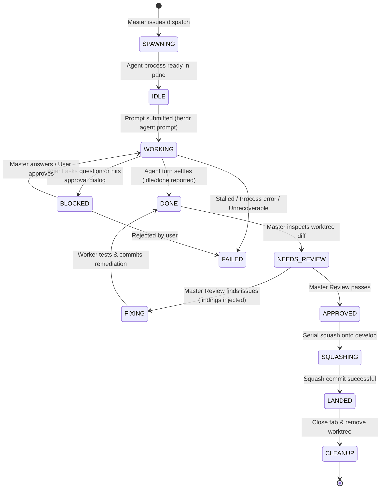

# Herdr-Master: Architecture & System Specifications

## 1. Domain Entities & Core Architecture

Herdr-Master is structured into decoupled subsystem modules:

```
herdr_master/
├── core/
│   ├── models.py            # Pydantic data schemas for Sessions, Agents, Worktrees, Tasks
│   ├── state_machine.py     # Worker, Master, and Pipeline state transitions
│   └── context.py           # Herdr session, workspace, and pane environment discovery
├── adapters/
│   ├── base.py              # Abstract HarnessAdapter interface
│   ├── agy.py               # Google Antigravity adapter (model slugs, CLI args, subagent watchers)
│   ├── pi.py                # Pi adapter (provider/model, pi-subagents, wait loops)
│   ├── claude.py            # Claude Code adapter (effort keywords, haiku/opus, agent tools)
│   ├── opencode.py          # OpenCode adapter (grok, deepseek, subagent calls)
│   └── codex.py             # OpenAI Codex CLI adapter
├── worktree/
│   ├── manager.py           # Git worktree lifecycle (branch creation, develop checkouts, safe removal)
│   └── reviewer.py          # Diffs inspection, conflict detection, squash integration
├── protocol/
│   ├── envelope.py          # JSON messaging envelopes (tasks, questions, approvals, artifacts)
│   ├── mailbox.py           # File-based IPC mailbox (.herdr-master/mailbox/)
│   └── bridge.py            # Herdr agent prompt & socket injection bridge
├── pipeline/
│   ├── engine.py            # DAG execution engine
│   ├── ergo.py              # Ergo Scout -> Architect -> Coders -> Reviewer pipeline runner
│   └── gates.py             # User approval & Master final review gates
└── ui/
    ├── cli.py               # Typer CLI subcommands
    └── tui/                 # Textual terminal management dashboard
```

---

## 2. Entity Model Definitions

### `MasterSession`
Represents an active coordinating orchestrator.
- `session_id`: Unique run UUID.
- `herdr_session`: Herdr persistent session name (e.g. `hermes`, `default`).
- `workspace_id`: Herdr workspace ID.
- `pane_id`: Terminal pane where the Master is running.
- `harness`: Harness kind (`agy`, `pi`, `claude`, `opencode`, or `cli`).
- `role`: Role (`orchestrator`, `sub-master`).
- `active_workers`: List of `WorkerSession` IDs.
- `pipeline_id`: Optional associated pipeline run.

### `WorkerSession`
Represents an individual agent running in an isolated pane.
- `worker_id`: Unique identifier (e.g. `worker-backend-01`, `coder-1`).
- `pane_id`: Herdr pane ID.
- `tab_id`: Herdr tab ID.
- `harness`: Agent kind (`agy`, `pi`, `claude`, `opencode`, `codex`).
- `model`: Explicit model slug (e.g. `xai/grok-4.7`, `gemini-4-argon-high`).
- `effort`: Reasoning effort level (`low`, `medium`, `high`, `max`).
- `worktree_path`: Absolute path to the isolated Git worktree.
- `branch`: Temporary branch name (e.g. `herdm/job-backend-01-20261103`).
- `state`: Lifecycle state (see §3).
- `watcher_id`: Active async watcher identifier.
- `last_commit_sha`: Latest commit SHA produced by worker.
- `review_status`: `PENDING`, `NEEDS_FIXES`, or `APPROVED`.

---

## 3. Worker Lifecycle State Machine



### State Definitions & Invariants:
1. **`SPAWNING`**: The Herdr tab is created (`--no-focus`), worktree checked out, and `herdr agent start` issued. Returns only when the agent is interactive.
2. **`IDLE`**: Ready for prompt submission.
3. **`WORKING`**: The agent has received the task prompt and is executing tools. Native async watcher is active (`herdr agent wait --timeout <ms>`).
4. **`BLOCKED`**: The agent encountered an approval gate or asked a clarification. The orchestrator intercepts the UI (`herdr agent read`) and routes the query to the user or answers if within delegated scope.
5. **`DONE`**: Worker reports turn completion. The master verifies file modifications and commits.
6. **`NEEDS_REVIEW`**: The Master Final Review Gate examines `git diff develop...<worker-branch>`.
7. **`FIXING`**: If review fails, the existing worker session receives actionable review findings without losing context.
8. **`APPROVED`**: Work passes all automated tests, syntax checks, security guidelines, and architectural criteria.
9. **`SQUASHING`**: Clean, serial squash merge onto `develop`. If conflicts arise, `develop` is rebased into the worker branch first; **NEVER** reset `develop` with `git reset --hard`.
10. **`LANDED` & `CLEANUP`**: Once the squash commit exists on `develop`, the worker tab is closed, clean worktree removed, and temporary branch deleted.

---

## 4. Multi-Master & Sub-Master Topology

Herdr-Master supports nested hierarchical orchestration:
- **Root Master (Level 0)**: Communicates directly with the user or operates the top-level pipeline (e.g. User feature request).
- **Sub-Master (Level 1..N)**: When a subsystem requires separate architectural breakdown (e.g., a complex data migration or microservice refactoring), the Root Master launches a sub-master agent in its own tab, granting it delegated worker spawning authority.
- **Coordination Rules**:
  - Sub-masters can only spawn workers inside their allocated workspace slice.
  - Sub-masters review and consolidate their workers' changes onto a subsystem integration branch (`feature/...`).
  - The Root Master performs the final review of the consolidated subsystem branch before landing onto `develop`.

---

## 5. Git Worktree Invariants & Safe Integration Engine

### Worktree Allocation Rules:
1. **Target Branch Verification**: The default integration target is `develop`. If `develop` does not exist in the repository, create it from `HEAD` prior to any worktree operations.
2. **Dedicated Branch**: Every worker gets an isolated branch:
   `herdm/<pipeline-or-job>/<worker-name>-<timestamp>`
3. **Worktree Directory**: Created under `<repo-root>/.herdr-worktrees/<branch-sanitized>` or adjacent workspace directory.
4. **No Contamination**: The user's main checkout and staging area are never touched. If uncommitted changes exist in the user's working copy, they are preserved untouched.
5. **Conflict Resolution Invariant**:
   - If `develop` has advanced during the worker's execution:
     ```bash
     cd "$WORKTREE"
     git fetch origin develop
     git merge develop  # or git rebase develop
     # If conflicts occur: Worker resolves conflicts, runs tests, commits
     ```
   - Only after successful resolution and test pass does the Master execute:
     ```bash
     cd "$CANONICAL_REPO"
     git checkout develop
     git merge --squash "$WORKER_BRANCH"
     git commit -m "feat(<scope>): <summary> (squashed from $WORKER_BRANCH)"
     ```
6. **The Absolute Ban on `git reset --hard`**:
   Under no circumstances is `git reset --hard` allowed to be executed on the target branch or worker branch to discard conflicts. In the event of an unresolvable conflict, the worktree is preserved and the orchestrator escalates to the user.

---

## 6. Reactive Async Watcher Engine

To prevent orchestrators from wasting context windows, spinning CPU cycles, or blocking client sockets:
- When a worker is launched and prompted:
  - An async watcher is scheduled using the parent harness's native asynchronous execution facility:
    - **Antigravity (`agy`)**: `define_subagent` (lightweight `flash_lite` watcher) or background `run_command` (`WaitMsBeforeAsync: 500`).
    - **Pi (`pi`)**: Native background subagent (`async: true`) running `herdr agent wait <pane-id>`.
    - **Claude Code (`claude`)**: Background subagent or background bash task running `herdr agent wait`.
    - **OpenCode (`opencode`)**: Background subagent running `herdr agent wait`.
    - **Standalone CLI / TUI (`herdm`)**: Python `asyncio.create_task` subscribing to the Herdr Unix socket event stream.
- The parent coordinator immediately completes its turn, freeing resources.
- When the watcher fires upon state change (`idle`, `done`, `blocked`, or timeout), the orchestrator is awakened reactively.
