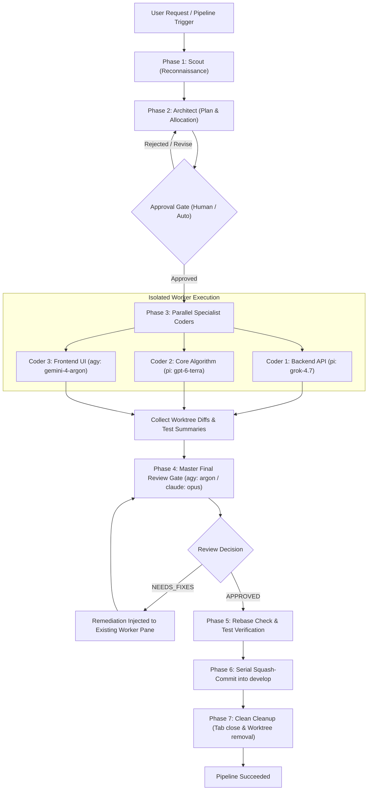

# Orchestration Pipelines & Ergo `--herdr` Integration

## 1. Pipeline Execution Framework

Herdr-Master provides a built-in workflow engine that executes structured multi-agent pipelines across heterogeneous harnesses. 

Pipelines are declared in YAML/TOML and executed deterministically with full checkpointing, rollback protection, and approval gates.



---

## 2. The Ergo `--herdr` Cross-Harness Pipeline

Herdr-Master embeds native, first-class support for the **Ergo Pipeline** via `ergo --herdr`. 

When invoked, the pipeline provisions every role as an independent interactive terminal tab inside a dedicated temporary Herdr workspace (`ergo-<run-id>`) running on the active Herdr session (the existing session if already inside Herdr, or `default`).

### Role-to-Harness Squad Configuration

Each stage can be assigned a tailored LLM harness and reasoning profile optimized for that phase:

| Pipeline Role | Default Harness & Model | Alternative Recommendations | Responsibility |
| :--- | :--- | :--- | :--- |
| **Scout** | `agy:gemini-3.8-flash-high` | `pi:openai-codex/gpt-6-luna`, `opencode:deepseek-v4.1` | Fast, low-cost codebase reconnaissance; maps architecture, dependency trees, entrypoints, and existing tests. |
| **Architect** | `pi:openai-codex/gpt-6.1-sol:high` | `claude:claude-opus-5-5-high`, `agy:gemini-4-argon:max` | Deep reasoning; breaks intent into independent atomic tasks, assigns specialized Expert Personas and harnesses to each task. |
| **Specialist Coders** | Dynamic Pool: `pi:xai/grok-4.7`, `pi:openai-codex/gpt-6.1-terra`, `agy:gemini-4-argon` | `agy:gemini-3.8-flash`, `opencode:grok-build` | Parallel implementation. Each worker is pinned to its designated harness, model, and expert persona. |
| **Reviewer** | `agy:gemini-4-argon-high` | `claude:opus`, `pi:openai-codex/gpt-6.1-sol` | Strict blind review of cumulative diffs against `develop`. Must be from a different model family than the Architect to avoid blindspots. |

---

## 3. Worker Model Pool Allocation (`--models` Syntax)

In Herdr-Master, the user or caller can dynamically customize which harness and model runs each role using intuitive CLI overrides:

```bash
# Example 1: Full multi-harness pipeline run
herdm pipeline run ergo \
  --scout agy:gemini-3.8-flash \
  --architect claude:claude-opus-5-5 \
  --workers pi:xai/grok-4.7,pi:openai-codex/gpt-6.1-terra,agy:gemini-4-argon \
  --reviewer agy:gemini-4-argon \
  --intent "Add distributed idempotency keys to payments API"

# Example 2: Compact syntax forwarded directly to /ergo
/ergo --herdr --models scout:agy:gemini-3.8-flash,architect:pi:gpt-6.1-sol,workers:pi:grok-4.7,reviewer:claude:opus <intent>
```

### How the Architect Allocates Models to Coders
When the Architect runs, Herdr-Master passes the user-approved worker pool in the prompt as `ALLOWED CODER MODELS`. The Architect writes `plan.md` declaring:

```markdown
### Task 1: Idempotency Storage Schema & Migration
- Model / Harness: `pi:xai/grok-4.7`
- Expert Persona: Senior Database & Distributed Systems Engineer
- Worktree Branch: `herdm/ergo-task1-db`
- Scope: `src/db/migrations/`, `src/models/idempotency.py`

### Task 2: Core Interceptor & Redis Lock Implementation
- Model / Harness: `pi:openai-codex/gpt-6.1-terra`
- Expert Persona: Concurrency & High-Availability Specialist
- Worktree Branch: `herdm/ergo-task2-interceptor`
- Scope: `src/middleware/idempotency.py`
```

---

## 4. Pipeline Execution Lifecycle Steps

### Step 1: Preflight & Workspace Setup
- Verify `git status` is clean or changes are safely isolated.
- Ensure integration branch `develop` exists.
- Launch or attach to the active Herdr session (existing session or `default`):
  ```bash
  herdr workspace create --cwd "$WORKTREE" --label "ergo-<run-id>" --no-focus
  ```

### Step 2: Scout Reconnaissance
- Spawn Scout in tab `scout`:
  ```bash
  herdr agent start scout --kind agy --pane <pane-id> -- --model gemini-3.8-flash-high
  herdr agent prompt scout "Perform reconnaissance on <intent>..." --wait --timeout 180000
  ```
- Output produced: `.orchestration/<run-id>/context.md`.

### Step 3: Architecture & Planning
- Spawn Architect in tab `architect`:
  ```bash
  herdr agent start architect --kind pi --pane <pane-id> -- --provider openai-codex --model gpt-6.1-sol
  herdr agent prompt architect "Formulate implementation plan..." --wait --timeout 300000
  ```
- Output produced: `.orchestration/<run-id>/plan.md`.

### Step 4: Human-in-the-Loop Approval Gate
- Displays resolved task graph, files to be modified, assigned harnesses, models, and estimated tokens/costs in the TUI or chat interface.
- Operator selects **[Proceed]**, **[Edit Plan]**, or **[Abort]**.

### Step 5: Parallel Worker Execution
- For each task in `plan.md`:
  1. Check out separate worktree based on `develop` `HEAD`.
  2. Create a Herdr tab labeled `<task-name>`.
  3. Start assigned harness (`agy`, `pi`, `claude`, `opencode`).
  4. Inject tailored persona and task prompt.
  5. Schedule async watchers (`herdr agent wait`).
- Master monitors all workers concurrently. When a worker finishes, it commits its changes inside its worktree.

### Step 6: Master Final Review Gate
- Before any merging, cumulative diffs are inspected against `develop`.
- Reviewer checks:
  - Logic correctness, boundary conditions, thread safety.
  - Test coverage (new or updated unit tests per `unitTestsMode`).
  - No accidental modifications to files outside task scope.
  - Zero presence of `git reset --hard` or destructive operations.
- **NEEDS FIXES Loop**: If issues are identified, the review findings are routed directly to the still-open worker pane with specific remediation instructions. The worker commits fixes, tests them, and the Reviewer validates again.

### Step 7: Landing & Serial Squash-Merge
- Switch to repository integration branch `develop`.
- Verify `develop` is clean.
- Serially squash-merge each worker branch:
  ```bash
  git merge --squash "herdm/<task-branch>"
  pytest  # Run repository verification suite
  git commit -m "feat(<scope>): <description> (squashed from <task-branch>)"
  ```
- Close worker tabs in Herdr.
- Delete temporary worktrees with `git worktree remove` and delete temporary branches.
- Report completion and commit SHAs to the user.
