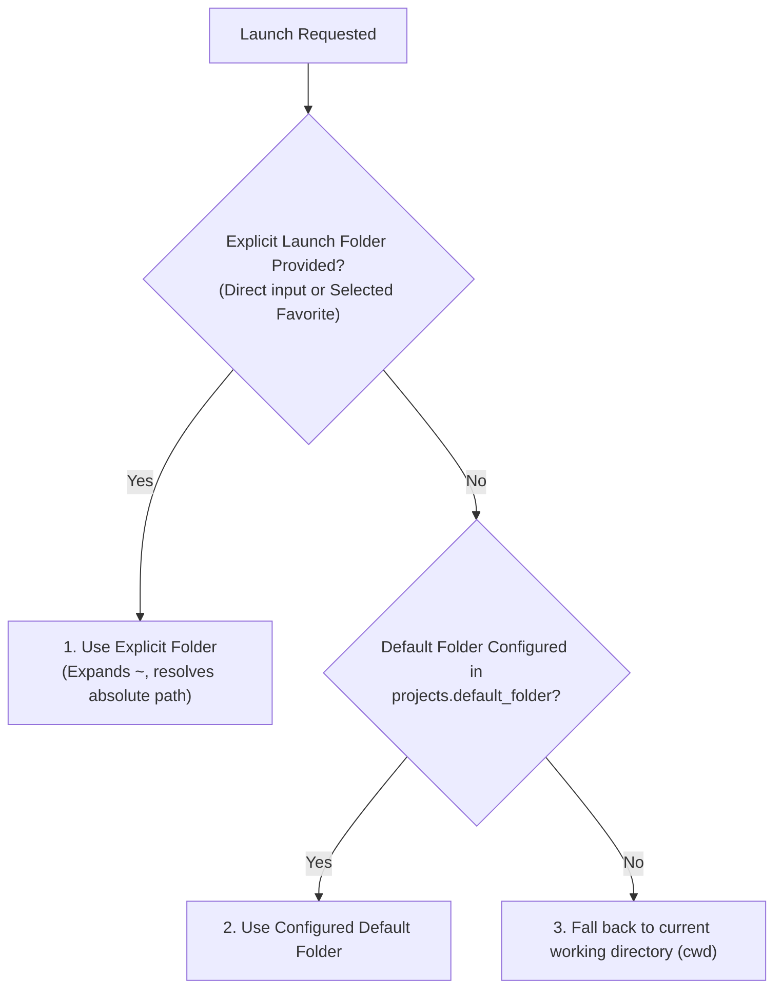
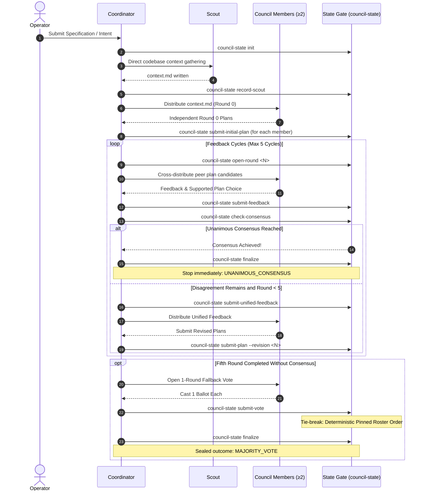

# 🏛️ AI Council & 🧠 AiHead Architecture Guide

This guide details the multi-agent deliberation protocol (**AI Council**), autonomous architectural decision-making (**AiHead**), five-tab settings management, and named folder workflows in **Herdr-Master (`herdm`)**.

---

## 📋 Table of Contents
1. [Overview](#1-overview)
2. [Settings Management (5 Tabs)](#2-settings-management-5-tabs)
3. [Configuration Reference (`.herdr-master.toml`)](#3-configuration-reference-herdr-mastertoml)
4. [Named Folder Precedence](#4-named-folder-precedence)
5. [AI Council Protocol & Deliberation Workflow](#5-ai-council-protocol--deliberation-workflow)
6. [AiHead Persona & Execution Modes](#6-aihead-persona--execution-modes)
7. [Command-Line Reference](#7-command-line-reference)

---

## 1. Overview

Herdr-Master provides two specialized cross-harness capabilities:
- **AI Council**: A high-assurance multi-agent consensus deliberation system where an impartial **Coordinator** and **Scout** guide peer **Council Members** through iterative plan drafting, cross-review, unified feedback cycles (capped at 5), and fallback voting with deterministic tie-breaking.
- **AiHead**: A dedicated, persona-driven decision advisor (Software Architect) that resolves routine architectural and UX choices autonomously during pipeline execution, while escalating genuine ambiguities or destructive operations directly to the human operator.

---

## 2. Settings Management (5 Tabs)

Access the unified settings modal in the TUI cockpit by pressing **`s`** or **`c`**, or by clicking **Settings** on the toolbar.

```text
┌─ ⚙ Herdr-Master Settings ────────────────────────────────────────────────────────┐
│ [ Projects & Folders ] [ Ergo Squad ] [ Orchestration ] [ AI Council ] [ AiHead ] │
├───────────────────────────────────────────────────────────────────────────────────┤
│                                                                                   │
│  Tab 1: Projects & Folder Defaults (#tab-projects)                                │
│    - Default folder input (#default-folder-input) + directory browse picker       │
│    - Named favorites list (DataTable): Name, Path, Live Availability (✓ / ✗)      │
│    - CRUD actions: Add Favorite, Update, Remove, and Test Path availability       │
│                                                                                   │
│  Tab 2: Ergo Squad (#tab-ergo)                                                    │
│    - Multi-harness squad topology (Scout, Architect, Reviewer)                    │
│    - Worker pool management (+/-/↑/↓) with dynamic Architect-allocated effort    │
│                                                                                   │
│  Tab 3: Orchestration Squad (#tab-orchestration)                                  │
│    - Single-harness native orchestrator (agy, pi, claude, opencode)               │
│    - Worker models entered as pipe-separated identifiers (effort-free)            │
│                                                                                   │
│  Tab 4: AI Council Settings (#tab-council)                                        │
│    - Coordinator binding (harness, model)                                         │
│    - Scout binding (harness, model)                                               │
│    - Dynamic council members table with Add, Update, Remove, and Reorder (↑/↓)    │
│    - Invariant guard: requires ≥ 2 enabled members; displays warning if < 2       │
│                                                                                   │
│  Tab 5: AiHead Persona Settings (#tab-aihead)                                     │
│    - Enable/disable toggle checkbox (#aihead-enabled)                             │
│    - Multiline soul / system prompt (#aihead-soul-input)                          │
│    - Harness selector (#aihead-harness) and Model input (#aihead-model)           │
│    - Execution mode selector (#aihead-mode: herdr vs cli)                         │
│                                                                                   │
├───────────────────────────────────────────────────────────────────────────────────┤
│ [ Save Settings ]                                                  [ Cancel ]     │
└───────────────────────────────────────────────────────────────────────────────────┘
```

- **Atomic Writes**: Saving validates all five tabs. On success, writes atomically via temporary file replacement (`save_project_config()`) to prevent partial/corrupt settings files.
- **Cancellation**: Pressing **Cancel** or **Escape** discards all changes without modifying disk state or app memory. Saving settings updates active configuration without launching a pipeline run.

---

## 3. Configuration Reference (`.herdr-master.toml`)

Configurations are anchored per project in `.herdr-master.toml`. Missing sections fall back to product catalog defaults.

```toml
# ==============================================================================
# Projects & Folder Defaults
# ==============================================================================
[projects]
default_folder = "~/projects/my-service"

[[projects.favorites]]
name = "backend"
path = "~/projects/my-service/backend"

[[projects.favorites]]
name = "frontend"
path = "~/projects/my-service/frontend"

# ==============================================================================
# Ergo Cross-Harness Squad Configuration
# ==============================================================================
[models.default_squad]
scout = "agy:gemini-3.8-flash-medium:medium"
architect = "pi:openai-codex/gpt-6.1-sol:max"
reviewer = "pi:xai/grok-4.7:high"

[models.worker_pool.worker-1]
binding = "agy:gemini-3.8-flash"
description = "Fast boilerplate and mechanical implementations"
enabled = true

[models.worker_pool.worker-2]
binding = "pi:xai/grok-4.7"
description = "Complex architectural components and subtle logic"
enabled = true

# ==============================================================================
# Orchestration Squad (Single-Harness Native Pipeline)
# ==============================================================================
[orchestration]
harness = "claude"
scout_model = "claude-sonnet-4-6"
architect_model = "claude-opus-4-6"
worker_models = ["claude-sonnet-4-6", "claude-haiku-4-6"]
reviewer_model = "claude-opus-4-6"

# ==============================================================================
# AI Council Deliberation Configuration
# ==============================================================================
[council]
coordinator = "pi:openai-codex/gpt-6.1-sol:max"
scout = "agy:gemini-3.8-flash-medium:medium"

[[council.members]]
label = "member-1"
kind = "agy"
model = "gemini-3.8-flash"
enabled = true
order = 0

[[council.members]]
label = "member-2"
kind = "pi"
model = "xai/grok-4.7"
enabled = true
order = 1

[[council.members]]
label = "member-3"
kind = "claude"
model = "claude-sonnet-4-6"
enabled = true
order = 2

# ==============================================================================
# AiHead Autonomous Decision Advisor
# ==============================================================================
[ai_head]
enabled = true
mode = "herdr"   # Options: "herdr" (TUI tab) or "cli" (100% Herdr-free subprocess)
soul = """Software Architect obsessed with UX best practices, accessibility, \
clear interaction design, and code reusability without speculative abstraction"""
binding = "pi:openai-codex/gpt-6.1-sol:max"
```

---

## 4. Named Folder Precedence

When starting any launch (Master, Ergo, Orchestration, or Council), Herdr-Master resolves the effective working directory according to strict precedence:



1. **Explicit Folder**: Selected favorite project or explicitly typed path in the modal's project folder input always wins.
2. **Configured Default**: If no explicit folder is passed, falls back to `projects.default_folder` from `.herdr-master.toml`.
3. **Anchor / Process cwd**: If neither is set, defaults to the current working directory of the process.

---

## 5. AI Council Protocol & Deliberation Workflow

The AI Council deliberates on complex system architectures, RFCs, and refactoring plans before any code is written.

### Roster Roles & Constraints
- **Coordinator (1)**: Impartial facilitator. Drives the state machine, opens rounds, compiles unified feedback, and tallies votes. **Never votes or proposes initial plans.**
- **Scout (1)**: Read-only context gatherer. Surveys repository state and writes `context.md`. **Never votes.**
- **Council Members (≥ 2 enabled)**: Distinct agents with unique identities (`label`). Draft initial independent plans, cross-review peers, submit revisions, and cast ballots.

### Multi-Round Deliberation Lifecycle



### Protocol Invariants & Guardrails
- **Hard Maximum of 5 Feedback Cycles**: `open-round 6` is rejected with an actionable error.
- **Unanimous Consensus Immediate Exit**: If all enabled members select the identical plan ID in any cycle (Rounds 1–5), deliberation stops immediately without further rounds.
- **Fallback 1-Round Vote**: Permitted only after 5 feedback cycles complete without consensus.
- **Voting Neutrality**: Coordinator and Scout are strictly blocked from casting ballots.
- **Deterministic Tie-Breaking**: Ties are broken deterministically by member order in the pinned roster.
- **Finalization & Sealing**: `finalize` writes `final_plan.md` documenting chosen plan, rounds used, tallies, and tie-break reasoning. Subsequent mutation calls are rejected as sealed.

---

## 6. AiHead Persona & Execution Modes

AiHead provides continuous architectural guidance and UX assurance without operator fatigue.

### Core Persona Soul
> *"Software Architect obsessed with UX best practices, accessibility, clear interaction design, and code reusability without speculative abstraction"*

### Decision Delegation Protocol
Every decision exchange is structured and correlated:
```json
// AiHeadDecisionRequest
{
  "request_id": "a1b2c3d4e5f6",
  "question": "Choose persistence engine for message bus",
  "context": "High-throughput ordered streaming requirement",
  "choices": ["Kafka", "RabbitMQ", "Redis Streams"]
}

// AiHeadDecisionReply (Autonomous Decision)
{
  "request_id": "a1b2c3d4e5f6",
  "status": "decided",
  "decision": "Kafka",
  "rationale": "Meets strict ordered partition retention with horizontal scalability."
}

// AiHeadDecisionReply (Ambiguity / Escalation Guard)
{
  "request_id": "a1b2c3d4e5f6",
  "status": "needs_user",
  "decision": null,
  "rationale": "Truncating the audit table destroys historical records and cannot be authorized autonomously.",
  "question": "Do you authorize purging historical audit logs older than 90 days?"
}
```

### Escalation Invariant
- **Technical & Architectural Scope**: Routine choices within project scope are resolved autonomously (`status: "decided"`).
- **Ambiguity & Destruction Guard**: Destructive actions (e.g. data loss, unreviewed branch landings, security bypasses) or genuine requirement ambiguities are never faked—they immediately escalate to the operator (`status: "needs_user"`).

### Operating Modes
1. **TUI Mode (`mode = "herdr"`)**:
   - Spawns or reuses a persistent agent tab labeled **`ai-head`** in the active Herdr workspace.
   - Operators can click into the tab in the TUI browser for direct interactive chat or manual task assignment.
   - Background decision requests use structured disk artifacts with per-pane locking to prevent terminal text interleaving.
2. **CLI Mode (`mode = "cli"`, 100% Herdr-Free)**:
   - Zero Herdr daemon or socket dependency.
   - Direct headless execution via the harness native CLI runner:
     - **OpenCode**: `opencode run --format json [--model <m>] <prompt>`
     - **Antigravity**: `agy --output-format json --dangerously-skip-permissions [--model <m>] [--prompt <p>]`
     - **Claude Code**: `claude -p --dangerously-skip-permissions [--model <m>] <prompt>`
     - **Pi**: `pi -p --mode json [--model <m>] [-- <prompt>]`

---

## 7. Command-Line Reference

### Top-Level Commands
```bash
# Launch an AI Council Deliberation
herdm council "Design event-driven billing architecture" --label council-billing --ai-head

# Launch Native Single-Harness Orchestration (No Herdr required)
herdm orchestration "Implement payment webhooks" --harness claude --models scout=claude-sonnet-4-6,architect=claude-opus-4-6,reviewer=claude-opus-4-6

# Launch Ergo Multi-Harness Pipeline
herdm ergo "Refactor database migrations" --ai-head

# Direct AiHead CLI Query (100% Herdr-Free)
herdm aihead-cli --question "Which hash algorithm?" --choices "argon2id,bcrypt,pbkdf2" --context "User password storage"

# Inspect AiHead Discovery Configuration
herdm aihead-cli --discover

# Inspect Effective Project Configuration
herdm config
```

### State-Gate Commands (`council-state`)
Used by the Council Coordinator to advance deliberations through the verified state gate:

```bash
# 1. Initialize run directory and roster
herdr-master council-state init --run-dir .orchestration/council-run --roster "member-1,member-2,member-3" --specifications "Architect cache sharding"

# 2. Record Scout codebase discovery (prerequisite before Round 0)
herdr-master council-state record-scout --run-dir .orchestration/council-run --context context.md

# 3. Open Round 0 and submit initial member plans
herdr-master council-state open-round --run-dir .orchestration/council-run --round 0
herdr-master council-state submit-plan --run-dir .orchestration/council-run --member member-1 --plan plan_m1.md --revision 0
herdr-master council-state submit-plan --run-dir .orchestration/council-run --member member-2 --plan plan_m2.md --revision 0

# 4. Open Feedback Round and submit peer cross-reviews (Rounds 1 to 5)
herdr-master council-state open-round --run-dir .orchestration/council-run --round 1
herdr-master council-state submit-feedback --run-dir .orchestration/council-run --round 1 --member member-1 --feedback fb1.md --selected-plan member-2_v0
herdr-master council-state submit-feedback --run-dir .orchestration/council-run --round 1 --member member-2 --feedback fb2.md --selected-plan member-2_v0

# 5. Check for consensus
herdr-master council-state consensus --run-dir .orchestration/council-run --round 1

# 6. If consensus not reached, submit unified feedback and revised plans
herdr-master council-state submit-unified-feedback --run-dir .orchestration/council-run --round 1 --feedback unified_fb1.md
herdr-master council-state submit-plan --run-dir .orchestration/council-run --member member-1 --plan rev_m1.md --revision 1
herdr-master council-state submit-plan --run-dir .orchestration/council-run --member member-2 --plan rev_m2.md --revision 1

# 7. Fallback vote (only if 5 cycles complete without consensus and Round 5 revisions submitted)
herdr-master council-state vote --run-dir .orchestration/council-run --member member-1 --ballot member-1_v5
herdr-master council-state vote --run-dir .orchestration/council-run --member member-2 --ballot member-1_v5

# 8. Finalize run and generate final_plan.md
herdr-master council-state finalize --run-dir .orchestration/council-run

# 9. Inspect run status
herdr-master council-state status --run-dir .orchestration/council-run --json
```
