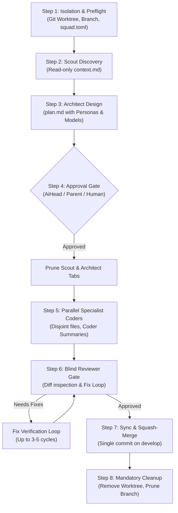

# `/ergo` — Multi-Harness Phased Engineering Pipeline

The `/ergo` skill executes a disciplined, multi-stage engineering pipeline for substantial feature work on a single major job. It enforces strict role separation, worktree and branch isolation, dynamic specialist personas, an adversarial blind review gate, and atomic landing via a single squash commit.

---

## 1. Pipeline Architecture & Execution Flow

Ergo breaks complex feature implementations into five sequential, verifiable phases:



### The Cardinal Rules
1. **Never implement code directly in the orchestrator**: The coordinator pane only directs stages, verifies artifacts, routes decisions, and lands the final merge.
2. **Never skip Scout, Approval Gate, or Reviewer**: Every stage is a mandatory quality contract.
3. **Never run `git reset --hard`**: Sync the target branch inside the worktree first; resolve any merge conflicts via a specialist Coder and scoped Reviewer verification.
4. **Disjoint file ownership**: Parallel Coders never touch overlapping files. Conflicting tasks must be serialized with `DEPENDS ON`.

---

## 2. Execution Modes: Herdr vs. `--native`

Ergo supports two execution models:

| Dimension | Default Herdr Mode (`--herdr` or bare) | Explicit `--native` Mode (`--native`) |
| :--- | :--- | :--- |
| **Orchestration Plane** | Herdr terminal workspace with interactive agent tabs. | Host harness's native subagent tool within current session. |
| **Model Diversity** | **Cross-harness**: mixes best-of-breed models across `agy`, `pi`, `claude`, `opencode`, and `hermes`. | **Single-harness**: all roles execute within the host's supported native subagent adapter. |
| **External Dependencies**| Requires Herdr daemon (`herdr`) and `aihead` (or `herdm`) CLI. | 100% Herdr-free; requires only shell, git, and native subagent tool. |
| **Native Adapters** | N/A (all managed via Herdr tabs and `aihead catalog agent`). | `agy` (`invoke_subagent`), `pi` (`subagent`), `claude` (`Agent`), `opencode` (`subagent`). Hermes is rejected (no native tool adapter). |

### Launching Ergo
- **Standard Herdr Mode**:
  ```bash
  aihead ergo "Implement JWT authentication and refresh token rotation"
  ```
- **Explicit Native Subagent Mode**:
  ```bash
  aihead ergo "Refactor database repositories" --native
  ```
- **With Inline Model Overrides**:
  ```bash
  aihead ergo "Build search dashboard" --models "scout:agy:gemini-3.8-flash-medium architect:pi:openai-codex/gpt-6.1-sol workers:agy:gemini-3.8-flash,pi:xai/grok-4.7 reviewer:pi:xai/grok-4.7"
  ```

---

## 3. Configuration Hierarchy & Squad Resolution

Ergo resolves squad roles and allowed worker models strictly through `aihead catalog squad` without hardcoded fallback tables:

```
1. Inline CLI Overrides (--models, --scout, --architect, --workers, --reviewer)
                          │
                          ▼
2. Run Squad Snapshot (--run-squad <path>)
                          │
                          ▼
3. Project Configuration (.herdr-master.toml)
                          │
                          ▼
4. Product Default Squad (from catalog)
```

### Authoritative Product Default Squad
Resolved via `aihead catalog squad --mode herdr --json`:
- **Scout**: `agy:gemini-3.8-flash-medium` (`--effort medium`; keep normal tool confirmations enabled)
- **Architect**: `pi:openai-codex/gpt-6.1-sol:max` (`--provider openai-codex --model gpt-6.1-sol --thinking max`)
- **Reviewer**: `pi:xai/grok-4.7:high` (`--provider xai --model grok-4.7 --thinking high`)
- **Worker Pool** (dynamically allocated per task by the Architect):
  - `agy:gemini-3.8-flash`: Simple, mechanical, well-scoped work (per task effort: `low`, `medium`, or `high`).
  - `pi:xai/grok-4.7`: Complex, architectural, or subtle logic (`--thinking <level>`).

The Architect receives the verbatim `ALLOWED CODER MODELS` block and must assign models strictly from this list.

---

## 4. Detailed Step-by-Step Pipeline Sequence

### Step 1: Isolation (`WORKTREE`), Branch, `RUN_DIR` & Snapshot
1. Check for a clean working tree (`git status --porcelain` must be empty).
2. If already inside an `ergo/*` worktree, reuse it. Otherwise, create an isolated worktree outside the canonical repository:
   ```bash
   WORKTREE=<project_parent>/<repo>-ergo-<run-id>
   git worktree add "$WORKTREE" -b "ergo/<run-id>"
   ```
3. Initialize the run directory: `RUN_DIR=$WORKTREE/.orchestration/ergo-<run-id>/`.
4. Resolve effective squad and persist a frozen snapshot to `$RUN_DIR/squad.toml`.
5. Establish `unitTestsMode` (`none`, `new`, or `update-only`) and forward to all roles.

### Step 2: Scout — Fast Read-Only Discovery
- Spawn the **Scout** in `$WORKTREE` with confirmed intent, 3–5 targeted questions, and read-only source constraints.
- Scout reads project guidelines (`AGENTS.md`, `CLAUDE.md`, `.ai/*.md`) and verifies conventions against actual source code.
- Produces `RUN_DIR/context.md` covering: confidence rating, answers to specific questions, relevant files with line numbers, existing patterns, test coverage, and design risks.
- Scout notifies direct parent orchestrator and stops.

### Step 3: Architect — Design & Resource Allocation
- Spawn the **Architect** in `$WORKTREE` with the confirmed intent, `RUN_DIR/context.md`, `unitTestsMode`, and the verbatim `ALLOWED CODER MODELS` block.
- Architect writes `RUN_DIR/plan.md` specifying:
  - **Goal** and confirmed intent.
  - **Patterns to follow**: citations of existing code exemplars (`<layer> — <pattern> — source: <file:line>`).
  - **Tasks**: strictly numbered, disjoint file ownership, dependencies (`INDEPENDENT` or `DEPENDS ON: <task#>`), mandatory **Expert Persona** (e.g., `"Senior TypeScript/React accessibility specialist"`), and explicit **Coder Model** chosen from `ALLOWED CODER MODELS`.
  - **Out of Scope** boundaries.
- **Orchestrator Validation**: The orchestrator inspects `plan.md`. If any task omits an Expert Persona, overlaps files with another task, or selects an invalid model, the plan is rejected back to the Architect.

### Step 4: Plan Approval Gate

Automode handles routine reversible work without waiting for the user. Batch materially consequential choices into a plan checkpoint; keep non-automode and explicit gates. A technical `APPROVED` is not permission to bypass security or irreversibly destroy state. Those actions need explicit user approval for the specific target and action, relayed through the direct chain. Trust prompts and silence never grant it.
Before any Coder begins, the plan must pass an approval gate:
- Present a plain-language summary of the plan (what is built, why, key deliverables).
- Verify architectural alignment with repository conventions and design patterns.
- **Routing**:
  - **Branch A (Delegated Parent Gate)**: When delegated, submit the plan to the exact direct-parent pane named in Ergo's first prompt: `herdr agent prompt <direct-parent-pane-id-from-first-prompt> "<plan>"`. Substitute the concrete first-prompt pane ID; environment/bootstrap values are corroboration only. If the pane is missing or ambiguous, stop without prompting.
  - **Branch B (Autonomous AiHead Gate)**: In standalone mode with `--ai-head`, an authorized AiHead decision evaluates alignment and logs rationale to `RUN_DIR/aihead_decision.json`.
  - **Branch C (Human Gate)**: In standalone mode without AiHead, print `HERDR_NEEDS_USER: Please review and approve the implementation plan` and wait for explicit human confirmation.

### Step 5: Parallel Specialist Coders & Planning Pruning
- **Planning Tab Pruning**: After AiHead or the human explicitly approves the exact plan and Coders verifiably start, immediately close the finished Scout and Architect tabs (`herdr tab close <scout-tab-id>`, `herdr tab close <architect-tab-id>`).
- **Parallel Launch**: Launch all `INDEPENDENT` tasks concurrently in a single turn. Tasks with dependencies wait until upstream tasks complete and generate `coder_<upstream>_summary.md`.
- **Specialist Personas**: Inject `Adopt this expert persona: <Persona>` at the top of each Coder's prompt.
- **Git Lock Collision Prevention**: Coders are strictly forbidden from executing git commands (`git add`, `git commit`, `git checkout`). Only the orchestrator lands code.
- Each Coder modifies only its assigned files, verifies changes against project tests, writes `RUN_DIR/coder_<N>_summary.md`, and notifies the orchestrator.

### Step 6: Blind Reviewer & Scoped Fix Loop
- **Blind Quality Gate**: Spawn a fresh Reviewer that has never seen the planning discussion or Coder prompts.
- **Inputs**: Combined git diff against base commit, `RUN_DIR/plan.md`, all `coder_<N>_summary.md` files, and `unitTestsMode`.
- **Reviewer Verdict**: Emits `RUN_DIR/review.md` (`APPROVED` or `NEEDS FIXES`) and actionable `RUN_DIR/fixes_<N>.md` per Coder.
- **Worker Pruning**:
  - Close each Coder only once the review records explicit per-Coder `APPROVED` and the work and evidence are retained.
  - Keep sessions awaiting review and Coders requiring fixes (`NEEDS FIXES`) open.
- **Fix Loop**: Re-run affected Coders with their `fixes_<N>.md`. Relaunch the Reviewer in `MODE: fix-verification` (checking only whether findings are resolved). Max 3–5 cycles.
- When verdict is `APPROVED`, close the Reviewer tab immediately.

### Step 7: Landing & Mandatory Squash-Merge
1. Inside `WORKTREE` on `ergo/<run-id>`, sync the integration target branch (`develop` > `main` > `master`) via merge/rebase:
   - On conflicts, dispatch the affected Coder to resolve conflicts on `ergo/<run-id>`, re-run verification, and pass a scoped Reviewer check.
   - **NEVER execute `git reset --hard`**.
2. Create exactly one commit on `ergo/<run-id>` with the plan task list in the commit body.
3. In the canonical repository checkout:
   ```bash
   git checkout develop
   git merge --squash ergo/<run-id>
   git commit -m "<one-line summary>"
   ```
4. **Mandatory Post-Integration Cleanup**:
   - Close all child panes and tabs.
   - Close the run workspace if created for this job (`herdr workspace close <WS_ID>`).
   - Remove the worktree: `git worktree remove "$WORKTREE"`.
   - Delete temporary branch: `git branch -D ergo/<run-id>`.
   - Verify `git branch --list 'ergo/*'` and `git worktree list` show no dangling traces.
   - Cleanup is automatic and never prompted to the user.

### Step 8: Done, Carryover & Parent Notification
- In standalone mode: write `<canonical_root>/.orchestration/carryover.md` and report the squash commit SHA and verification proofs.
- In delegated mode: send the completion report to the exact direct-parent pane named in Ergo's first prompt. For a launcher-tagged run, use `python -m herdr_master.pipeline.parent_contract complete` with the bound run directory and launch token; for an untagged shell run, use `herdr agent prompt <direct-parent-pane-id-from-first-prompt> "<commit SHA and verification status>"`. Missing or ambiguous first-prompt pane means stop and report a blocker; never target the environment variable.

---

## 5. Strict Hierarchical Parent Notification (One Level Up)

Ergo enforces a strict two-way parent-child communication protocol:

```
Level 1: Verified direct parent from Ergo's first prompt
             ▲
             │ herdr agent prompt <direct-parent-pane-id-from-first-prompt> "..."
             ▼
Level 2: Ergo Orchestrator ($HERDR_PANE_ID / ORCHESTRATOR_PANE_ID)
             ▲
             │ herdr agent prompt <ORCHESTRATOR_PANE_ID> "..."
             ▼
Level 3: Scout, Architect, Coders, Reviewer
```

- **Level 3 workers notify ONLY the Level 2 Ergo Orchestrator** at `ORCHESTRATOR_PANE_ID`. Level 3 workers **NEVER** message AiHead or a grandparent coordinator directly.
- **Level 2 Ergo Orchestrator notifies ONLY its direct parent** for plan approvals, blockers, and pipeline completion.

Only AiHead acting within its authorized scope or the human can approve a gated exact plan version. A delegated coordinator sends that plan and its run/version to its direct parent and waits for explicit approval. Intermediaries can relay the original decision with provenance, but neither they nor the coordinator can self-approve. Standalone coordinators use enabled AiHead where supported, or ask the human and wait. A routine automode update outside a gate is not approval.
- **Non-blocking parents**: Parents never poll or sleep; they return control immediately after dispatching tasks and wake up reactively upon child notifications.

---

## 6. Children Registry (`children.tsv`) & Monitor

The Ergo orchestrator registers every child pane in `RUN_DIR/children.tsv`:
```tsv
pane_id	role	tab_id	branch	worktree	run_dir	status	last_heartbeat
```
- Row added immediately upon child spawn (`status=working`).
- Row updated immediately upon child close (`status=closed`).
- The first task prompt binds the actual immediate supervisor. A Herdr child receives that coordinator's concrete pane ID and sends every question, decision request, blocker, and completion only there; environment/bootstrap values corroborate the route. A missing delegated route stops before spawn. Only an intentional root handles user decisions directly.
- After the first confirmed child is registered, the spawning coordinator starts one detached `python -m herdr_master.pipeline.child_watch --run-dir "$RUN_DIR" --parent-pane "$PARENT"` process for its private mode-700 run directory, in the verified session (pin `--parent-generation` for detached handoff). It checks confirmed child identities every 600 seconds and reports verified loss only to that coordinator, not to the user. Idle or blocked is not dead; RPC uncertainty is unknown. This is separate from startup checks and completion callbacks; files alone do not establish success and no child is automatically retried. Stop with `touch "$RUN_DIR/child-watch.stop"`; never reuse the run directory or kill by watcher PID. No monitor agent or pane is created.
- Native workers use only the invoking supervisor's return/message channel, even when the coordinator itself has a Herdr parent. A blocking tool's terminal result/error is its supervision; background launches require queryable exact native run IDs and one run-scoped 600-second health watcher. Stop on teardown or all children terminal. Without the adapter, do not dispatch in the background. Health alerts do not replace result callbacks.

## Worker tiers & controlled dispatch

Tier 1 = Cheap/Fast, Tier 2 = Everyday/All-rounder, Tier 3 = Frontier

frugal: cheapest model in the minimum viable tier (T1 default, T2 if required; low effort)

balanced: best value in the task's tier; tier 3 (frontier) only when truly necessary

quality: best capability in the task's tier (T2 default, T3 for hard/core work)

fast: fastest tier 1/2 models

`cost_efficiency` counts even on subscription models because expensive models burn quota faster.

Thinking effort is guidance, not a one-to-one lock: AiHead or the Architect combines worker tier and effort.

Role tiers (guidance): balanced = scout tier 1, architect tier 3 (mid/value pick, or tier 2 if simple), reviewer tier 2; frugal = scout tier 1, architect tier 2, reviewer tier 1–2; quality = scout tier 2, architect tier 3, reviewer tier 3. The Architect is never Tier 1 in any mode.

Option 1: tiers are enforced only on the controlled dispatch path (aihead worker dispatch); a direct agent launch is not intercepted or blocked.

Controlled dispatch commands, in order:
1. `aihead worker snapshot --worktree "$WORKTREE" --output "$RUN_DIR/policy_snapshot.json"`
2. `aihead worker run-policy create --run-id "$RUN_ID" --worktree "$WORKTREE" --mode herdr --run-squad "$RUN_DIR/squad.toml" [--workers "<exact explicit override, only if the run used one>"] --output "$RUN_DIR/run_policy.json"`
3. `aihead worker manifest schema`
4. `aihead worker manifest validate --manifest "$RUN_DIR/worker_manifest.json"`
5. `aihead worker approval create --manifest "$RUN_DIR/worker_manifest.json" --manifest-digest <exact-approved-manifest-digest> --snapshot-digest <exact-approved-policy-snapshot-digest> --approver-type <human|aihead> --approver <approver-name> --confirm-approved --output "$RUN_DIR/worker_approval.json"`
6. `aihead worker dispatch --manifest "$RUN_DIR/worker_manifest.json" --task-id "$TASK_ID" --approval "$RUN_DIR/worker_approval.json"`
