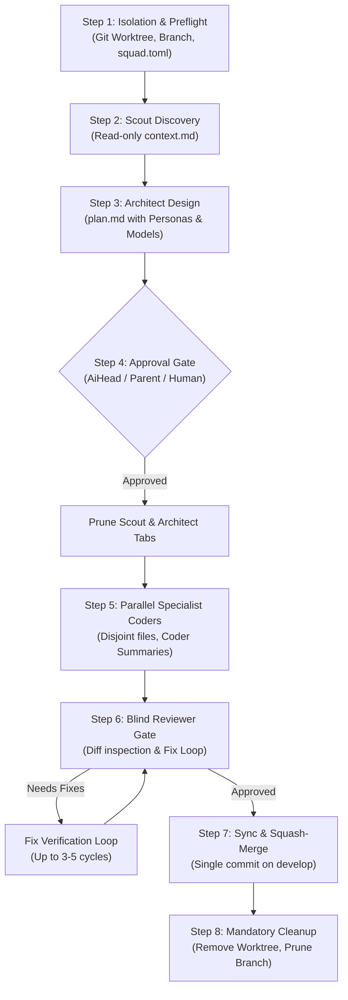

# `/ergo` — Multi-Harness Phased Engineering Pipeline

The `/ergo` skill executes a disciplined, multi-stage engineering pipeline for substantial feature work on a single major job. It enforces strict role separation, worktree and branch isolation, dynamic specialist personas, an adversarial blind review gate, and atomic landing via a single squash commit.

---

## 1. Pipeline Architecture & Execution Flow

Ergo breaks complex feature implementations into five sequential, verifiable phases:



### The Cardinal Rules
1. **Never implement code directly in the orchestrator**: The coordinator pane only directs stages, verifies artifacts, routes decisions, and lands the final merge.
2. **Never skip Scout, Approval Gate, or Reviewer**: Every stage is a mandatory quality contract.
3. **Never run `git reset --hard`**: Sync the target branch inside the worktree first; resolve any merge conflicts via a specialist Coder and scoped Reviewer verification.
4. **Disjoint file ownership**: Parallel Coders never touch overlapping files. Conflicting tasks must be serialized with `DEPENDS ON`.

---

## 2. Execution Modes: Herdr vs. `--native`

Ergo supports two execution models:

| Dimension | Default Herdr Mode (`--herdr` or bare) | Explicit `--native` Mode (`--native`) |
| :--- | :--- | :--- |
| **Orchestration Plane** | Herdr terminal workspace with interactive agent tabs. | Host harness's native subagent tool within current session. |
| **Model Diversity** | **Cross-harness**: mixes best-of-breed models across `agy`, `pi`, `claude`, `opencode`, and `hermes`. | **Single-harness**: all roles execute within the host's supported native subagent adapter. |
| **External Dependencies**| Requires Herdr daemon (`herdr`) and `herdm` CLI. | 100% Herdr-free; requires only shell, git, and native subagent tool. |
| **Native Adapters** | N/A (all managed via Herdr tabs and `herdm catalog agent`). | `agy` (`invoke_subagent`), `pi` (`subagent`), `claude` (`Agent`), `opencode` (`subagent`). Hermes is rejected (no native tool adapter). |

### Launching Ergo
- **Standard Herdr Mode**:
  ```bash
  aihead --ergo "Implement JWT authentication and refresh token rotation"
  ```
- **Explicit Native Subagent Mode**:
  ```bash
  aihead --ergo "Refactor database repositories" --native
  ```
- **With Inline Model Overrides**:
  ```bash
  aihead --ergo "Build search dashboard" --models "scout=agy:gemini-3.8-flash-medium architect=pi:openai-codex/gpt-6.1-sol workers=agy:gemini-3.8-flash,pi:xai/grok-4.7 reviewer=pi:xai/grok-4.7"
  ```

---

## 3. Configuration Hierarchy & Squad Resolution

Ergo resolves squad roles and allowed worker models strictly through `herdm catalog squad` without hardcoded fallback tables:

```
1. Inline CLI Overrides (--models, --scout, --architect, --workers, --reviewer)
                          │
                          ▼
2. Run Squad Snapshot (--run-squad <path>)
                          │
                          ▼
3. Project Configuration (.herdr-master.toml)
                          │
                          ▼
4. Product Default Squad (from catalog)
```

### Authoritative Product Default Squad
Resolved via `herdm catalog squad --mode herdr --json`:
- **Scout**: `agy:gemini-3.8-flash-medium` (`--effort medium --dangerously-skip-permissions`)
- **Architect**: `pi:openai-codex/gpt-6.1-sol:max` (`--provider openai-codex --model gpt-6.1-sol --thinking max`)
- **Reviewer**: `pi:xai/grok-4.7:high` (`--provider xai --model grok-4.7 --thinking high`)
- **Worker Pool** (dynamically allocated per task by the Architect):
  - `agy:gemini-3.8-flash`: Simple, mechanical, well-scoped work (per task effort: `low`, `medium`, or `high`).
  - `pi:xai/grok-4.7`: Complex, architectural, or subtle logic (`--thinking <level>`).

The Architect receives the verbatim `ALLOWED CODER MODELS` block and must assign models strictly from this list.

---

## 4. Detailed Step-by-Step Pipeline Sequence

### Step 1: Isolation (`WORKTREE`), Branch, `RUN_DIR` & Snapshot
1. Check for a clean working tree (`git status --porcelain` must be empty).
2. If already inside an `ergo/*` worktree, reuse it. Otherwise, create an isolated worktree outside the canonical repository:
   ```bash
   WORKTREE=<project_parent>/<repo>-ergo-<run-id>
   git worktree add "$WORKTREE" -b "ergo/<run-id>"
   ```
3. Initialize the run directory: `RUN_DIR=$WORKTREE/.orchestration/ergo-<run-id>/`.
4. Resolve effective squad and persist a frozen snapshot to `$RUN_DIR/squad.toml`.
5. Establish `unitTestsMode` (`none`, `new`, or `update-only`) and forward to all roles.

### Step 2: Scout — Fast Read-Only Discovery
- Spawn the **Scout** in `$WORKTREE` with confirmed intent, 3–5 targeted questions, and read-only source constraints.
- Scout reads project guidelines (`AGENTS.md`, `CLAUDE.md`, `.ai/*.md`) and verifies conventions against actual source code.
- Produces `RUN_DIR/context.md` covering: confidence rating, answers to specific questions, relevant files with line numbers, existing patterns, test coverage, and design risks.
- Scout notifies direct parent orchestrator and stops.

### Step 3: Architect — Design & Resource Allocation
- Spawn the **Architect** in `$WORKTREE` with the confirmed intent, `RUN_DIR/context.md`, `unitTestsMode`, and the verbatim `ALLOWED CODER MODELS` block.
- Architect writes `RUN_DIR/plan.md` specifying:
  - **Goal** and confirmed intent.
  - **Patterns to follow**: citations of existing code exemplars (`<layer> — <pattern> — source: <file:line>`).
  - **Tasks**: strictly numbered, disjoint file ownership, dependencies (`INDEPENDENT` or `DEPENDS ON: <task#>`), mandatory **Expert Persona** (e.g., `"Senior TypeScript/React accessibility specialist"`), and explicit **Coder Model** chosen from `ALLOWED CODER MODELS`.
  - **Out of Scope** boundaries.
- **Orchestrator Validation**: The orchestrator inspects `plan.md`. If any task omits an Expert Persona, overlaps files with another task, or selects an invalid model, the plan is rejected back to the Architect.

### Step 4: Plan Approval Gate
Before any Coder begins, the plan must pass an approval gate:
- Present a plain-language summary of the plan (what is built, why, key deliverables).
- Verify architectural alignment with repository conventions and design patterns.
- **Routing**:
  - **Branch A (Delegated Parent Gate)**: When running under a parent coordinator or AiHead (`$HERDR_PARENT_PANE_ID`), submit plan via `herdr agent prompt "$HERDR_PARENT_PANE_ID" "<plan>"` and wait for explicit approval.
  - **Branch B (Autonomous AiHead Gate)**: In standalone mode with `--ai-head`, an authorized AiHead decision evaluates alignment and logs rationale to `RUN_DIR/aihead_decision.json`.
  - **Branch C (Human Gate)**: In standalone mode without AiHead, print `HERDR_NEEDS_USER: Please review and approve the implementation plan` and wait for explicit human confirmation.

### Step 5: Parallel Specialist Coders & Planning Pruning
- **Planning Tab Pruning**: As soon as the plan is approved, immediately close the Scout and Architect tabs (`herdr tab close <scout-tab-id>`, `herdr tab close <architect-tab-id>`).
- **Parallel Launch**: Launch all `INDEPENDENT` tasks concurrently in a single turn. Tasks with dependencies wait until upstream tasks complete and generate `coder_<upstream>_summary.md`.
- **Specialist Personas**: Inject `Adopt this expert persona: <Persona>` at the top of each Coder's prompt.
- **Git Lock Collision Prevention**: Coders are strictly forbidden from executing git commands (`git add`, `git commit`, `git checkout`). Only the orchestrator lands code.
- Each Coder modifies only its assigned files, verifies changes against project tests, writes `RUN_DIR/coder_<N>_summary.md`, and notifies the orchestrator.

### Step 6: Blind Reviewer & Scoped Fix Loop
- **Blind Quality Gate**: Spawn a fresh Reviewer that has never seen the planning discussion or Coder prompts.
- **Inputs**: Combined git diff against base commit, `RUN_DIR/plan.md`, all `coder_<N>_summary.md` files, and `unitTestsMode`.
- **Reviewer Verdict**: Emits `RUN_DIR/review.md` (`APPROVED` or `NEEDS FIXES`) and actionable `RUN_DIR/fixes_<N>.md` per Coder.
- **Worker Pruning**:
  - As each Coder's task passes review, close its tab immediately.
  - Keep active only Coders requiring fixes (`NEEDS FIXES`).
- **Fix Loop**: Re-run affected Coders with their `fixes_<N>.md`. Relaunch the Reviewer in `MODE: fix-verification` (checking only whether findings are resolved). Max 3–5 cycles.
- When verdict is `APPROVED`, close the Reviewer tab immediately.

### Step 7: Landing & Mandatory Squash-Merge
1. Inside `WORKTREE` on `ergo/<run-id>`, sync the integration target branch (`develop` > `main` > `master`) via merge/rebase:
   - On conflicts, dispatch the affected Coder to resolve conflicts on `ergo/<run-id>`, re-run verification, and pass a scoped Reviewer check.
   - **NEVER execute `git reset --hard`**.
2. Create exactly one commit on `ergo/<run-id>` with the plan task list in the commit body.
3. In the canonical repository checkout:
   ```bash
   git checkout develop
   git merge --squash ergo/<run-id>
   git commit -m "<one-line summary>"
   ```
4. **Mandatory Post-Integration Cleanup**:
   - Close all child panes and tabs.
   - Close the run workspace if created for this job (`herdr workspace close <WS_ID>`).
   - Remove the worktree: `git worktree remove "$WORKTREE"`.
   - Delete temporary branch: `git branch -D ergo/<run-id>`.
   - Verify `git branch --list 'ergo/*'` and `git worktree list` show no dangling traces.
   - Cleanup is automatic and never prompted to the user.

### Step 8: Done, Carryover & Parent Notification
- In standalone mode: write `<canonical_root>/.orchestration/carryover.md` and report the squash commit SHA and verification proofs.
- In delegated mode: notify direct parent orchestrator via `herdr agent prompt "$HERDR_PARENT_PANE_ID"` with the commit SHA and verification status.

---

## 5. Strict Hierarchical Parent Notification (One Level Up)

Ergo enforces a strict two-way parent-child communication protocol:

```
Level 1: AiHead / Master Coordinator ($HERDR_PARENT_PANE_ID)
             ▲
             │ herdr agent prompt $HERDR_PARENT_PANE_ID "..."
             ▼
Level 2: Ergo Orchestrator ($HERDR_PANE_ID / ORCHESTRATOR_PANE_ID)
             ▲
             │ herdr agent prompt <ORCHESTRATOR_PANE_ID> "..."
             ▼
Level 3: Scout, Architect, Coders, Reviewer
```

- **Level 3 workers notify ONLY the Level 2 Ergo Orchestrator** at `ORCHESTRATOR_PANE_ID`. Level 3 workers **NEVER** message AiHead or a grandparent coordinator directly.
- **Level 2 Ergo Orchestrator notifies ONLY Level 1** (`$HERDR_PARENT_PANE_ID`) for plan approvals, blockers, and pipeline completion.
- **Non-blocking parents**: Parents never poll or sleep; they return control immediately after dispatching tasks and wake up reactively upon child notifications.

---

## 6. Children Registry (`children.tsv`) & Monitor

The Ergo orchestrator registers every child pane in `RUN_DIR/children.tsv`:
```tsv
pane_id	role	tab_id	branch	worktree	run_dir	status	last_heartbeat
```
- Row added immediately upon child spawn (`status=working`).
- Row updated immediately upon child close (`status=closed`).
- A 10-minute read-only background monitor checks child health using `herdr agent get` and `herdr agent read` without modifying code or closing tabs.
