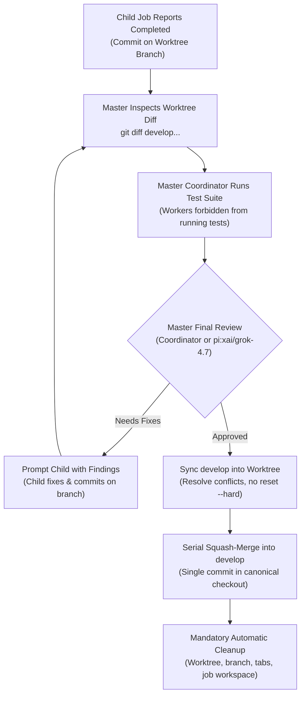

# `/herdr-master` — Root Multi-Job Orchestrator across Isolated Worktrees

The `/herdr-master` skill manages concurrent, complex multi-job workstreams across parallel isolated Git worktrees. It coordinates delegated agent sessions across all 5 supported harnesses (`agy`, `pi`, `claude`, `opencode`, `hermes`), monitors progress using native asynchronous watchers, enforces a Master Final Review Gate, and executes serial squash-merges into `develop`.

---

## 1. Operating Philosophy: Herdr-Master vs. AiHead

The fundamental difference between Herdr-Master and AiHead is their posture toward human escalation:

- **Herdr-Master is a Coordinator that Escalates to the Human**: When trade-offs, ambiguities, model choices, plan approvals, or architectural decisions arise, Herdr-Master opens interactive question tabs to consult the human developer.
- **AiHead is an Autonomous Technical Director**: AiHead acts as the human technical lead within the Herdr-Master flow, evaluating objectives, approving plans, making technical trade-offs, and directing execution without bothering the human user for routine choices.

```
+─────────────────────────────────────────────────────────────────────────────+
|                               Human Operator                                |
+─────────────────────────────────────────────────────────────────────────────+
                                       ▲
                        Q: <short> /   │   Update: <short>
                        Decisions      │   Summaries
                                       ▼
+─────────────────────────────────────────────────────────────────────────────+
|                     Herdr-Master Coordinator Session                        |
|  - Manages concurrent jobs across isolated Git worktrees                    |
|  - Launches bounded native async watchers (No busy polling loops)           |
|  - Master Final Review Gate (inspects diffs, runs test suites)              |
|  - Serial squash-merge into develop                                         |
+─────────────────────────────────────────────────────────────────────────────+
         │                                       │
         ▼ (Workspace per Job)                   ▼ (Workspace per Job)
+─────────────────────────────────+     +─────────────────────────────────+
| Job Workspace: Feature Alpha    |     | Job Workspace: Feature Beta     |
| - Root Pane: Job Root Worker    |     | - Root Pane: /ergo Pipeline     |
| - Tab 2: Specialist Sub-Job     |     | - Tab 2..N: Ergo Roles          |
| - Worktree: repo-job-alpha      |     | - Worktree: repo-job-beta       |
+─────────────────────────────────+     +─────────────────────────────────+
```

### The Cardinal Rule: Master Session Never Implements
- The coordinator session **never directly edits files, runs build commands, or applies commits**.
- Every task, including small edits, diagnosis, file changes, and skill updates, is delegated to its own new background Herdr workspace (`herdr workspace create --label "<job-name>" --cwd "$WORKTREE" --no-focus`).
- Same-session subagents within the master session are restricted solely to evaluating skill choices or monitoring children; they must never implement code.

---

## 2. Workspace-per-Job Delegation Model

Herdr-Master establishes clean process and workspace sandboxing:

1. **One New Herdr Workspace per Job**:
   ```bash
   herdr workspace create --label "<job-name>" --cwd "$WORKTREE" --no-focus --env "HERDR_PARENT_PANE_ID=$HERDR_PANE_ID"
   ```
   - The returned root pane serves as the job root. Do not create a redundant tab for it.
2. **Sub-Jobs Stay in the Job Workspace**:
   - Secondary workers, reviewers, and sub-jobs stay within that specific job workspace:
     ```bash
     herdr tab create --workspace "$JOB_WORKSPACE_ID" --cwd "$WORKTREE" --label "<role>" --env "HERDR_PARENT_PANE_ID=$HERDR_PANE_ID" --no-focus
     ```
   - Sub-jobs **must never call `herdr workspace create`**.
3. **Dedicated Worktree per Job**:
   - Every repository job receives an isolated Git worktree based on `develop` `HEAD` (creating `develop` first if missing):
     ```bash
     WORKTREE=<project_parent>/<repo>-<job-slug>
     git worktree add "$WORKTREE" -b "<job-branch>" develop
     ```
   - Separate writers operate in separate worktrees to eliminate concurrent git index lock collisions.

---

## 3. Native Asynchronous Watcher Mechanism (No Polling Loops)

Herdr-Master parent sessions **never block or sleep in busy polling loops**. After launching and verifying a child agent, the coordinator dispatches a bounded **native async watcher** that sleeps non-blockingly and wakes the coordinator upon completion.

### Harness-Specific Watcher Implementations

| Harness | Mechanism | Execution Command & Parameters |
| :--- | :--- | :--- |
| **Antigravity (`agy`)** | Subagent or command | `define_subagent` (`herdr-watcher`, `Model: "flash_lite"`) + `invoke_subagent`, or `run_command("herdr agent wait <target> --timeout <ms>", WaitMsBeforeAsync=500)`. |
| **Pi (`pi`)** | Subagent tool | `subagent` with read-only agent, `async: true`, executing `herdr agent wait <target> --timeout <ms>`. |
| **Claude Code (`claude`)** | Subagent or Bash | `Agent(subagent_type="general-purpose", run_in_background=true)` or `Bash(run_in_background=true)` running `herdr agent wait <target> --timeout <ms>`. |
| **OpenCode (`opencode`)** | Subagent tool | `subagent(agent="general", background=true, ...)` running `herdr agent wait <target> --timeout <ms>`. |
| **Hermes (`hermes`)** | Direct background terminal | `terminal(command="herdr agent wait <target> --timeout <ms>", background=true, notify=true)` running in inherited Herdr environment. |

*Rule*: Watchers have a single, strictly read-only task: execute `herdr agent wait <target> --timeout <ms>` and report the result. Watchers must never send input, edit files, or start coordinators.

---

## 4. User Communication: Question Tabs vs. Update Tabs

All communication directed to the human developer occurs strictly inside the **coordinator workspace** (`$HERDR_WORKSPACE_ID`), never in a background job workspace:

### Question Tabs (`Q: <short>`)
- Created when human decision-making is necessary (ambiguity, destructive operations, trade-offs).
- Spawned with `--focus` using a dedicated coding agent of the coordinator's harness (`herdr tab create --workspace "$HERDR_WORKSPACE_ID" --label "Q: <short>" --focus`).
- Context and questions are written to a file and presented to the user.
- **Lifecycle**: Waits for the user to answer. When the answer arrives, forwards response to the child pane and **closes the tab immediately** (`herdr tab close <tab-id>`).

### Interactive Update Tabs (`Update: <short>`)
- Created with `--focus` upon job completion to brief the user on the outcome, commit SHA, and test verification proofs.
- **Interactive Lifecycle**: Stays **open** waiting for the user to see it, close it themselves, or reply:
  - If the user sends a pure acknowledgement (e.g., `"ok"`, `"ack"`), the coordinator closes the tab (`herdr tab close <tab-id>`).
  - If the user replies with follow-up tasks, the coordinator acts on them and keeps the session active.
  - The coordinator does **not** auto-close Update tabs immediately upon verification.

---

## 5. Strict Hierarchical Parent Notification (One Level Up)

Herdr-Master enforces strict hierarchical communication:

```
Level 1: Herdr-Master Coordinator ($HERDR_PANE_ID)
             ▲
             │ herdr agent prompt $HERDR_PARENT_PANE_ID "..."
             ▼
Level 2: Job Root Worker / Forwarded Pipeline Orchestrator (/ergo, /orchestration)
             ▲
             │ herdr agent prompt <ORCHESTRATOR_PANE_ID> "..."
             ▼
Level 3: Nested Specialist Sub-Jobs (Coders, Reviewers, Scouts)
```

- **Level 3 workers notify ONLY Level 2** (`ORCHESTRATOR_PANE_ID`). They never message Herdr-Master directly.
- **Level 2 workers notify ONLY Level 1** (`HERDR_PARENT_PANE_ID`) upon completion or blockers.
- **When Herdr-Master is delegated under AiHead**: Herdr-Master notifies its direct parent AiHead (`herdr agent prompt "$HERDR_PARENT_PANE_ID" ...`) and does not open user tabs directly. AiHead manages user-facing interactions.

---

## 6. Master Final Review Gate & Serial Squash-Merge into `develop`



### 1. Workers Do NOT Run Test Suites
Running full test suites is reserved solely for the master coordinator after child work finishes. This prevents redundant test execution and resource thrashing.

### 2. Master Final Review Gate
- Inspect the full diff: `git diff develop...<child-branch>`.
- Coordinator performs a rigorous review or delegates to a dedicated read-only Reviewer tab (`pi:xai/grok-4.7:high`).
- If issues are detected (`NEEDS FIXES`), send findings back to the existing child session (`herdr agent prompt <child-pane-id> "<findings>"`), rearm the watcher, and await fixes.

### 3. Serial Squash-Merge into `develop`
- Only after Master Final Review is `APPROVED`:
  1. Ensure `develop` is clean in the canonical repository.
  2. If `develop` has advanced, rebase/merge `develop` inside the child's worktree first. Resolve conflicts on the child branch without ever using `git reset --hard`.
  3. In canonical repository checkout:
     ```bash
     git checkout develop
     git merge --squash <child-branch>
     git commit -m "<one-line summary>"
     ```

### 4. Mandatory Post-Integration Cleanup
Cleanup is mandatory, automatic, and never prompted to the user:
- Close child tabs in the job workspace.
- Remove the clean job worktree (`git worktree remove "$WORKTREE"`).
- Delete the temporary branch (`git branch -D <child-branch>`).
- Close the job workspace (`herdr workspace close "$JOB_WORKSPACE_ID"`).
- Verify `git branch --list` and `git worktree list` show no dangling traces.
- Closing the job workspace does **not** close the interactive Update tab in the coordinator workspace.

---

## 7. Children Registry (`children.tsv`) & Monitor

The coordinator logs every child in `RUN_DIR/children.tsv`:
```tsv
pane_id	role	tab_id	branch	worktree	run_dir	status	last_heartbeat
```
- Row added on spawn (`status=working`).
- Row updated on close (`status=closed`).
- A 10-minute read-only background monitor checks child health using `herdr agent get` and `herdr agent read` without touching code or closing tabs.
