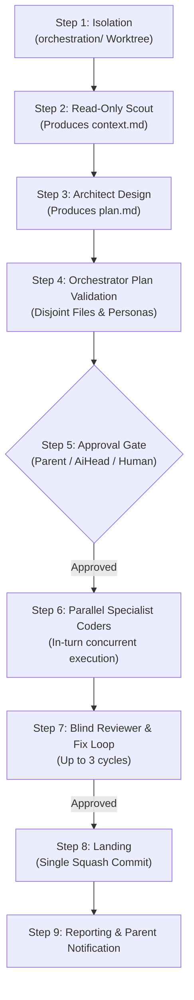

# `/orchestration` — Self-Contained Native Subagent Pipeline

The `/orchestration` skill provides a **100% Herdr-free**, single-harness engineering pipeline. It executes the full Scout → Architect → Parallel Specialist Coders → Blind Reviewer workflow entirely using the host harness's native subagent tool, with zero external daemon or catalog dependencies.

---

## 1. Zero External Dependencies & Philosophy

Unlike Ergo, which coordinates cross-harness tabs inside a Herdr workspace, `/orchestration` is completely self-contained:
- **No Herdr Daemon Required**: Operates without `herdr`, Herdr sockets, or terminal workspaces.
- **No `herdm` CLI Required**: Does not invoke `herdm` or perform external catalog lookups.
- **Pure Host Native Execution**: Every role executes as a native subagent spawned directly by the host agent session.
- **Host Ecosystem Velocity**: Ideal for cohesive, fast-moving tasks within a single agent platform (`agy`, `pi`, `claude`, `opencode`, `hermes`).

```
+─────────────────────────────────────────────────────────────────────────────+
|                     Host Agent Session (The Orchestrator)                   |
|                   (No Herdr daemon, No external catalog)                    |
+─────────────────────────────────────────────────────────────────────────────+
                                       │
     ┌──────────────────┬──────────────┴─────┬──────────────────┐
     ▼                  ▼                    ▼                  ▼
┌───────────┐     ┌──────────────┐     ┌────────────┐     ┌────────────┐
|   Scout   |     |  Architect   |     |  Parallel  |     |   Blind    |
| (Subagent)|     |  (Subagent)  |     |   Coders   |     |  Reviewer  |
└───────────┘     └──────────────┘     └────────────┘     └────────────┘
```

---

## 2. Host Adapter Matrix across All 5 Harnesses

The pipeline resolves its native subagent tool once at initialization and adheres strictly to the host's specific tool schema:

| Host Harness | Native Tool Name | Task / Prompt Parameter | Read-Only Enforcement Mechanism |
| :--- | :--- | :--- | :--- |
| **Claude Code (`claude`)** | `Agent` | `prompt` | Prompt directive for read-only roles; orchestrator persists returned report text. |
| **Antigravity (`agy`)** | `invoke_subagent` | `Prompt` | Native parameter `EnableWriteTools: false` for read-only roles (Scout, Architect, Reviewer). Requires tier IDs (`flash_lite`, `flash`, `pro`); CLI slugs are rejected. |
| **Pi (`pi`)** | `subagent` | `task` | Read-only agent definition for review roles; optional `async: true`. |
| **OpenCode (`opencode`)** | `subagent` | `prompt` | Standard parameter `agent: "general"`; prompt directive for read-only roles. |
| **Hermes (`hermes`)** | `delegate_task` | `tasks` array (`goal`, `context`) | Read-only directive in `goal`/`context`; orchestrator persists returned report text. |

---

## 3. Strict Model Selection & Hermes Fail-Closed Policy

### Model Policy
- **Never invent model IDs**: Models are either explicitly specified by the user via `--models` or inherited directly from the host session's default.
- **User Overrides (`--models`)**: Parse `<role>=<model>` pairs (roles: `scout`, `architect`, `coder`, `reviewer`; `coder` can specify multiple fallback bindings with `|`):
  ```bash
  aihead --orchestration "<intent>" --models "scout=flash,architect=pro,coder=flash,reviewer=pro"
  ```
- **Allowlist Filtering**: If an allowlist is saved in `.herdr-master.toml` under `[models.available.native]`, dynamically chosen models must come from this list. Explicit user CLI overrides are always honored.

### Hermes Fail-Closed Enforcement
The Hermes native subagent tool `delegate_task` does **not** support per-task model parameters (all delegated subagents strictly inherit the host session's active model).
- If a user passes `--models` when running under Hermes, the orchestrator **MUST FAIL CLOSED**:
  - Report immediately that per-task model overrides are unsupported by the Hermes `delegate_task` schema.
  - Explain the technical limitation clearly.
  - **STOP immediately** rather than silently proceeding with the inherited model.

### Reasoning Effort Overrides
- Users may configure effort levels via `--efforts scout=<level>,architect=<level>,reviewer=<level>` (values: `low`, `medium`, `high`, `max`).
- Passed as the host's native effort parameter or as a line-1 prompt directive (`think`, `think hard`, `think harder`, `ultrathink`).
- **Worker effort is never set by the user**: The Architect assigns reasoning effort dynamically per Coder task in `plan.md`.

---

## 4. Execution Sequence & Phased Lifecycle



### Step 1: Isolation (`WORKTREE`), Branch & `RUN_DIR`
- Verify clean working tree (`git status --porcelain` empty).
- Create isolated worktree outside canonical repository:
  ```bash
  WORKTREE=<repo-parent>/<repo>-orch-<run-id>
  git worktree add "$WORKTREE" -b "orchestration/<run-id>"
  ```
- Initialize run directory: `RUN_DIR=$WORKTREE/.orchestration/orch-<run-id>/`.
- Establish `unitTestsMode` (`none`, `new`, `update-only`).

### Step 2: Scout — Fast Read-Only Discovery
- Spawn read-only Scout subagent with confirmed intent, 3–5 specific questions, `WORKTREE`, and `RUN_DIR`.
- Scout inspects conventions (`AGENTS.md`, `CLAUDE.md`, `.ai/*.md`) and produces `RUN_DIR/context.md`.
- Verify git status remains clean.

### Step 3: Architect — Design & Resource Allocation
- Spawn read-only Architect subagent with confirmed intent and `RUN_DIR/context.md`.
- Architect produces `RUN_DIR/plan.md` detailing:
  - Confirmed intent and architectural patterns to follow.
  - Strictly disjoint task files.
  - Dependencies (`INDEPENDENT` or `DEPENDS ON: <task#>`).
  - Mandatory domain-specific **Expert Persona** per task.
  - Explicit Coder model (`host default` or pinned model).

### Step 4: Orchestrator Plan Validation
The orchestrator independently verifies `plan.md` before presenting it to the user. If any task omits an Expert Persona, overlaps files, or specifies unapproved models, the plan is rejected back to the Architect.

### Step 5: User Approval Gate
Evaluate exactly one approval condition:
1. **Delegated Parent Gate**: When dispatched by a parent master (`HERDR_PARENT_PANE_ID`), route the plan and child pane ID to the direct parent and wait for explicit approval.
2. **Standalone AiHead Gate**: In a standalone run with `--ai-head`, an authorized AiHead decision evaluates alignment and logs rationale to `RUN_DIR/aihead_decision.json`.
3. **Standalone Human Gate**: In a standalone run without AiHead, print plan details and pause until explicit user confirmation is received.

### Step 6: Parallel Specialist Coders
- For each approved task, spawn a Coder subagent with `Adopt this expert persona: <Expert Persona>.` injected on line 1.
- Dispatch all `INDEPENDENT` tasks concurrently in a single turn. Dependent tasks wait for upstream `coder_<upstream>_summary.md` artifacts.
- Coders modify only assigned files, execute verification commands, and write `RUN_DIR/coder_<N>_summary.md`.

### Step 7: Blind Reviewer & Scoped Fix Loop
- Spawn a fresh Reviewer subagent that has never seen the Coder prompts or planning debates.
- Reviewer inspects combined diff against base commit, `RUN_DIR/plan.md`, coder summaries, and `unitTestsMode`.
- Emits `RUN_DIR/review.md` (`APPROVED` or `NEEDS FIXES`) and `RUN_DIR/fixes_<N>.md`.
- Read-Only Persistence: If the native Reviewer has read-only tools, the orchestrator persists returned report text into `review.md`.
- Fix Loop: Re-run affected Coders with `fixes_<N>.md`. Relaunch Reviewer in fix-verification mode (max 3 cycles).

### Step 8: Landing & Mandatory Squash-Merge
*(Note: If delegated by a parent master orchestrator, create one commit on the assigned branch and STOP; the parent owns integration).*
For standalone runs:
1. Inside `WORKTREE` on `orchestration/<run-id>`, sync the integration target branch (`develop` > `main` > `master`) via merge/rebase.
2. Resolve any conflicts via Coder + scoped Reviewer check. **NEVER run `git reset --hard`**.
3. Create one commit on `orchestration/<run-id>` with the plan task list in the body.
4. In canonical repository checkout:
   ```bash
   git checkout develop
   git merge --squash orchestration/<run-id>
   git commit -m "<one-line summary>"
   ```
5. **Mandatory Post-Integration Cleanup**: Automatically remove the worktree (`git worktree remove "$WORKTREE"`) and delete temporary branch (`git branch -D orchestration/<run-id>`).

### Step 9: Report & Parent Notification
- Deliver concise final report: commit SHA, review verdict, test verification results, and remaining risks.
- If delegated under a parent orchestrator (`HERDR_PARENT_PANE_ID`), notify the direct parent via `herdr agent prompt`:
  ```bash
  herdr agent prompt "$HERDR_PARENT_PANE_ID" "Orchestration run <run-id>: assigned branch <branch>, commit <SHA>, review APPROVED, verification passed."
  ```

---

## 5. Standalone Execution vs. Master Delegation

| Behavior | Standalone Run | Delegated Run (under `/herdr-master` or `/aihead`) |
| :--- | :--- | :--- |
| **Workspace & Worktree** | Creates temporary worktree `orchestration/<run-id>`. | Adopts worktree, branch, and `RUN_DIR` provided by parent. |
| **Plan Approval Gate** | Satisfied by AiHead or human operator. | Must submit plan to direct parent via `herdr agent prompt`. |
| **Commit on Branch** | Creates commit on `orchestration/<run-id>`. | Creates commit on assigned branch. |
| **Squash-Merge into `develop`** | **Performs squash-merge** in canonical checkout. | **FORBIDDEN**: Stops after assigned branch commit; parent integrates. |
| **Worktree & Branch Cleanup** | Removes worktree and deletes temp branch. | **FORBIDDEN**: Leaves cleanup to the parent coordinator. |
| **Children Registry** | Tracks native subagents in `RUN_DIR/children.tsv` (`subagent_id` in `pane_id`). | Tracks native subagents in `children.tsv` and notifies parent. |
